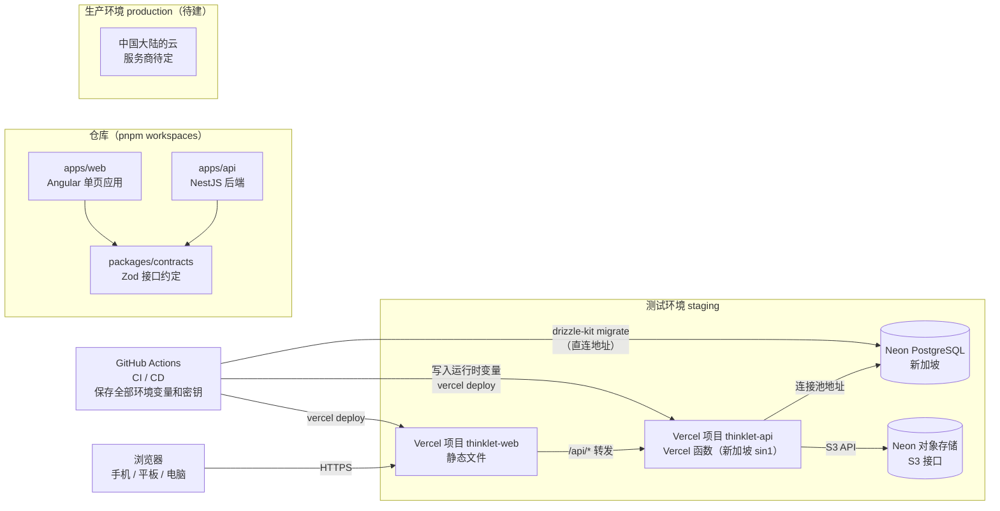

# thinklet 架构

thinklet 由一个 Angular 单页前端、一个 NestJS 后端、一个只放接口约定的共用包、一个 PostgreSQL 数据库和一个兼容 S3 的对象存储组成。代码在一个 pnpm workspaces 仓库里。测试环境部署在 Vercel 和 Neon；生产环境放在中国大陆的云上，还没有建。

每个决定的理由和比较过的方案见 `.docs/decisions/`。

## 架构图



## 指标

| 指标     | 内容                                                                                                                                         |
| -------- | -------------------------------------------------------------------------------------------------------------------------------------------- |
| 规模     | 上线后第一年，同时在线不超过几百人；注册家长在几千人以内。一台小服务器加一个数据库就够                                                       |
| 可用性   | 99.5%，一个月累计停机不超过约 3.6 小时；发布生产环境时允许停几分钟                                                                           |
| 一致性   | 写入后立刻可见：家长分派的书本、孩子提交的答案，刷新后马上能看到。用一个关系型数据库和事务来保证                                             |
| 成本     | 测试环境和生产环境加起来每月不超过 200 元人民币。测试环境用免费套餐，每月 0 元                                                               |
| 维护能力 | 一个人配合 AI 代理开发和运维：组件尽量少，运维尽量自动化，优先用托管服务                                                                     |
| 安全     | 全站 HTTPS；密码加盐散列保存；孩子的个人信息只收集必需的部分，并加密保存；每个接口都检查家长只能访问自己的孩子；没有已知的高危或严重依赖漏洞 |
| 无障碍   | WCAG 2.1 AA                                                                                                                                  |
| 兼容性   | Chrome、Edge、Safari（含 iOS）、Firefox 的近两个大版本                                                                                       |

不设性能指标和资源指标。

## 组件

| 组件                 | 种类                     | 说明                                                                                                                            |
| -------------------- | ------------------------ | ------------------------------------------------------------------------------------------------------------------------------- |
| `apps/web`           | 网页前端                 | Angular 单页应用，在浏览器里渲染，一套自适应页面同时支持触屏和键鼠                                                              |
| `apps/api`           | 后端服务                 | NestJS，提供 `/api/*` 接口，包括健康检查 `GET /api/health`：在数据库上执行 `SELECT 1`，并确认存储桶能访问，两者都正常就返回 200 |
| `packages/contracts` | 共用代码包（不单独运行） | 前后端共用的接口约定：Zod schema 和由它推出的类型。只放接口约定，不放业务逻辑                                                   |
| PostgreSQL           | 数据库                   | 存全部业务数据                                                                                                                  |
| 对象存储             | 对象存储                 | 存书本和教学里的图片、音频等文件，代码只走 S3 接口                                                                              |

题型怎么教、孩子怎么参与，等具体题型的 issue 在 design 步骤里再定，架构不为题型预先设计。

## 技术选择和决策点

| 方面             | 选择                                                                                                       |
| ---------------- | ---------------------------------------------------------------------------------------------------------- |
| 前端框架         | Angular（TypeScript），独立组件加 signals，单页应用                                                        |
| 前端界面         | Angular CDK 加 Tailwind CSS，界面自己设计                                                                  |
| 后端语言和运行时 | TypeScript，Node.js 26.13.1（最新 LTS），版本写死在 `.node-version` 和各 `package.json` 的 `engines` 里    |
| 后端框架         | NestJS，底层用 Express                                                                                     |
| 接口约定         | `packages/contracts` 里的 Zod schema；后端用它校验请求，前端用它推出类型                                   |
| 数据访问         | Drizzle ORM 加 node-postgres 驱动                                                                          |
| 配置             | `@nestjs/config` 加 Zod 校验：启动时校验全部环境变量，缺了或格式不对就拒绝启动，并说明是哪个               |
| 日志             | pino（nestjs-pino）输出一行一条的 JSON 日志，自动带请求编号，按遮挡列表遮掉密码和孩子的个人信息            |
| 数据库           | PostgreSQL；开发和测试用的版本与 Neon 项目的主版本一致                                                     |
| 对象存储         | S3 接口（`@aws-sdk/client-s3`）；测试环境用 Neon 对象存储，生产环境换成国内云的对象存储时只改配置          |
| 包管理           | pnpm workspaces；前端用 Angular CLI 构建，后端用 Nest CLI 构建                                             |
| 任务入口         | Task（`Taskfile.yml`）。它作为仓库根目录的开发依赖由 pnpm 安装，开发机上只要先装好 Node.js、pnpm 和 Docker |
| 云               | 测试环境用 Vercel（Hobby 套餐）和 Neon（免费套餐）；生产环境用中国大陆的云，服务商待定                     |

## 各组件的库

版本只写在各 `package.json` 和 `pnpm-lock.yaml` 里。生成器自带的依赖不列出。

### apps/web

由 Angular CLI（`ng new`）生成。

| 库                    | 用途                                                       | 许可证 |
| --------------------- | ---------------------------------------------------------- | ------ |
| `@angular/cdk`        | 无样式的组件基础：焦点管理、键盘操作、弹层，符合无障碍要求 | MIT    |
| `tailwindcss`         | 样式                                                       | MIT    |
| `@thinklet/contracts` | 接口约定（本仓库的包）                                     | 本项目 |

### apps/api

由 Nest CLI（`nest new`）生成。

| 库                                 | 用途                   | 许可证     |
| ---------------------------------- | ---------------------- | ---------- |
| `@nestjs/config`                   | 读取环境变量           | MIT        |
| `zod`                              | 校验配置和请求         | MIT        |
| `drizzle-orm`                      | 数据访问               | Apache-2.0 |
| `pg`                               | PostgreSQL 驱动        | MIT        |
| `@aws-sdk/client-s3`               | 对象存储的 S3 客户端   | Apache-2.0 |
| `nestjs-pino`、`pino`、`pino-http` | JSON 日志              | MIT        |
| `@thinklet/contracts`              | 接口约定（本仓库的包） | 本项目     |

### packages/contracts

| 库    | 用途                   | 许可证 |
| ----- | ---------------------- | ------ |
| `zod` | 定义数据格式并推出类型 | MIT    |

### 仓库根目录的开发工具

| 工具                                                          | 用途                                 | 许可证       |
| ------------------------------------------------------------- | ------------------------------------ | ------------ |
| `typescript`                                                  | 类型检查                             | Apache-2.0   |
| `@go-task/cli`                                                | 任务入口 Task                        | MIT          |
| `lefthook`                                                    | git hooks                            | MIT          |
| `prettier`、`prettier-plugin-tailwindcss`                     | 格式化，给 Tailwind 的 class 排序    | MIT          |
| `eslint`、`typescript-eslint`、`angular-eslint`               | 代码规范检查                         | MIT          |
| `dependency-cruiser`                                          | 架构规则                             | MIT          |
| `jscpd`                                                       | 重复代码                             | MIT          |
| `@commitlint/cli`、`@commitlint/config-conventional`          | 提交信息格式                         | MIT          |
| `markdownlint-cli2`                                           | Markdown 规则                        | MIT          |
| `license-checker-rseidelsohn`                                 | 依赖的许可证                         | BSD-3-Clause |
| `squawk-cli`                                                  | PostgreSQL 迁移脚本的安全检查        | Apache-2.0   |
| `drizzle-kit`                                                 | 生成和执行数据库迁移                 | Apache-2.0   |
| `vitest`、`@vitest/browser-playwright`、`@vitest/coverage-v8` | 单元测试、组件测试、集成测试、覆盖率 | MIT          |
| `@testing-library/angular`                                    | 组件测试里像用户一样操作页面         | MIT          |
| `msw`                                                         | 组件测试里替换后端接口               | MIT          |
| `axe-core`、`@axe-core/playwright`                            | 无障碍检查                           | MPL-2.0      |
| `@playwright/test`                                            | 端到端测试和冒烟测试                 | Apache-2.0   |
| `testcontainers`、`@testcontainers/postgresql`                | 测试里临时起 PostgreSQL 和 SeaweedFS | MIT          |
| `supertest`                                                   | 集成测试里从 HTTP 入口调用后端       | MIT          |

不通过 npm 安装的工具：gitleaks（MIT）、actionlint（MIT）、zizmor（MIT）、OSV-Scanner（Apache-2.0）、CodeQL（GitHub 提供）、ZAP（Apache-2.0）。容器镜像：`postgres`（PostgreSQL License）、`chrislusf/seaweedfs`（Apache-2.0）、Playwright 官方镜像（Apache-2.0）。

`vercel` 和 `neonctl` 命令行不写进依赖清单，按固定版本临时运行（见决策 0017）：CD 用 `npm install --global vercel@<版本>` 安装，版本是部署工作流里的 `VERCEL_CLI_VERSION`，由 Renovate 更新；本机用 `npx vercel@<同一版本>` 和 `npx neonctl@<版本>`。

## 代码结构

```text
apps/
  web/                 Angular 前端
    src/app/
      core/            全局的东西：接口请求、拦截器、布局
      features/<业务>/  各业务的页面，按路由懒加载
      shared/ui/       只管显示、不调接口的通用组件
  api/                 NestJS 后端
    src/
      modules/<业务>/   每个业务一个 NestJS 模块
        *.controller.ts  收发和校验请求
        *.service.ts     业务规则
        *.repository.ts  用 Drizzle 读写数据库
      infrastructure/  数据库、对象存储、配置、日志的接入
    drizzle/           迁移脚本
packages/
  contracts/           Zod schema 和类型
tools/                 仓库自己的检查脚本（步骤检查、PR 标题检查、风险分级）
```

规则，由 dependency-cruiser 检查：

- 后端只能从上往下调用：controller → service → repository。
- 后端模块之间只能调用对方导出的 service，不能碰对方的 repository。
- 后端各层都可以用 `infrastructure`，`infrastructure` 不引用 `modules`。
- 前端的 `features` 之间不互相引用；`shared` 不引用 `features`；`core` 不引用 `features`。
- `apps/web` 不引用 `apps/api`，反过来也一样；两边都只能通过 `packages/contracts` 共用代码。
- `packages/contracts` 不引用任何应用。
- 不允许循环依赖。

命名：文件名用小写加连字符；前端按 Angular 官方风格指南；后端按 NestJS 的约定（`<名称>.controller.ts`、`<名称>.service.ts`、`<名称>.repository.ts`、`<名称>.module.ts`）。

每一层的测试：

| 层                                 | 测试                                |
| ---------------------------------- | ----------------------------------- |
| 后端 service、`packages/contracts` | 单元测试                            |
| 后端 repository 和 controller      | 集成测试，连临时起的真实 PostgreSQL |
| 前端组件和页面                     | 组件测试                            |
| 用户能完整走一遍的流程             | 端到端测试                          |

## Deployment targets

| 名称       | 部署在哪里                                                                                     | 地址                                                                           | 用到的资源                                                                                                                                                                 |
| ---------- | ---------------------------------------------------------------------------------------------- | ------------------------------------------------------------------------------ | -------------------------------------------------------------------------------------------------------------------------------------------------------------------------- |
| staging    | Vercel（前端静态文件和后端函数，函数区域 `sin1` 新加坡）和 Neon（`aws-ap-southeast-1` 新加坡） | 前端 `https://thinklet-web.vercel.app`，后端 `https://thinklet-api.vercel.app` | 新建：Vercel 项目 `thinklet-web` 和 `thinklet-api`（Hobby 套餐，每月 0 元）；Neon 项目 `thinklet-staging`，含一个 PostgreSQL 数据库和一个对象存储桶（免费套餐，每月 0 元） |
| production | 中国大陆的云，服务商待定                                                                       | 无（待建）                                                                     | 待定，由建生产环境的 issue 回到 architect 步骤来定                                                                                                                         |

部署方式：

- **staging**：合并到 `main` 后，GitHub Actions 的 CD 任务按顺序做这些事：
  1. 用 Neon 的直连地址执行 `drizzle-kit migrate`。
  2. 把后端运行时要用的环境变量从 GitHub 覆盖写进 Vercel 项目 `thinklet-api`，再用 `vercel build` 和 `vercel deploy --prebuilt --prod` 发布它。
  3. 按 `API_ORIGIN` 生成 `thinklet-web` 的 `vercel.json`，里面是把 `/api/*` 转发到后端的规则，再同样发布 `thinklet-web`。`vercel.json` 读不了环境变量，所以转发规则在发布时生成，不提交到仓库。
  4. 跑全部冒烟测试。

  手动部署（`/deploy staging`）也走同一个任务。Vercel 不连接 Git 集成，PR 没有预览环境。

- **production**：还没有部署任务。建生产环境的 issue 会加上一个手动启动的部署任务，之后才能用 `/deploy production`。

说明：

- Vercel 项目里的 “Production” 环境就是本项目的测试环境 staging。
- 测试环境只放测试数据，不放真实用户的个人信息。
- `*.vercel.app` 在中国大陆经常打不开，要在国内访问测试环境，需要用代理。
- Vercel Hobby 套餐只能用于个人、非商业用途；项目商用前要升级到 Pro。
- Neon 免费套餐的数据库闲置 5 分钟后自动暂停，下一个请求要等不到一秒来唤醒。
- 两个 Vercel 项目的根目录分别是 `apps/web` 和 `apps/api`，并允许构建读取根目录以外的文件，这样才能用到 `packages/contracts`。
- 两个 Vercel 项目用标准保护：预览部署和各次部署自己的地址要登录 Vercel 才能打开，正式地址 `thinklet-web.vercel.app`、`thinklet-api.vercel.app` 公开访问，冒烟测试和 `/api/*` 转发才能用。

基础设施直接用 `vercel` 和 `neonctl` 命令行创建，不用基础设施即代码工具。scaffold 步骤执行前先用 `--help` 核对参数：

```text
npx neonctl@9.7.2 projects create --name thinklet-staging --region-id aws-ap-southeast-1 --pg-version 18 --org-id <组织 id> --no-secrets
npx neonctl@9.7.2 buckets create thinklet --project-id <id> --branch <branch>
npx neonctl@9.7.2 api /projects/<id>/branches/<branch>/storage                 # 存储地址和区域，写入 GitHub 变量 S3_ENDPOINT、S3_REGION
npx neonctl@9.7.2 credentials create --project-id <id> --branch <branch> --scope storage:read --scope storage:write --output json
                                                                                 # token_id、s3_secret_access_key 直接写入 GitHub 密钥 S3_ACCESS_KEY_ID、S3_SECRET_ACCESS_KEY，不显示
npx neonctl@9.7.2 connection-string <branch> --project-id <id> --pooled         # 输出直接写入 GitHub 密钥 DATABASE_URL，不显示
npx neonctl@9.7.2 connection-string <branch> --project-id <id>                  # 输出直接写入 GitHub 密钥 MIGRATION_DATABASE_URL，不显示
npx vercel@66.5.0 project create thinklet-web
npx vercel@66.5.0 project create thinklet-api
npx vercel@66.5.0 project update thinklet-web --root-directory apps/web --framework angular --source-files-outside-root-directory --yes
npx vercel@66.5.0 project update thinklet-api --root-directory apps/api --framework nestjs --source-files-outside-root-directory --yes
npx vercel@66.5.0 api /v9/projects/<项目名> -X PATCH --input <文件>             # 文件内容 {"ssoProtection":{"deploymentType":"prod_deployment_urls_and_all_previews"}}
```

## 数据迁移

| 数据                      | 方式                                                                                                                                       | 工具                                                                                                                                                     | 在哪里执行                                                                                      |
| ------------------------- | ------------------------------------------------------------------------------------------------------------------------------------------ | -------------------------------------------------------------------------------------------------------------------------------------------------------- | ----------------------------------------------------------------------------------------------- |
| PostgreSQL 的表结构和数据 | 按版本逐个迁移：脚本放在 `apps/api/drizzle/`，从数据库当前的版本按顺序往后执行。只能往前迁移，写错了就再写一个新脚本；合并过的脚本不再修改 | Drizzle Kit：改了 TypeScript 里的表定义后由它生成 SQL 脚本，脚本可以手改；执行过的脚本记在表 `__drizzle_migrations` 里；执行命令是 `drizzle-kit migrate` | 测试环境：CD 发布前执行。生产环境：它的部署任务里执行，允许停机。开发机和测试数据库：创建时执行 |
| 对象存储里的文件          | 暂不迁移                                                                                                                                   | 等第一个写文件的 issue 再定                                                                                                                              | —                                                                                               |

现在没有完全由代码生成、需要重建的数据。以后一个 issue 同时改了几种数据，各自用自己的方式迁移，执行顺序在那个 issue 里定。

## 各组件怎么运行

| 组件       | 开发机                                                                                             | CI                                        |
| ---------- | -------------------------------------------------------------------------------------------------- | ----------------------------------------- |
| `apps/web` | 本机直接运行 `ng serve`，把 `/api` 转给本机的后端                                                  | GitHub 的 Linux 机器上装 Node.js 直接运行 |
| `apps/api` | 本机直接运行 `nest start --watch`，常驻的 Node.js 进程                                             | 同上                                      |
| PostgreSQL | 容器（官方 `postgres` 镜像）：开发时用 Docker Compose 起；测试时用 Testcontainers 临时起，测完删除 | Testcontainers                            |
| 对象存储   | SeaweedFS 容器模拟 S3：开发时用 Docker Compose 起；测试时用 Testcontainers 临时起                  | Testcontainers                            |

开发机要先装 Node.js 26.13.1、pnpm 和 Docker，并启动 Docker。后端在开发机和 CI 里以常驻进程运行，在测试环境里以 Vercel 函数运行；两种方式共用同一个 NestJS 应用模块，只是入口文件不同。

## 静态检查

| 检查         | 工具                                                                                                                                                            |
| ------------ | --------------------------------------------------------------------------------------------------------------------------------------------------------------- |
| 格式         | Prettier，含 `prettier-plugin-tailwindcss`                                                                                                                      |
| 代码规范     | ESLint、typescript-eslint（结合类型信息）、angular-eslint（含模板的无障碍规则），另加复杂度和长度上限：圈复杂度、嵌套深度、函数行数、参数个数                   |
| 类型检查     | 三个包都开 TypeScript 的 strict，各自跑 `tsc --noEmit`；前端开启严格模板检查                                                                                    |
| 编译和构建   | `ng build`、`nest build`                                                                                                                                        |
| 架构规则     | dependency-cruiser，按“代码结构”一节的规则检查                                                                                                                  |
| 重复代码     | jscpd，生成的迁移脚本和测试里的固定数据不算在内                                                                                                                 |
| 代码安全扫描 | CodeQL（公开仓库免费；仓库改成私有就要付费）                                                                                                                    |
| 依赖漏洞     | OSV-Scanner，有高危或严重漏洞时失败                                                                                                                             |
| 密钥泄漏     | gitleaks，加上 GitHub 的推送保护                                                                                                                                |
| 许可证       | license-checker-rseidelsohn：只查产品运行时用到的依赖，只允许宽松的开源许可证（MIT、Apache-2.0、BSD、ISC 等），允许的列表在根目录的 `license-allowlist.json` 里 |
| 部署配置     | actionlint 和 zizmor，检查 GitHub Actions 工作流；项目不打包自己的镜像，没有 Dockerfile 要查                                                                    |
| 迁移脚本     | Squawk，只查新增的脚本                                                                                                                                          |
| 提交信息     | commitlint，加上项目自己的规则：提交类型要和分支类型对得上，要带 issue 编号，最后一行要有 `Step:`。PR 标题用同一套规则检查                                      |
| 步骤检查     | `tools/` 里的 Node.js 脚本，对照各步骤能改的文件，由 commit-msg 钩子和 PR 的 CI 调用                                                                            |
| 文档格式     | Prettier、markdownlint-cli2，另加一条项目规则：`.docs/` 下每个文档都以 `Last changed: #<编号> (<日期>)` 结尾                                                    |
| AI 简化      | Claude Code 的 `/simplify`                                                                                                                                      |
| AI 评审      | Claude Code 的 `/code-review`，见“评审标准和风险规则”                                                                                                           |
| AI 安全评审  | Claude Code 的 `/security-review`                                                                                                                               |

git hooks 由 lefthook 管理，配置在 `lefthook.yml`。

## 测试

### 测试对象和工具

| 测试对象   | 工具                                                                               | 说明                                                                                                                                                                  |
| ---------- | ---------------------------------------------------------------------------------- | --------------------------------------------------------------------------------------------------------------------------------------------------------------------- |
| 单元       | Vitest，三个包都用；覆盖率用 V8                                                    | —                                                                                                                                                                     |
| 组件       | Vitest 浏览器模式（Playwright 驱动的 Chromium）、Angular Testing Library、MSW、axe | 每个状态都跑 axe；每个状态、每种屏幕尺寸（手机、平板、电脑）各截一张图做对比                                                                                          |
| 集成       | Vitest、supertest、Testcontainers（PostgreSQL 和 SeaweedFS）                       | 数据库从空库开始，用 `drizzle-kit migrate` 建表                                                                                                                       |
| 端到端     | Playwright、axe                                                                    | 测试自己起前后端和容器里的数据库、存储，测完删除；每个页面都跑 axe                                                                                                    |
| 冒烟       | Playwright，打了 `@smoke` 标签的端到端测试                                         | 部署后直接对测试环境的地址跑。现在有两条：首页能正常打开；经过前端的 `/api` 转发调用 `GET /api/health` 返回 200。两条都只读、不改数据，都打上 `@production-safe` 标签 |
| 安全       | 安全测试用例用集成测试的工具来写；另加 ZAP 基线扫描                                | ZAP 在 CI 里扫测试临时起的环境                                                                                                                                        |
| 迁移       | Vitest、Testcontainers                                                             | 每个有新迁移脚本的 issue 都要写：把临时库停在上一个版本，用原始 SQL 塞入旧格式的数据，再执行 `drizzle-kit migrate`，检查数据都在、格式正确                            |
| 契约       | 不做                                                                               | 前后端在同一个仓库，由同一个 CD 任务一起发布                                                                                                                          |
| 性能和负载 | 不做                                                                               | 没有性能指标；`/perf-test` 暂时没有可跑的东西                                                                                                                         |

- **覆盖率**：单元测试和组件测试的语句覆盖率下限是 80%，后端、前端和共用包各自计算，生成的代码和配置文件不算；低于下限时 CI 失败。
- **截图基准图**：只在 Linux 上生成和比较。开发机用 Playwright 官方的 Docker 镜像跑截图测试，CI 直接在 Linux 上跑。

### 指标由什么检查

| 指标或要求                   | 测试对象     | 怎么检查                                                                                                                                               |
| ---------------------------- | ------------ | ------------------------------------------------------------------------------------------------------------------------------------------------------ |
| 写入后立刻可见               | 集成         | 写入后马上读，能读到新数据                                                                                                                             |
| 安全                         | 安全         | 安全测试用例：没登录不能访问；家长 A 改了 URL 里的 id 也看不到家长 B 的孩子；恶意输入不会被执行。另有 ZAP 扫描，以及静态检查里的 CodeQL 和 OSV-Scanner |
| WCAG 2.1 AA                  | 组件、端到端 | 组件的每个状态、端到端的每个页面都跑 axe                                                                                                               |
| 主流浏览器近两个大版本       | 端到端       | PR 上只跑 Chromium；发版前在 Chromium、Firefox、WebKit 上都跑                                                                                          |
| 手机、平板、电脑三种屏幕     | 组件         | 每种尺寸各截一张图                                                                                                                                     |
| 触屏和键鼠两种操作           | 组件、端到端 | 组件测试用键盘操作；发版前的端到端测试再加上模拟手机的触屏操作                                                                                         |
| 规模、可用性、成本、维护能力 | —            | 测试检查不了，靠架构本身保证；部署后的冒烟测试确认首页、后端、数据库和存储都能访问                                                                     |

### 运行时机

| 检查或测试                                               | 提交前          | 推送前       | 开 PR 前       | PR CI          | 合并后 | 部署到测试环境后 | 发版前               |
| -------------------------------------------------------- | --------------- | ------------ | -------------- | -------------- | ------ | ---------------- | -------------------- |
| 格式、代码规范、gitleaks、actionlint 和 zizmor、文档格式 | 只查暂存的文件  |              |                | ✓              |        |                  |                      |
| 提交信息、步骤检查                                       | commit-msg 钩子 |              |                | ✓              |        |                  |                      |
| 类型检查、编译和构建                                     |                 | ✓            |                | ✓              | ✓      |                  |                      |
| 架构规则、重复代码、迁移脚本检查                         |                 |              | ✓              | ✓              |        |                  |                      |
| 代码安全扫描、依赖漏洞、许可证                           |                 |              |                | ✓              |        |                  | ✓                    |
| AI 简化、AI 评审、AI 安全评审                            |                 |              | ✓              |                |        |                  |                      |
| 单元                                                     |                 | 只跑受影响的 | ✓              | ✓              | ✓      |                  |                      |
| 组件、集成（含安全用例）                                 |                 |              | ✓              | ✓              | ✓      |                  |                      |
| 端到端                                                   |                 |              | 只跑受影响的   | ✓（Chromium）  | ✓      |                  | 三种浏览器加手机模拟 |
| 迁移                                                     |                 |              | 改了迁移脚本时 | 改了迁移脚本时 |        |                  | ✓                    |
| ZAP 基线扫描                                             |                 |              |                | ✓              |        |                  | ✓                    |
| 冒烟                                                     |                 |              |                |                |        | 全部             |                      |

PR CI 这一列里的每项都是必过检查。用路径过滤跳过的任务也报告成功：工作流总是会运行，由任务里的 `if:` 判断有没有要做的事。

### 本机运行的范围

CI 始终全部运行。本机在推送前和开 PR 前运行时，单元、组件、集成测试全部运行；端到端测试只跑经过改动页面或接口的流程，代理判断漏掉的流程要到 CI 才会发现。

GitHub 上的公开仓库在标准机器上跑 CI 不限分钟数。如果仓库以后改成私有，每月只有 2000 分钟。

## 评审标准和风险规则

### AI 评审

- 开 PR 前，代理在本机跑 `/code-review`，级别是 medium，评审发现的每个问题都要改掉，或者写明理由才能关掉。CI 里不跑 AI 评审。
- `/simplify` 和 `/security-review` 也都在开 PR 前于本机运行。
- 评审意见用中文。

### REVIEW.md 的内容

1. **分层各管各的事**：controller 只收发和校验请求，业务规则都在 service，repository 只读写数据；前端 `shared/ui` 的组件只管显示，不调接口。
2. **保护孩子的个人信息**：每个接口都检查家长只能访问自己的孩子；孩子的个人信息只收集必需的字段，并加密保存；不写进日志，要列进日志的遮挡列表；不传给第三方。
3. **接口只有一份定义**：每个请求和响应都用 `packages/contracts` 里的 Zod schema 校验，前后端都不再手写一份重复的类型。
4. **不依赖 Vercel 和 Neon 的专有接口**：只用标准的 PostgreSQL、S3 接口和环境变量；Vercel 相关的东西只放在部署配置和一个入口文件里。
5. **界面照顾孩子和无障碍**：界面文字是简体中文，语气适合孩子的年龄；可点的元素至少 44×44 像素；用触屏和只用键盘都能操作；颜色和间距只用 Tailwind 主题里定义的值。
6. **测试写在最低能测到的一层**：边界情况在单元测试里测，端到端只测主要流程和最重要的失败流程；只转发调用、没有逻辑的方法不写测试；测试之间不互相依赖。
7. **注释只说现在的代码**：注释用英文，只讲代码做什么、为什么这样设计；不写修改历史。
8. **不写死环境和个人信息**：地址、密钥、账号、地区这类信息都从配置里读。

### 风险规则

规则写在仓库根目录的 `risk-rules.yml` 里。CI 任务 `risk` 从目标分支读取这些规则，给 PR 打上 `risk:low`、`risk:medium` 或 `risk:high`：只要改到高风险路径就是高风险；改动全在低风险路径里才是低风险；其余都是中风险；发版 PR 一律是高风险。同时属于两边的，按高风险算。

高风险：

```text
.github/**
lefthook.yml
.claude/**
AGENTS.md
CLAUDE.md
REVIEW.md
risk-rules.yml
Taskfile.yml
eslint.config.*
.prettierrc*
.prettierignore
.markdownlint-cli2.*
.dependency-cruiser.*
.jscpd.json
commitlint.config.*
.gitleaks.toml
.squawk.toml
**/vitest.config.*
**/playwright.config.*
**/tsconfig*.json
license-allowlist.json
tools/**
**/__screenshots__/**
**/auth/**
apps/api/drizzle/**
**/*.sql
**/.env*
**/vercel.json
apps/api/src/infrastructure/**
```

低风险：

```text
.docs/**
**/*.md
**/*.txt
LICENSE
```

以后做家长和孩子数据的 issue，要把那些模块的路径加进高风险。

## 依赖更新

- **工具**：Renovate，用 Mend 免费托管的 GitHub App，只装到这个仓库，大约每 4 小时检查一次。
- **配置**：
  - 用 `config:best-practices`；GitHub Actions 和 Docker 镜像都按摘要固定版本。
  - 新版本发布满 3 天才开 PR。
  - Angular、NestJS 这类一起发版的包合成一个 PR。
  - 每周一早上开 PR，安全更新随时开。
  - 大版本升级要先在依赖面板里勾选才开。
  - Node.js 只升到 LTS 版本。
- **PR 标题**：产品运行时用到的（各包的 `dependencies` 和 Node.js 版本）用 `fix(deps)`；其余（`devDependencies`、GitHub Actions、开发用的镜像、pnpm）用 `chore(deps)`。
- **合并**：不自动合并，由 `/issue next` 按风险规则来合并。CI 失败的更新 PR 转成一个 `maintenance` issue。
- **Dependabot**：只开漏洞和恶意包告警，Renovate 读这些告警来开安全更新 PR；Dependabot 自己的版本更新和安全更新都关掉。

## 平台设置、App、环境变量和密钥

### GitHub 仓库

- **仓库**：GitHub 免费账号上的公开仓库 `juanchaopan/thinklet`，默认分支 `main`。
- **合并方式**：只允许 squash 合并。
- **`main` 的规则**：
  - 只能通过 PR 合并。
  - 必过检查要全部通过：步骤检查、PR 标题检查、`risk-gate`，以及 PR CI 时机的每项检查和测试。
  - 分支必须包含最新的 `main`。
  - 评论线程要全部解决。
  - 禁止强推和删除。
  - 管理员也不能绕过这些规则。
- **人的批准**：靠 `risk-gate` 和 `human-reviewed` 标签，不设“必须有几人批准”，因为 GitHub 不让 PR 作者批准自己的 PR。
  - `risk-gate` 在标签的加上和去掉时都会重新运行。
  - 新的提交推上来时，另一个任务会去掉这个标签。
- **远程 issue 分支**：合并后永久保留；本地分支合并后删除。
- **App**：只装 Renovate（Mend）。不装 Claude App，因为 AI 评审只在本机跑；也不装 Vercel App，因为发布只走 GitHub Actions。
- **GitHub 的安全功能**：Dependabot 告警、推送保护和 CodeQL 都打开。
- **`staging` 环境**：只允许 `main` 分支上的工作流使用；手动部署只接受已经在 `main` 上的提交。

### 环境变量和密钥

测试环境用到的全部环境变量和密钥只在 GitHub 的 `staging` 环境里维护。公开仓库能按环境保存密钥，所以名称里不带环境。

| 名称                                       | 用途                                                                                                                            | 类型 | 谁用             | 值从哪来                                                            |
| ------------------------------------------ | ------------------------------------------------------------------------------------------------------------------------------- | ---- | ---------------- | ------------------------------------------------------------------- |
| `VERCEL_TOKEN`                             | 用 vercel 命令行发布、写入后端的运行时变量                                                                                      | 密钥 | CD               | 用户在 Vercel 网站上生成，存成不提交的文件，由代理从文件读入 GitHub |
| `VERCEL_ORG_ID`                            | 指定 Vercel 账号                                                                                                                | 变量 | CD               | 建 Vercel 项目时产生                                                |
| `VERCEL_WEB_PROJECT_ID`                    | 指定前端的 Vercel 项目                                                                                                          | 变量 | CD               | 建 Vercel 项目时产生                                                |
| `VERCEL_API_PROJECT_ID`                    | 指定后端的 Vercel 项目                                                                                                          | 变量 | CD               | 建 Vercel 项目时产生                                                |
| `MIGRATION_DATABASE_URL`                   | 执行 `drizzle-kit migrate`（Neon 的直连地址）                                                                                   | 密钥 | CD               | 建 Neon 项目时产生                                                  |
| `STAGING_URL`                              | 冒烟测试访问的地址                                                                                                              | 变量 | CD               | 建 Vercel 前端项目时产生                                            |
| `API_ORIGIN`                               | 生成前端的 `vercel.json`，把 `/api/*` 转发到这个地址                                                                            | 变量 | CD               | 建 Vercel 后端项目时产生                                            |
| `DATABASE_URL`                             | 后端连数据库（Neon 的连接池地址）                                                                                               | 密钥 | 后端运行时       | 建 Neon 项目时产生                                                  |
| `S3_ENDPOINT`、`S3_REGION`、`S3_BUCKET`    | 后端连对象存储                                                                                                                  | 变量 | 后端运行时       | 建 Neon 存储桶时产生                                                |
| `S3_FORCE_PATH_STYLE`                      | 对象存储用路径式地址（`<endpoint>/<桶名>/<文件>`）。Neon 和 SeaweedFS 只支持路径式；只支持 `<桶名>.<endpoint>` 的云设成 `false` | 变量 | 后端运行时       | 测试环境固定为 `true`                                               |
| `S3_ACCESS_KEY_ID`、`S3_SECRET_ACCESS_KEY` | 对象存储的访问凭据                                                                                                              | 密钥 | 后端运行时       | 建 Neon 存储桶时产生                                                |
| `PORT`                                     | 后端以常驻进程运行时监听的端口，可选，默认 3000                                                                                 | 变量 | 开发机和常驻进程 | 只写在 `.env.example`；GitHub 和 Vercel 都不放，Vercel 函数用不到   |

- “后端运行时”那几项，后端作为 Vercel 函数运行时要从 Vercel 项目 `thinklet-api` 里读。CD 每次发布 `thinklet-api` 前，用 `vercel env add <名称> --environment production --force` 从标准输入把它们覆盖写进去，值不出现在命令行和日志里。
- Vercel 上的这一份只是副本。改值要在 GitHub 里改，再重新部署一次（`/deploy staging`）才生效；直接在 Vercel 网站上改的，下次发布会被覆盖。
- Vercel 项目 `thinklet-web` 不放环境变量。
- 由建资源产生的值，直接从命令输出写进 GitHub，从不显示在对话里。
- 不需要额外密钥的：去掉 `human-reviewed` 标签的任务用 GitHub 自带的令牌；Renovate 用 Mend 的 App；AI 评审只在本机跑。
- 测试用的外部账号：现在没有。
- 加密孩子个人信息用的密钥：等第一个存孩子信息的 issue 回到 architect 步骤时再加。
- 开发机和测试用的值写在不提交的 `.env` 文件里，示例写在提交的 `.env.example` 里。

Last changed: #1 (2026-11-20)
