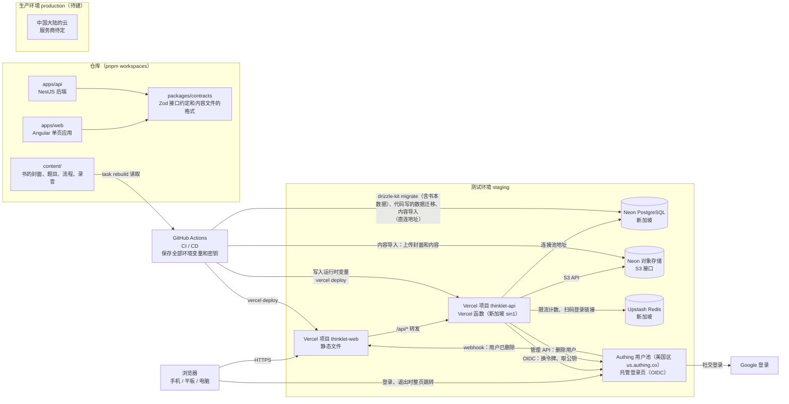

# thinklet 架构

thinklet 由一个 Angular 单页前端、一个 NestJS 后端、一个只放接口约定的共用包、一个 PostgreSQL 数据库、一个兼容 S3 的对象存储和一个放短时数据的 Redis 组成，家长通过第三方身份服务 Authing 登录。代码在一个 pnpm workspaces 仓库里，书的内容也在仓库里，写成文件。测试环境部署在 Vercel、Neon 和 Upstash；生产环境放在中国大陆的云上，还没有建。

每个决定的理由和比较过的方案见 `.docs/decisions/`。

## 架构图



## 指标

| 指标     | 内容                                                                                                                                                                               |
| -------- | ---------------------------------------------------------------------------------------------------------------------------------------------------------------------------------- |
| 规模     | 上线后第一年，同时在线不超过几百人；注册家长在几千人以内。一台小服务器加一个数据库就够                                                                                             |
| 可用性   | 99.5%，一个月累计停机不超过约 3.6 小时；发布生产环境时允许停几分钟                                                                                                                 |
| 一致性   | 写入后立刻可见：家长分派的书本、孩子提交的答案，刷新后马上能看到。用一个关系型数据库和事务来保证                                                                                   |
| 成本     | 测试环境和生产环境加起来每月不超过 200 元人民币。测试环境用免费套餐，每月 0 元                                                                                                     |
| 维护能力 | 一个人配合 AI 代理开发和运维：组件尽量少，运维尽量自动化，优先用托管服务                                                                                                           |
| 安全     | 全站 HTTPS；密码加盐散列保存；孩子的个人信息只收集必需的部分，并加密保存；每个接口都检查家长只能访问自己的孩子；孩子登录和查家庭码按来源限制尝试次数；没有已知的高危或严重依赖漏洞 |
| 无障碍   | WCAG 2.1 AA                                                                                                                                                                        |
| 兼容性   | Chrome、Edge、Safari（含 iOS）、Firefox 的近两个大版本                                                                                                                             |

不设性能指标和资源指标。

## 组件

| 组件                 | 种类                     | 说明                                                                                                                                                                                                                   |
| -------------------- | ------------------------ | ---------------------------------------------------------------------------------------------------------------------------------------------------------------------------------------------------------------------- |
| `apps/web`           | 网页前端                 | Angular 单页应用，在浏览器里渲染，一套自适应页面同时支持触屏和键鼠                                                                                                                                                     |
| `apps/api`           | 后端服务                 | NestJS，提供 `/api/*` 接口，包括健康检查 `GET /api/health`：在数据库上执行 `SELECT 1`，确认存储桶能访问，并向 Redis 发 `PING`，三者都正常就返回 200                                                                    |
| `packages/contracts` | 共用代码包（不单独运行） | 前后端共用的接口约定：Zod schema 和由它推出的类型，包括内容文件的格式。只放接口约定，不放业务逻辑                                                                                                                      |
| PostgreSQL           | 数据库                   | 存全部业务数据                                                                                                                                                                                                         |
| 对象存储             | 对象存储                 | 存书本的封面和内容：流程和题目的文件、题目的图片和旁白录音。代码只走 S3 接口                                                                                                                                           |
| Redis                | 缓存                     | 只放到期就该消失的短时数据：按来源限流的计数（只活一个时间窗口）和孩子的扫码登录链接（10 分钟）。连不上时限流照常放行，扫码登录用不了                                                                                  |
| Authing              | 第三方身份服务           | 家长的注册、密码登录、找回密码和社交登录，用它的托管登录页，本站通过 OIDC 标准协议接入。家长的密码由 Authing 保存，本站不经手。家长删除账号时，后端用 Authing 的管理 API 删掉这个用户，Authing 删完用 webhook 通知本站 |

讲题和练习由三样东西组成（决策 0041）：

- **组件**是前端代码，放在 `apps/web/src/app/shared/lesson/`，跨题型复用：有显示用的，比如乐谱、钢琴键盘、结论栈；也有作答用的，比如选择、按键填空、在谱上放音符。
- **流程**是内容文件，放在 `content/workflows/`：一道讲题或一道练习从头到尾的一串幕和步骤，练习的流程还写这类题默认怎么判分。每个流程带一个教学年级的范围，只作参考，不强制和书的教学年级一致；出题时尽量选范围覆盖这本书教学年级的流程，没有合适的就新建一个。
- **题目**是内容文件，放在它所在书本的文件夹里：绑定一个流程，选若干组件，写谱、旁白台词、答案和评分标准，带自己的图片和旁白录音。

前端的播放器按流程和题目的文件一步一步播放：加流程只加文件，不改播放器的代码；要新的组件时才改代码。

## 技术选择和决策点

| 方面                     | 选择                                                                                                                                                                                                                                                                                                                                                                                                                                                                                                                                                                                                                                                                                                                                                                                                                                                                                                                                                                                                                                                                                                         |
| ------------------------ | ------------------------------------------------------------------------------------------------------------------------------------------------------------------------------------------------------------------------------------------------------------------------------------------------------------------------------------------------------------------------------------------------------------------------------------------------------------------------------------------------------------------------------------------------------------------------------------------------------------------------------------------------------------------------------------------------------------------------------------------------------------------------------------------------------------------------------------------------------------------------------------------------------------------------------------------------------------------------------------------------------------------------------------------------------------------------------------------------------------ |
| 前端框架                 | Angular（TypeScript），独立组件加 signals，单页应用                                                                                                                                                                                                                                                                                                                                                                                                                                                                                                                                                                                                                                                                                                                                                                                                                                                                                                                                                                                                                                                          |
| 前端界面                 | Angular CDK 加 Tailwind CSS，界面自己设计                                                                                                                                                                                                                                                                                                                                                                                                                                                                                                                                                                                                                                                                                                                                                                                                                                                                                                                                                                                                                                                                    |
| 后端语言和运行时         | TypeScript，Node.js 26.13.1（最新 LTS），版本写死在 `.node-version` 和各 `package.json` 的 `engines` 里                                                                                                                                                                                                                                                                                                                                                                                                                                                                                                                                                                                                                                                                                                                                                                                                                                                                                                                                                                                                      |
| 后端框架                 | NestJS，底层用 Express                                                                                                                                                                                                                                                                                                                                                                                                                                                                                                                                                                                                                                                                                                                                                                                                                                                                                                                                                                                                                                                                                       |
| 接口约定                 | `packages/contracts` 里的 Zod schema；后端用它校验请求，前端用它推出类型。前端的 CSP 没有 `'unsafe-eval'`，而 Zod 4 建 schema 时会试探 `new Function`，CSP 会把它报成违规，所以 `packages/contracts` 用一个模块调用 `z.config({ jitless: true })`，两个应用都在任何 schema 之前导入它                                                                                                                                                                                                                                                                                                                                                                                                                                                                                                                                                                                                                                                                                                                                                                                                                        |
| 数据访问                 | Drizzle ORM 加 node-postgres 驱动                                                                                                                                                                                                                                                                                                                                                                                                                                                                                                                                                                                                                                                                                                                                                                                                                                                                                                                                                                                                                                                                            |
| 配置                     | `@nestjs/config` 加 Zod 校验：启动时校验全部环境变量，缺了或格式不对就拒绝启动，并说明是哪个                                                                                                                                                                                                                                                                                                                                                                                                                                                                                                                                                                                                                                                                                                                                                                                                                                                                                                                                                                                                                 |
| 日志                     | pino（nestjs-pino）输出一行一条的 JSON 日志，自动带请求编号，按遮挡列表遮掉密码和孩子的个人信息                                                                                                                                                                                                                                                                                                                                                                                                                                                                                                                                                                                                                                                                                                                                                                                                                                                                                                                                                                                                              |
| 安全响应头               | 不用库，自己写。前端的响应头写成一份清单，生成的 `vercel.json`、本机端到端测试的服务器和 `ng serve` 都用这一份；后端由一个全局中间件给每个响应加上自己的一份。CSP 的脚本只允许本站文件，不含 `'unsafe-eval'`，样式允许内联（Angular 运行时会插入 `<style>`）。各响应头的值见 `.docs/design/interfaces.md`                                                                                                                                                                                                                                                                                                                                                                                                                                                                                                                                                                                                                                                                                                                                                                                                    |
| 家长登录                 | Authing 的托管登录页，OIDC 授权码加 PKCE，流程在后端跑，用 openid-client。只走标准协议：Authing 的地址都从 issuer 的发现文档里读，换别的身份服务只改配置。跳到 Authing 和从 Authing 跳回来都是整页跳转，不用表单提交，因为前端 CSP 的 `form-action 'self'` 会挡住提交后跳到别的域名                                                                                                                                                                                                                                                                                                                                                                                                                                                                                                                                                                                                                                                                                                                                                                                                                          |
| 登录状态                 | 服务器无状态，不存会话。家长从 Authing 登录回来、孩子在本站登录后，后端都用同一把 ES256 私钥签发 JWT（jose），放在 HttpOnly、Secure、SameSite=Lax 的 cookie 里，家长和孩子各用一个 cookie。JWT 里只有一个编号和身份种类（家长 `parent` 或孩子 `child`），带密钥编号 `kid`，可以换密钥。孩子 JWT 的签发时间取数据库的当前时间，和重设密码时写的 `sessions_valid_after` 用同一个时钟，后端实例的时钟不一致也不会误判。同一个浏览器里家长和孩子可以同时登录，各退各的。Authing 返回的 ID 令牌另放在一个属性相同的 HttpOnly cookie 里，只在家长退出时用；请求只靠本站的 JWT 认证。登录过程中的 state、nonce 和 PKCE 也放在一个用同一把私钥签名、几分钟就过期的 cookie 里                                                                                                                                                                                                                                                                                                                                                                                                                                         |
| 孩子登录                 | 孩子的账号和密码由本站管理，不经过 Authing。孩子用三种方式登录：家庭码、账号和密码；家长给的一次性扫码登录链接；在记住了他的设备上点头像。密码用 Node 自带的 argon2id（`node:crypto`）加盐散列保存，散列字符串里带着参数，以后可以调高。家长的接口只认家长 cookie 里种类是 `parent` 的 JWT，孩子的接口只认孩子 cookie 里种类是 `child` 的 JWT；孩子的每个请求都查一次这个孩子还在不在，删掉孩子后下一个请求就进不来。家长不给孩子设密码：孩子第一次登录时自己设，家长重设密码就是清掉密码，孩子下次登录时再设。扫码登录随时能设；用家庭码和账号登录时，只在家长添加孩子或重设密码后的 48 小时内能设，过了期限要扫码。两种输入密码的登录按来源限制失败次数，见「按来源限流」                                                                                                                                                                                                                                                                                                                                                                                                                                  |
| 扫码登录链接和记住的设备 | 两者都是后端生成的 32 字节随机令牌，只存它的 SHA-256。链接的令牌放在地址里，日志里遮掉；链接存在 Redis 里，10 分钟后自动消失，登录时用一条原子命令取出并删掉，只能用一次；同一个孩子生成新链接时，旧的作废；家长查链接状态（有效、用过、作废、过期）也读 Redis，状态留到链接过期。记住的设备存在数据库里，带过期时间；令牌放在一个长期有效的 HttpOnly cookie 里，点头像时后端核对数据库；孩子登录时，在同一个事务里删掉这个孩子已经过期的设备。孩子用密码或扫码登录并记住设备时，每次都签发新的设备令牌，浏览器旧令牌下同一个家庭的设备换到新令牌，预先写进浏览器的令牌不会变成设备凭证。撤销设备就是删掉对应的行；删除孩子时删掉他的设备，并删掉 Redis 里他的链接                                                                                                                                                                                                                                                                                                                                                                                                                                           |
| 孩子个人信息加密         | 孩子的昵称、账号和记住的设备名称，在后端用 Node 自带的 AES-256-GCM 按字段加密后再存，数据库和备份里只有密文；密文带密钥编号，以后能换密钥。加密时把表名、列名和这一行的主键作为附加认证数据（AAD），密文换到别的行或别的列就解不开。账号另存一个 HMAC-SHA256 算出的查找值，用来在家庭内查重和登录时查找。加密和查找用的两把子密钥，以及限流键用的子密钥，都由密钥 `CHILD_DATA_KEY` 用 HKDF 推出                                                                                                                                                                                                                                                                                                                                                                                                                                                                                                                                                                                                                                                                                                              |
| 防跨站请求伪造           | cookie 用 SameSite=Lax；后端再用一个全局中间件检查每个非 GET、HEAD、OPTIONS 请求的 `Origin` 头，不是本站地址（`APP_ORIGIN`）或者没有就拒绝。只有 Authing 的 webhook 接口不查 `Origin`，它靠 webhook 密钥证明来源                                                                                                                                                                                                                                                                                                                                                                                                                                                                                                                                                                                                                                                                                                                                                                                                                                                                                             |
| 退出登录                 | 家长退出：清掉 JWT cookie 和 ID 令牌 cookie，再整页跳到 Authing 发现文档里的退出地址（`end_session_endpoint`），带上 ID 令牌作为 `id_token_hint`，同时退出 Authing，退完回到本站的产品主页。孩子退出只清孩子的 JWT cookie，记住设备的 cookie 留着                                                                                                                                                                                                                                                                                                                                                                                                                                                                                                                                                                                                                                                                                                                                                                                                                                                            |
| 家庭和权限               | 家长和家庭是多对多的成员关系，每个家庭恰好一位管理员。一个家庭里的接口都在 `/api/families/{familyId}/...` 下，每个请求都查这位家长是不是这个家庭的成员，要管理员的再查角色。JWT 里不放家庭和角色，被移出家庭或交出管理员后马上生效。孩子属于一个家庭，家长管孩子的接口也在 `/api/families/{familyId}/...` 下，用同样的成员检查                                                                                                                                                                                                                                                                                                                                                                                                                                                                                                                                                                                                                                                                                                                                                                               |
| 按来源限流               | 孩子用家庭码、账号和密码登录，扫码页输入密码，家长查家庭码，这三个接口按来源 IP 限制一个时间窗口里的失败次数，成功的不算：孩子登录的两个接口合起来，按来源加孩子、按来源合计两层计数；查家庭码只算查不到的。次数和窗口见 `.docs/design/`。计数放在 Redis，用 node-redis 走标准 Redis 协议，换服务只改连接地址。键里是来源 IP 的 HMAC-SHA256 值，不存 IP 原文，子密钥由 `CHILD_DATA_KEY` 用 HKDF 推出；键只活一个时间窗口。来源 IP 只认前端代理写的一个请求头，头的名字是配置 `CLIENT_IP_HEADER`。测试环境用哪一个，合并后用临时接口 `GET /api/client-ip` 核对：它只把请求者自己的几个候选请求头回显给他，不写日志；核对完由一个 fix issue 删掉这个接口，并把核对的结果写在这里。Redis 连不上时照常放行，记一条错误日志                                                                                                                                                                                                                                                                                                                                                                                       |
| 删除账号和家庭           | 家长删除账号：后端用 Node 自带的 fetch 调 Authing 的管理 API，先用用户池编号和密钥换管理令牌，再删除这个用户；Authing 返回成功后，在同一个请求里用一个事务删掉这位家长在本站的数据，并清掉他的登录。Authing 删完还会向本站的 `POST /api/webhooks/authing` 发 `user:deleted` 通知：后端用定长比较核对请求头里的 webhook 密钥，找到这位家长就在一个事务里删掉他在本站的数据，找不到（比如家长自己删的，已经删过了）就什么都不做；在 Authing 控制台里删掉的用户靠它同步。这个接口不要登录。家长只有不是任何家庭的管理员时才能删除自己的账号；删掉时，他在各个家庭的成员关系和他发的加入申请一起删掉。在 Authing 控制台里直接删掉的家长：他是管理员、家里还有别的家长的家庭，管理员交给其余家长里最早加入的一位；只剩他一位家长的家庭整个删掉。只有管理员能删除家庭，在一个事务里当场删掉：家庭里的孩子（连同记住的设备、扫码登录链接、分派的书、练习结果和学习时间）、家庭获取的书、加入申请和所有家长在这个家庭的成员关系；家长的账号留着。都是真删，不留待删标记；审计表不删（见「审计记录」）；Neon 的历史记录里还会留一段时间。控制台里删掉的用户，通知没送到时本站的数据留着，Authing 的文档没写会不会重发 |
| 审计记录                 | 每一个改数据的动作，在同一个事务里往审计表 `audit_events` 写一行：时间、做事的人（家长或孩子，以及编号；家长另存 Authing 的 issuer 和标识）、动作、对象（种类和编号）、家庭编号，以及动作本身的少量细节（比如监护人同意文字的版本）。孩子提交练习、记一段学习时间、第一次打开一本书也各写一行。只存编号和标识，不存名字、邮箱、昵称、账号这类个人信息。审计表只增不改不删，删除家长、家庭和孩子时也不删。其他表只记最终状态，不再记「是谁做的」。登录、退出和只读的动作不记                                                                                                                                                                                                                                                                                                                                                                                                                                                                                                                                                                                                                                  |
| 数据库                   | PostgreSQL；开发和测试用的版本与 Neon 项目的主版本一致                                                                                                                                                                                                                                                                                                                                                                                                                                                                                                                                                                                                                                                                                                                                                                                                                                                                                                                                                                                                                                                       |
| 对象存储                 | S3 接口（`@aws-sdk/client-s3`）；测试环境用 Neon 对象存储，生产环境换成国内云的对象存储时只改配置                                                                                                                                                                                                                                                                                                                                                                                                                                                                                                                                                                                                                                                                                                                                                                                                                                                                                                                                                                                                            |
| 书本数据                 | 年级、学科和书本都存在 PostgreSQL 的表里，数据库是这几项的唯一来源。书本表每本书一行：编号（小写字母、数字和连字符，也是它在仓库里的内容文件夹名）、书名、简介、适用年级的范围（最低年级和最高年级）、教学年级、学科、状态（`active` 或 `inactive`，`inactive` 是下架）、替代的书（可空）。三个年级都引用年级表的编号；最低年级不高于最高年级、教学年级在这个范围里，由数据库检查，不对的数据写不进去。家长看到的是适用年级的范围；教学年级不显示，出题时按它选流程。加书、改书、下架、删书和改年级、学科，都写成 `apps/api/drizzle/` 里一个新的 SQL 迁移脚本，走 PR，由 `drizzle-kit migrate` 在每个环境执行。有家庭获取过的书，数据库的外键不让删，删它的脚本执行失败。书里的单元和题目不在书本表里，见「内容文件」。现在的迁移脚本建好这几张表，写入 13 个年级、各学科（含音乐）、30 本示例书和「英皇乐理五级精讲」；建生产环境的 issue 再写一个脚本删掉示例书                                                                                                                                                                                                                                            |
| 内容文件                 | 书的内容、题目和流程都写成 YAML，放在仓库的 `content/` 下，仓库里的文件是它们的唯一来源，加题、改题、改流程只改文件，不写迁移脚本：流程是 `content/workflows/<流程编号>/workflow.yaml`；一本书的单元顺序（每个单元一道讲题加几道练习）是 `content/books/<书本编号>/book.yaml`；每道题一个文件夹 `content/books/<书本编号>/questions/<题目编号>/`，里面是 `question.yaml`，以及题目自己的 `images/`（WebP、PNG）和 `narration/`（MP3）。文件的格式是 `packages/contracts` 里的 Zod schema，每个组件的参数各有一个 schema。动画由组件代码实现，文件里只写动哪个、怎么动；不收 SVG 和动画文件。加书、加题、加流程、加组件的做法，以及用 `/change` 和 `/issue next` 加题时怎么说，写在加题手册 `content/README.md` 里，`AGENTS.md` 引用它                                                                                                                                                                                                                                                                                                                                                                        |
| 内容检查                 | `task content`，入口 `apps/api/src/check-content.ts`：只读 `content/`，不连数据库和存储。检查每个文件符合 schema；题目选的流程、组件和资源都存在；每句台词都有录音，而且和现在的文字、声音设置一致；ABC 谱能解析；答案和评分标准符合作答组件的格式。流程的教学年级范围和书的教学年级对不上不算错。内容导入用同一套校验                                                                                                                                                                                                                                                                                                                                                                                                                                                                                                                                                                                                                                                                                                                                                                                       |
| 乐谱                     | abcjs：题目里的谱写成 ABC 记谱法，前端画成 SVG，每个音符是单独的元素，可以标亮和点击；不用字体文件，CSP 不用改。内容检查和内容导入在 Node 里用它解析 ABC                                                                                                                                                                                                                                                                                                                                                                                                                                                                                                                                                                                                                                                                                                                                                                                                                                                                                                                                                     |
| 旁白                     | 用 education 项目的旁白引擎：edge-tts 的晓晓（`zh-CN-XiaoxiaoNeural`），默认语速和音高。`task narrate` 用 uv 的 `uvx` 临时运行固定版本 `edge-tts==7.3.1`（Python 3.12，第一次运行时由 uv 装好），只录台词或声音设置改过的句子。MP3 和题目一起提交进仓库，同一个文件夹里的清单记下每段录音的台词和声音设置的散列；发布时不连微软的服务。播放时浏览器用 `playbackRate` 变速，音高不变                                                                                                                                                                                                                                                                                                                                                                                                                                                                                                                                                                                                                                                                                                                          |
| 练习判分                 | 后端判分。答案和评分标准写在题目文件里：每个作答点的答案（可以有几种都算对的答案，或几组都算对的组合）、每个作答点几分，以及整题对错、按小题算百分比或按步骤；流程文件写这类题默认的判分方式，题目只写和默认不同的。后端的判分代码是几种通用的规则，只读这两个文件，不为某一道题写代码。发给浏览器的练习去掉答案和评分标准；孩子提交后，后端读题目文件判分、存结果，再返回对错和正确答案                                                                                                                                                                                                                                                                                                                                                                                                                                                                                                                                                                                                                                                                                                                     |
| 学习记录                 | 每道练习只存最后一次作答：完成百分比、得分百分比和作答的时间，重做就覆盖。孩子在每道讲题和练习上花的时间，每看一次记一行，进学习历史。都按孩子编号和题目编号存，不用外键引用题目：题目从内容里删掉后，它的记录不再显示；删除孩子时一起删掉                                                                                                                                                                                                                                                                                                                                                                                                                                                                                                                                                                                                                                                                                                                                                                                                                                                                   |
| 内容导入                 | 后端里的一个命令，入口 `apps/api/src/rebuild.ts`，任务命令是 `rebuild`：用 NestJS 的应用上下文只启动数据库、对象存储、`book` 模块的封面导入和 `lesson` 模块的内容导入，只读这几项配置。它按书本表里的每本书找封面和内容：封面是 `content/books/<书本编号>/cover.webp` 或 `cover.png`，按文件头检查是 WebP 或 PNG、不超过 300 KB、宽高比 3:4；内容用和 `task content` 一样的校验，书可以没有内容。有一项不对就什么都不改，并说明是哪本书的哪个文件哪里不对。校验通过后，把封面、流程、题目（转成 JSON）、图片和录音传到对象存储，内容没变的不重传；再把每张封面的 SHA-256 写进书本表，并在一个事务里重建题目表：每本书的单元和题目的目录（题目编号、讲题还是练习、单元里的顺序、内容散列）。可以重复运行，结果一样。只处理书本表里有的书：仓库里有文件夹、表里没有的书，以及对象存储里已经删掉的书的文件，都不处理                                                                                                                                                                                                                                                                                            |
| 封面和内容的存放         | 对象存储里和仓库一样分文件夹：封面 `books/<书本编号>/cover.webp`（或 `.png`），题目 `books/<书本编号>/questions/<题目编号>/…`，流程 `workflows/<流程编号>/…`；换文件就覆盖。浏览器经过后端的接口取封面和内容，要家长或孩子登录；后端从对象存储读出返回，前端 CSP 不用改。地址带上内容的散列：文件换了，地址跟着变；响应只让浏览器自己长期缓存，没换的文件不再重取。练习的题目文件由后端去掉答案和评分标准后再返回                                                                                                                                                                                                                                                                                                                                                                                                                                                                                                                                                                                                                                                                                            |
| 分批加载                 | 列表接口用游标分批：每批按固定的顺序取，响应带一个游标，也就是这批最后一项的排序位置，编码成一个不透明的字符串；下一批从它之后取，没有更多时不带游标。加载中途加了新书，也不会重复或漏掉                                                                                                                                                                                                                                                                                                                                                                                                                                                                                                                                                                                                                                                                                                                                                                                                                                                                                                                     |
| 包管理                   | pnpm workspaces；前端用 Angular CLI 构建，后端用 Nest CLI 构建                                                                                                                                                                                                                                                                                                                                                                                                                                                                                                                                                                                                                                                                                                                                                                                                                                                                                                                                                                                                                                               |
| 任务入口                 | Task（`Taskfile.yml`）。它作为仓库根目录的开发依赖由 pnpm 安装，开发机上只要先装好 Node.js、pnpm 和 Docker；录旁白另要 uv                                                                                                                                                                                                                                                                                                                                                                                                                                                                                                                                                                                                                                                                                                                                                                                                                                                                                                                                                                                    |
| 云                       | 测试环境用 Vercel（Hobby 套餐）、Neon（免费套餐）、Upstash（免费档）和 Authing 美国区 us.authing.co（免费用户池）；生产环境用中国大陆的云，服务商待定                                                                                                                                                                                                                                                                                                                                                                                                                                                                                                                                                                                                                                                                                                                                                                                                                                                                                                                                                        |

## 各组件的库

版本只写在各 `package.json` 和 `pnpm-lock.yaml` 里。生成器自带的依赖不列出。

### apps/web

由 Angular CLI（`ng new`）生成。

| 库                    | 用途                                                                           | 许可证 |
| --------------------- | ------------------------------------------------------------------------------ | ------ |
| `@angular/cdk`        | 无样式的组件基础：焦点管理、键盘操作、弹层，符合无障碍要求                     | MIT    |
| `tailwindcss`         | 样式                                                                           | MIT    |
| `qrcode`              | 生成二维码的点阵，由组件画成页面里的 SVG（邀请家长的二维码和孩子的登录二维码） | MIT    |
| `abcjs`               | 把题目里 ABC 记谱法的谱画成 SVG                                                | MIT    |
| `@thinklet/contracts` | 接口约定（本仓库的包）                                                         | 本项目 |

### apps/api

由 Nest CLI（`nest new`）生成。

| 库                                 | 用途                                  | 许可证     |
| ---------------------------------- | ------------------------------------- | ---------- |
| `@nestjs/config`                   | 读取环境变量                          | MIT        |
| `zod`                              | 校验配置和请求                        | MIT        |
| `drizzle-orm`                      | 数据访问                              | Apache-2.0 |
| `pg`                               | PostgreSQL 驱动                       | MIT        |
| `@aws-sdk/client-s3`               | 对象存储的 S3 客户端                  | Apache-2.0 |
| `redis`                            | Redis 客户端（node-redis），限流计数  | MIT        |
| `nestjs-pino`、`pino`、`pino-http` | JSON 日志                             | MIT        |
| `openid-client`                    | OIDC 客户端：跳转登录、换令牌、退出   | MIT        |
| `jose`                             | 签发和校验登录状态的 JWT              | MIT        |
| `cookie-parser`                    | 读请求里的 cookie                     | MIT        |
| `yaml`                             | 内容导入和内容检查读 YAML 文件        | ISC        |
| `abcjs`                            | 内容导入和内容检查解析题目里的 ABC 谱 | MIT        |
| `@thinklet/contracts`              | 接口约定（本仓库的包）                | 本项目     |

### packages/contracts

| 库    | 用途                   | 许可证 |
| ----- | ---------------------- | ------ |
| `zod` | 定义数据格式并推出类型 | MIT    |

### 仓库根目录的开发工具

| 工具                                                          | 用途                                                            | 许可证       |
| ------------------------------------------------------------- | --------------------------------------------------------------- | ------------ |
| `typescript`                                                  | 类型检查                                                        | Apache-2.0   |
| `@go-task/cli`                                                | 任务入口 Task                                                   | MIT          |
| `lefthook`                                                    | git hooks                                                       | MIT          |
| `prettier`、`prettier-plugin-tailwindcss`                     | 格式化，给 Tailwind 的 class 排序                               | MIT          |
| `eslint`、`typescript-eslint`、`angular-eslint`               | 代码规范检查                                                    | MIT          |
| `dependency-cruiser`                                          | 架构规则                                                        | MIT          |
| `jscpd`                                                       | 重复代码                                                        | MIT          |
| `@commitlint/cli`、`@commitlint/config-conventional`          | 提交信息格式                                                    | MIT          |
| `markdownlint-cli2`                                           | Markdown 规则                                                   | MIT          |
| `license-checker-rseidelsohn`                                 | 依赖的许可证                                                    | BSD-3-Clause |
| `squawk-cli`                                                  | PostgreSQL 迁移脚本的安全检查                                   | Apache-2.0   |
| `drizzle-kit`                                                 | 生成和执行数据库迁移                                            | Apache-2.0   |
| `jose`                                                        | `tools/bin/jwt-key.ts` 用它生成本机开发用的 JWT 签名密钥        | MIT          |
| `vitest`、`@vitest/browser-playwright`、`@vitest/coverage-v8` | 单元测试、组件测试、集成测试、覆盖率                            | MIT          |
| `@testing-library/angular`                                    | 组件测试里像用户一样操作页面                                    | MIT          |
| `msw`                                                         | 组件测试里替换后端接口                                          | MIT          |
| `axe-core`、`@axe-core/playwright`                            | 无障碍检查                                                      | MPL-2.0      |
| `@playwright/test`                                            | 端到端测试和冒烟测试                                            | Apache-2.0   |
| `testcontainers`、`@testcontainers/postgresql`                | 测试里临时起 PostgreSQL、SeaweedFS、Valkey 和模拟的 OIDC 服务器 | MIT          |
| `supertest`                                                   | 集成测试里从 HTTP 入口调用后端                                  | MIT          |

不通过 npm 安装的工具：gitleaks（MIT）、actionlint（MIT）、zizmor（MIT）、OSV-Scanner（Apache-2.0）、CodeQL（GitHub 提供）、ZAP（Apache-2.0）；uv（Apache-2.0 或 MIT）和由它临时运行的 edge-tts（LGPL-3.0），只在开发机录旁白时用，不进产品，CI 和 CD 都不用。容器镜像：`postgres`（PostgreSQL License）、`chrislusf/seaweedfs`（Apache-2.0）、`valkey/valkey`（BSD-3-Clause，开发和测试里代替 Redis）、`ghcr.io/navikt/mock-oauth2-server`（MIT）、Playwright 官方镜像（Apache-2.0）。

组件测试用的镜像由仓库里的 `apps/web/component-tests.Dockerfile` 在 Playwright 官方镜像上构建，装了开源的 Noto Sans CJK 简体中文字体（SIL Open Font License 1.1），让截图里的中文有粗体字重：Dockerfile 从 Noto CJK 在 GitHub 上的发布（`notofonts/noto-cjk`）下载固定版本的字体文件，核对 SHA-256 后装进字体目录，版本和散列都写在 Dockerfile 里。字体只在测试截图时用，不进产品。Dockerfile 里的基础镜像按标签和摘要固定版本，标签里的 Playwright 版本和 `playwright`、`@playwright/test` 两个包的版本一致。

`vercel` 和 `neonctl` 命令行不写进依赖清单，按固定版本临时运行（见决策 0017）：CD 用 `npm install --global vercel@<版本>` 安装，版本是部署工作流里的 `VERCEL_CLI_VERSION`，由 Renovate 更新；本机用 `npx vercel@<同一版本>` 和 `npx neonctl@<版本>`。

## 代码结构

```text
apps/
  web/                 Angular 前端
    src/app/
      core/            全局的东西：接口请求、拦截器、布局
      features/<业务>/  各业务的页面，按路由懒加载
      shared/ui/       只管显示、不调接口的通用组件
      shared/lesson/   讲题和练习的播放器、每个组件一个文件夹、组件编号到代码的对照表；只接收数据、发出事件，不调接口
  api/                 NestJS 后端
    src/
      modules/<业务>/   每个业务一个 NestJS 模块
        *.controller.ts  收发和校验请求
        *.service.ts     业务规则
        *.repository.ts  用 Drizzle 读写数据库
      infrastructure/  数据库、对象存储、Redis、身份服务的管理 API、配置、日志、安全响应头、加密和密码散列的接入
      data-migrations/ 代码写的数据迁移，每个一个按版本编号的文件
      migrate-data.ts  代码写的数据迁移的命令入口
      rebuild.ts       封面和内容导入的命令入口
      check-content.ts 内容检查的命令入口
    drizzle/           迁移脚本，包括书本数据
    test/support/      测试的公共代码，包括 Authing 管理 API 和 webhook 的替身服务
packages/
  contracts/           Zod schema 和类型，包括内容文件和组件参数的格式
content/
  README.md            加题手册
  workflows/<流程编号>/  每个流程一个文件夹
  books/<书本编号>/      每本书一个文件夹：封面、book.yaml、每道题一个文件夹
tools/                 仓库自己的检查脚本（步骤检查、PR 标题检查、风险分级）和录旁白的脚本
```

后端的业务模块：

| 模块     | 管什么                                                                                                                                            |
| -------- | ------------------------------------------------------------------------------------------------------------------------------------------------- |
| `auth`   | 家长跳到 Authing 登录、接收回调、家长退出，签发和校验家长和孩子的 JWT，以及接口都用的登录检查                                                     |
| `family` | 家长账号、同意记录、家庭、家庭码、时区、家长成员、加入申请，删除家长账号（含 Authing 的 webhook）和删除家庭，以及家庭内接口都用的成员和管理员检查 |
| `audit`  | 审计表的写入，其他模块在自己的事务里调用它导出的 service                                                                                          |
| `child`  | 孩子账号、孩子的密码、扫码登录链接、记住的设备、孩子登录和退出，以及孩子接口都用的「是不是这个孩子」检查                                          |
| `book`   | 年级、学科和书本目录，封面导入和取封面，家庭获取的书、分派给孩子的书，以及孩子看到的自己的书和第一次打开时清掉“新”                                |
| `lesson` | 内容导入和内容检查，题目表，给家长预览和孩子学习取书的单元、讲题和练习的内容，练习判分和练习结果，学习时间                                        |

规则，由 dependency-cruiser 检查：

- 后端只能从上往下调用：controller → service → repository。
- 后端模块之间只能调用对方导出的 service，不能碰对方的 repository。
- 后端各层都可以用 `infrastructure`，`infrastructure` 不引用 `modules`。
- 前端的 `features` 之间不互相引用；`shared` 不引用 `features`；`core` 不引用 `features`。`shared/lesson` 可以用 `shared/ui`，反过来不行。
- `apps/web` 不引用 `apps/api`，反过来也一样；两边都只能通过 `packages/contracts` 共用代码。
- `packages/contracts` 不引用任何应用。
- 不允许循环依赖。

命名：文件名用小写加连字符；前端按 Angular 官方风格指南；后端按 NestJS 的约定（`<名称>.controller.ts`、`<名称>.service.ts`、`<名称>.repository.ts`、`<名称>.module.ts`）。内容文件夹和文件里的编号（书本、题目、流程、组件）都用小写字母、数字和连字符。

每一层的测试：

| 层                                                  | 测试                                |
| --------------------------------------------------- | ----------------------------------- |
| 后端 service、`packages/contracts`                  | 单元测试                            |
| 后端 repository 和 controller                       | 集成测试，连临时起的真实 PostgreSQL |
| 前端组件和页面，包括 `shared/lesson` 的组件和播放器 | 组件测试                            |
| 内容文件                                            | 内容检查（`task content`）          |
| 用户能完整走一遍的流程                              | 端到端测试                          |

## Deployment targets

| 名称       | 部署在哪里                                                                                     | 地址                                                                           | 用到的资源                                                                                                                                                                                                                                                                                                                                                                                                                                                                                                                                                     |
| ---------- | ---------------------------------------------------------------------------------------------- | ------------------------------------------------------------------------------ | -------------------------------------------------------------------------------------------------------------------------------------------------------------------------------------------------------------------------------------------------------------------------------------------------------------------------------------------------------------------------------------------------------------------------------------------------------------------------------------------------------------------------------------------------------------- |
| staging    | Vercel（前端静态文件和后端函数，函数区域 `sin1` 新加坡）和 Neon（`aws-ap-southeast-1` 新加坡） | 前端 `https://thinklet-web.vercel.app`，后端 `https://thinklet-api.vercel.app` | 新建：Vercel 项目 `thinklet-web` 和 `thinklet-api`（Hobby 套餐，每月 0 元）；Neon 项目 `thinklet-staging`，含一个 PostgreSQL 数据库和一个对象存储桶（免费套餐，每月 0 元）；Authing 美国区（us.authing.co）的免费用户池 `好奇星球` 和其中一个 OIDC 应用，开 Google 登录，issuer 地址 `https://thinklet-staging.us.authing.co/oidc`（每月 0 元）；Google Cloud 项目 `thinklet-staging` 里的一个 OAuth 客户端，给 Authing 的 Google 登录用（免费）；Upstash 的 Redis 库 `thinklet-staging`（新加坡 `ap-southeast-1`，免费档每月 50 万条命令、256 MB，每月 0 元） |
| production | 中国大陆的云，服务商待定                                                                       | 无（待建）                                                                     | 待定，由建生产环境的 issue 回到 architect 步骤来定                                                                                                                                                                                                                                                                                                                                                                                                                                                                                                             |

部署方式：

- **staging**：合并到 `main` 后，GitHub Actions 的 CD 任务按顺序做这些事：
  1. 用 Neon 的直连地址执行 `task migrate`：先 `drizzle-kit migrate`，书本数据的改动也在这一步执行；再执行代码写的数据迁移，这一步带上 `CHILD_DATA_KEY`。
  2. 用同一个直连地址和对象存储的凭据执行 `task rebuild`，把 `content/` 里的封面和内容传到对象存储，在书本表里记下封面的散列，重建题目表。
  3. 把后端运行时要用的环境变量从 GitHub 覆盖写进 Vercel 项目 `thinklet-api`，再用 `vercel build` 和 `vercel deploy --prebuilt --prod` 发布它。
  4. 按 `API_ORIGIN` 生成 `thinklet-web` 的 `vercel.json`，里面是把 `/api/*` 转发到后端的规则和前端的安全响应头，再同样发布 `thinklet-web`。`vercel.json` 读不了环境变量，所以它在发布时生成，不提交到仓库。
  5. 跑全部冒烟测试。

  手动部署（`/deploy staging`）也走同一个任务。Vercel 不连接 Git 集成，PR 没有预览环境。

- **production**：还没有部署任务。建生产环境的 issue 会加上一个手动启动的部署任务，之后才能用 `/deploy production`。那时生产环境的前端也要带上同一份安全响应头。

说明：

- Vercel 项目里的 “Production” 环境就是本项目的测试环境 staging。
- 测试环境只放测试数据，不放真实用户的个人信息。
- `*.vercel.app` 在中国大陆经常打不开，要在国内访问测试环境，需要用代理。
- Vercel Hobby 套餐只能用于个人、非商业用途；项目商用前要升级到 Pro。
- Neon 免费套餐的数据库闲置 5 分钟后自动暂停，下一个请求要等不到一秒来唤醒。
- 两个 Vercel 项目的根目录分别是 `apps/web` 和 `apps/api`，并允许构建读取根目录以外的文件，这样才能用到 `packages/contracts`。
- 两个 Vercel 项目用标准保护：预览部署和各次部署自己的地址要登录 Vercel 才能打开，正式地址 `thinklet-web.vercel.app`、`thinklet-api.vercel.app` 公开访问，冒烟测试和 `/api/*` 转发才能用。
- 登录的回调地址和退出后的返回地址都在前端的地址 `https://thinklet-web.vercel.app` 下，经过 `/api/*` 转发到后端，cookie 只属于前端的域名。
- 测试环境的 Authing 用户池在美国区（控制台 `console.us.authing.co`，服务器在腾讯云美国弗吉尼亚）：家长的名字、邮箱和密码存在美国，Google 登录经过 Authing 美国区的服务器连 Google。新加坡的 Vercel 函数连 authing.cn 北京的服务器会随机丢连接，登录时好时坏；连美国区稳定。
- Authing 免费用户池每月最多 10 个活跃用户，只能连一个社交账号；每天最多发 50 封邮件（注册验证、找回密码）。authing.cn 的用户池（生产环境）要账号主人完成 Authing 的实名认证或企业认证后才能发邮件，美国区没有这个要求。
- 生产环境在 authing.cn 上另建用户池，测试环境的家长账号不带过去。代码不分区域，区域只在配置里：`OIDC_ISSUER`、`OIDC_CLIENT_ID`、`AUTHING_MANAGEMENT_ORIGIN`、`AUTHING_USER_POOL_ID` 和三个密钥。

基础设施直接用 `vercel` 和 `neonctl` 命令行创建，不用基础设施即代码工具。scaffold 步骤执行前先用 `--help` 核对参数：

```text
npx neonctl@9.7.2 projects create --name thinklet-staging --region-id aws-ap-southeast-1 --pg-version 18 --org-id <组织 id> --no-secrets
npx neonctl@9.7.2 buckets create thinklet --project-id <id> --branch <branch>
npx neonctl@9.7.2 api /projects/<id>/branches/<branch>/storage                 # 存储地址和区域，写入 GitHub 变量 S3_ENDPOINT、S3_REGION
npx neonctl@9.7.2 credentials create --project-id <id> --branch <branch> --scope storage:read --scope storage:write --output json
                                                                                 # token_id、s3_secret_access_key 直接写入 GitHub 密钥 S3_ACCESS_KEY_ID、S3_SECRET_ACCESS_KEY，不显示
npx neonctl@9.7.2 connection-string <branch> --project-id <id> --pooled         # 输出直接写入 GitHub 密钥 DATABASE_URL，不显示
npx neonctl@9.7.2 connection-string <branch> --project-id <id>                  # 输出直接写入 GitHub 密钥 MIGRATION_DATABASE_URL，不显示
npx vercel@66.5.0 project create thinklet-web
npx vercel@66.5.0 project create thinklet-api
npx vercel@66.5.0 project update thinklet-web --root-directory apps/web --framework angular --source-files-outside-root-directory --yes
npx vercel@66.5.0 project update thinklet-api --root-directory apps/api --framework nestjs --source-files-outside-root-directory --yes
npx vercel@66.5.0 api /v9/projects/<项目名> -X PATCH --input <文件>             # 文件内容 {"ssoProtection":{"deploymentType":"prod_deployment_urls_and_all_previews"}}
curl --user <邮箱>:<API 密钥> -X POST https://api.upstash.com/v2/redis/database \
  --data '{"database_name":"thinklet-staging","platform":"aws","primary_region":"ap-southeast-1","tls":true}'
                                                                                 # 邮箱和 API 密钥由用户存成不提交的文件，代理从文件读入；输出里的地址和密码
                                                                                 # 拼成 rediss:// 地址，直接写入 GitHub 密钥 REDIS_URL，不显示
```

Upstash 的官方命令行已经不维护，所以用它的开发者 API；scaffold 步骤执行前先核对 API 文档里的参数。

Authing 和 Google Cloud 没有可用的命令行工具，由用户在网站上建。重建时按这几步：

1. 在 Google Cloud 建项目 `thinklet-staging`。在 Google Auth Platform 里配 OAuth 同意屏幕：应用名 好奇星球，受众选 External，保持 Testing 状态，只有加进 Test users 的账号能用 Google 登录。
2. 在 Authing 美国区的控制台 `https://console.us.authing.co` 建用户池 好奇星球，子域名 `thinklet-staging`。
3. 在用户池里建一个 Regular Web APP 类型的应用，名字 好奇星球，子域名同上。登录回调地址填 `<APP_ORIGIN>/api/auth/callback`，退出回调地址填 `<APP_ORIGIN>/`。
4. 应用的 Protocol Configuration：授权模式只勾 `authorization_code`，返回类型 `code`，ID 令牌签名 `RS256`，换令牌时的客户端验证用 `client_secret_post`，关掉 User informed consent page；ID 令牌 14 天过期。Authing 没有“必须用 PKCE”的开关：请求带了 PKCE 它就校验，本站后端每次都带。
5. 应用的 Login Control：Single Page Login，只开邮箱加密码登录，关掉邮箱验证码登录。应用的 Access Authorization 里默认访问策略选 Allow all users：策略是拒绝所有用户时，登录页显示「No permission to log in to this application」。
6. 允许注册：Security → General → Registration Security 里关掉 Prohibit Sign up。
7. 注册和登录协议：Branding → Universal Login → Functional configuration 里加一条协议，文字是「我已阅读并同意《用户协议》和《隐私政策》」，注册和登录时都显示，必须勾选，语言选中文。默认语言设成简体中文，关掉语言切换，因为协议的勾选框只在中文页面上出现。
8. Google 登录：在 Google Cloud 项目里建一个 Web application 类型的 OAuth 客户端，授权回调地址填 Authing 的 Google 连接页上给出的 Google 回调地址。在 Authing 里加社交连接 Google Web，填上这个客户端，Login Mode 选 Sign in & sign up，关掉 Bind to Existing Account：开着的话，有人先用别人的邮箱注册一个没验证过的密码账号，就能截下邮箱主人的 Google 登录。再把这个连接加进应用的社交登录。
9. 应用和用户池的图标用地球标志。
10. 用户把 client secret 存成不提交的文件，代理从文件读入 GitHub 密钥 `OIDC_CLIENT_SECRET`，不显示；issuer 地址和 client id 写入 GitHub 变量。
11. 删除用户的管理 API：用户池的编号写入 GitHub 变量 `AUTHING_USER_POOL_ID`；用户把用户池密钥存成不提交的文件，代理从文件读入 GitHub 密钥 `AUTHING_USER_POOL_SECRET`，不显示。
12. webhook：代理生成一个随机的 webhook 密钥写进不提交的文件，并从文件读入 GitHub 密钥 `AUTHING_WEBHOOK_SECRET`；用户在 Authing 控制台的 自动化 → Webhooks 里加一个 webhook，回调链接 `<APP_ORIGIN>/api/webhooks/authing`，请求密钥从这个文件复制，数据格式 `application/json`，触发事件只勾 `user:deleted`，然后删掉文件。
13. 代理读 issuer 的发现文档，确认有授权、换令牌、公钥、退出（`end_session_endpoint`）和用户信息五个地址，支持 S256 的 PKCE 和 `client_secret_post`，ID 令牌能用 RS256 签名。

应用、应用的访问授权、安全设置、Google 身份源和 webhook 也能用管理 API 从另一个用户池复制：`get-application`/`create-application`、`get-application-permission-strategy`/`update-application-permission-strategy`、`get-security-settings`/`update-security-settings`（`allowedOrigins` 不复制）、`get-ext-idp`/`create-ext-idp`/`create-ext-idp-conn`/`change-ext-idp-conn-state`、`list-webhooks`/`create-webhook`。用户池本身、通用登录页的协议和语言、用户池图标，以及 Google Cloud 里 Authing 的回调地址只能在网站上设。

## 数据迁移

| 数据                                                                                     | 方式                                                                                                                                                                                                       | 工具                                                                                                                                                                                                             | 在哪里执行                                                                                                                                                     |
| ---------------------------------------------------------------------------------------- | ---------------------------------------------------------------------------------------------------------------------------------------------------------------------------------------------------------- | ---------------------------------------------------------------------------------------------------------------------------------------------------------------------------------------------------------------- | -------------------------------------------------------------------------------------------------------------------------------------------------------------- |
| PostgreSQL 的表结构和数据，包括年级、学科、书本、练习结果和学习时间                      | 按版本逐个迁移：脚本放在 `apps/api/drizzle/`，从数据库当前的版本按顺序往后执行。只能往前迁移，写错了就再写一个新脚本；合并过的脚本不再修改。加书、改书、下架、删书也都写成新脚本                           | Drizzle Kit：改了 TypeScript 里的表定义后由它生成 SQL 脚本，脚本可以手改；只改数据的脚本手写；执行过的脚本记在表 `__drizzle_migrations` 里；执行命令是 `drizzle-kit migrate`                                     | 测试环境：CD 发布前执行。生产环境：它的部署任务里执行，允许停机。开发机和测试数据库：创建时执行                                                                |
| PostgreSQL 里要用代码或密钥才能改的数据，比如重新加密孩子的个人信息                      | 按版本逐个迁移，规则和上一行一样：每个迁移是 `apps/api/src/data-migrations/` 里一个按版本编号的 TypeScript 文件，在一个事务里执行                                                                          | 本项目的数据迁移命令：入口 `apps/api/src/migrate-data.ts`，用 NestJS 的应用上下文只启动数据库和要用的 infrastructure；执行过的记在表 `data_migrations` 里。`task migrate` 先执行 `drizzle-kit migrate`，再执行它 | 和上一行一样，紧接在 `drizzle-kit migrate` 之后；要 `CHILD_DATA_KEY`                                                                                           |
| 封面和内容：对象存储里的封面、流程、题目、图片和录音，书本表里记下的封面散列，以及题目表 | 重建：完全由仓库里的 `content/` 生成，由内容导入同步，可以重复运行；封面换了格式时，记下新散列后删掉另一种格式的旧文件。内容文件的格式变了，就在同一个 PR 里把 `content/` 下的文件全部改成新格式，重新导入 | 本项目的内容导入命令，`task rebuild`                                                                                                                                                                             | 测试环境：CD 在迁移之后、发布后端之前执行。生产环境：在它的部署任务里，迁移之后执行。开发机：`task dev` 在迁移之后执行。测试：集成测试和端到端测试建好库后执行 |
| 对象存储里的其他文件                                                                     | 现在没有                                                                                                                                                                                                   | 等第一个存别的文件的 issue 再定                                                                                                                                                                                  | —                                                                                                                                                              |
| Redis 里的限流计数和扫码登录链接                                                         | 不迁移：每个键最多活 10 分钟，格式变了，旧的键到期自然消失。扫码登录链接从数据库表搬到 Redis 时，表由迁移脚本删掉，当时还没用掉的链接失效，家长重新生成就行                                                | —                                                                                                                                                                                                                | —                                                                                                                                                              |

先执行 `drizzle-kit migrate`，再执行代码写的数据迁移，最后导入封面和内容：代码写的数据迁移读写的是迁移后的表结构；新加的书先要在书本表里有一行，内容导入才知道要找它的封面和内容。迁移之后、内容导入之前，新加的书还没有封面散列和题目，书库怎么显示见 `.docs/design/`。练习结果和学习时间按题目编号存，不随内容导入改动。家长在 Authing 里的账号不随本站迁移，本站只存 Authing 给的家长标识。

## 各组件怎么运行

| 组件       | 开发机                                                                                                                                                                                                                                                                                                                                      | CI                                        |
| ---------- | ------------------------------------------------------------------------------------------------------------------------------------------------------------------------------------------------------------------------------------------------------------------------------------------------------------------------------------------- | ----------------------------------------- |
| `apps/web` | 本机直接运行 `ng serve`，把 `/api` 转给本机的后端，响应带上和测试环境一样的安全响应头                                                                                                                                                                                                                                                       | GitHub 的 Linux 机器上装 Node.js 直接运行 |
| `apps/api` | 本机直接运行 `nest start --watch`，常驻的 Node.js 进程                                                                                                                                                                                                                                                                                      | 同上                                      |
| PostgreSQL | 容器（官方 `postgres` 镜像）：开发时用 Docker Compose 起；测试时用 Testcontainers 临时起，测完删除                                                                                                                                                                                                                                          | Testcontainers                            |
| 对象存储   | SeaweedFS 容器模拟 S3：开发时用 Docker Compose 起；测试时用 Testcontainers 临时起                                                                                                                                                                                                                                                           | Testcontainers                            |
| Redis      | Valkey 容器（`valkey/valkey` 镜像，协议和 Redis 一致）：开发时用 Docker Compose 起；测试时用 Testcontainers 临时起                                                                                                                                                                                                                          | Testcontainers                            |
| Authing    | mock-oauth2-server 容器模拟 OIDC 服务器，打开它的登录页，填什么用户都能登录：开发时用 Docker Compose 起；测试时用 Testcontainers 临时起。管理 API 和 webhook 由仓库里的替身服务代替（`apps/api/test/support/`）：它实现换管理令牌和删除用户两个接口，删除后带着 webhook 密钥回调后端；集成和端到端测试自己起它、测完关掉，`task dev` 也起它 | Testcontainers；替身服务由测试自己起      |
| 旁白录音   | `task narrate` 用 uv 的 `uvx` 临时运行 edge-tts，要联网连微软的朗读服务                                                                                                                                                                                                                                                                     | 不运行；内容检查只核对录音和台词一致      |

开发机要先装 Node.js 26.13.1、pnpm 和 Docker，并启动 Docker；录旁白另要装 uv。后端在开发机和 CI 里以常驻进程运行，在测试环境里以 Vercel 函数运行；两种方式共用同一个 NestJS 应用模块，只是入口文件不同。

## 静态检查

| 检查         | 工具                                                                                                                                                            |
| ------------ | --------------------------------------------------------------------------------------------------------------------------------------------------------------- |
| 格式         | Prettier，含 `prettier-plugin-tailwindcss`                                                                                                                      |
| 代码规范     | ESLint、typescript-eslint（结合类型信息）、angular-eslint（含模板的无障碍规则），另加复杂度和长度上限：圈复杂度、嵌套深度、函数行数、参数个数                   |
| 类型检查     | 三个包都开 TypeScript 的 strict，各自跑 `tsc --noEmit`；前端开启严格模板检查                                                                                    |
| 编译和构建   | `ng build`、`nest build`                                                                                                                                        |
| 架构规则     | dependency-cruiser，按“代码结构”一节的规则检查                                                                                                                  |
| 重复代码     | jscpd，生成的迁移脚本和测试里的固定数据不算在内                                                                                                                 |
| 代码安全扫描 | CodeQL（公开仓库免费；仓库改成私有就要付费）                                                                                                                    |
| 依赖漏洞     | OSV-Scanner，有高危或严重漏洞时失败                                                                                                                             |
| 密钥泄漏     | gitleaks，加上 GitHub 的推送保护                                                                                                                                |
| 许可证       | license-checker-rseidelsohn：只查产品运行时用到的依赖，只允许宽松的开源许可证（MIT、Apache-2.0、BSD、ISC 等），允许的列表在根目录的 `license-allowlist.json` 里 |
| 部署配置     | actionlint 和 zizmor，检查 GitHub Actions 工作流；项目自己的镜像只有组件测试用的那一个，不部署，没有对 Dockerfile 的专门检查                                    |
| 迁移脚本     | Squawk，只查新增的脚本                                                                                                                                          |
| 内容文件     | `task content`，见「内容检查」                                                                                                                                  |
| 提交信息     | commitlint，加上项目自己的规则：提交类型要和分支类型对得上，要带 issue 编号，最后一行要有 `Step:`。PR 标题用同一套规则检查                                      |
| 步骤检查     | `tools/` 里的 Node.js 脚本，对照各步骤能改的文件，由 commit-msg 钩子和 PR 的 CI 调用                                                                            |
| 文档格式     | Prettier、markdownlint-cli2，另加一条项目规则：`.docs/` 下每个文档都以 `Last changed: #<编号> (<日期>)` 结尾                                                    |
| AI 简化      | Claude Code 的 `/simplify`                                                                                                                                      |
| AI 评审      | Claude Code 的 `/code-review`，见“评审标准和风险规则”                                                                                                           |
| AI 安全评审  | Claude Code 的 `/security-review`                                                                                                                               |

git hooks 由 lefthook 管理，配置在 `lefthook.yml`。

## 测试

### 测试对象和工具

| 测试对象   | 工具                                                                                                                  | 说明                                                                                                                                                                                                                                                                                                                                                                                                                                                                                                                                                                                                                                                                                                                                                                                                                                                                                                                         |
| ---------- | --------------------------------------------------------------------------------------------------------------------- | ---------------------------------------------------------------------------------------------------------------------------------------------------------------------------------------------------------------------------------------------------------------------------------------------------------------------------------------------------------------------------------------------------------------------------------------------------------------------------------------------------------------------------------------------------------------------------------------------------------------------------------------------------------------------------------------------------------------------------------------------------------------------------------------------------------------------------------------------------------------------------------------------------------------------------- |
| 单元       | Vitest，三个包都用；覆盖率用 V8                                                                                       | 判分的每种通用规则在这里测全                                                                                                                                                                                                                                                                                                                                                                                                                                                                                                                                                                                                                                                                                                                                                                                                                                                                                                 |
| 组件       | Vitest 浏览器模式（Playwright 驱动的 Chromium）、Angular Testing Library、MSW、axe                                    | 每个状态都跑 axe；每个状态、每种屏幕尺寸（手机、平板、电脑）各截一张图做对比。讲题和练习的截图对比到组件、播放器和页面为止，用测试自己的固定题目，书里的每道题不截图                                                                                                                                                                                                                                                                                                                                                                                                                                                                                                                                                                                                                                                                                                                                                         |
| 集成       | Vitest、supertest、Testcontainers（PostgreSQL、SeaweedFS、Valkey 和 mock-oauth2-server），Authing 管理 API 的替身服务 | 数据库从空库开始，用 `drizzle-kit migrate` 建表，迁移脚本同时写入示例书；内容导入对着临时的 PostgreSQL 和 SeaweedFS，用测试自己的固定封面和固定内容；练习判分和学习记录对着导入后的内容测                                                                                                                                                                                                                                                                                                                                                                                                                                                                                                                                                                                                                                                                                                                                    |
| 端到端     | Playwright、axe                                                                                                       | 测试自己起前后端、容器里的数据库、存储、Valkey、mock-oauth2-server 和 Authing 管理 API 的替身服务，测完删除；建库时迁移脚本写入示例书，起好环境后对 `content/` 执行内容导入；前端用 HTTPS（`https://localhost:<随机端口>`），证书在测试开始时自签生成，只有设了 `TEST_IGNORE_HTTPS_ERRORS=true` 的端到端测试接受它，因为 WebKit 在 http 上不回传 `Secure` cookie；家长登录走 mock-oauth2-server 的登录页，测试起的这一个换成不加载外网资源的登录页；每个页面都跑 axe                                                                                                                                                                                                                                                                                                                                                                                                                                                         |
| 冒烟       | Playwright，打了 `@smoke` 标签的端到端测试                                                                            | 部署后直接对测试环境的地址跑。现在有十一条：首页能正常打开，显示标题和一句话介绍，没有控制台报错和 CSP 拦截；经过前端的 `/api` 转发调用 `GET /api/health` 返回 200（数据库、存储桶和 Redis 都能访问）；首页带着前端的安全响应头；经过前端转发的 `/api/health` 带着后端的安全响应头；`GET /api/auth/login` 返回 302，跳到身份提供方的授权地址，带 PKCE（S256）、state、nonce 和 client id，测试不跟着跳过去；没登录调用 `GET /api/me` 返回 401 `unauthenticated`；`Origin` 不是本站的 `POST /api/auth/logout` 返回 403 `bad_origin`；带本站 `Origin` 的 `POST /api/auth/logout` 经过前端转发返回 200 和退出地址；孩子登录页 `/child` 能正常打开，显示「孩子登录」，没有控制台报错和 CSP 拦截；经过前端转发、不带设备凭证调用 `GET /api/child-auth/remembered` 返回 200 和空列表；没登录取一本示例书的封面（带它的散列）返回 401 `unauthenticated`，不返回图片。十一条都只读、不改数据，不登录，都打上 `@production-safe` 标签 |
| 安全       | 安全测试用例用集成测试的工具来写；另加 ZAP 基线扫描                                                                   | ZAP 在 CI 里扫测试临时起的环境，有中危及以上的告警就失败；确实不用修的告警，在扫描的配置里逐条写明理由后忽略                                                                                                                                                                                                                                                                                                                                                                                                                                                                                                                                                                                                                                                                                                                                                                                                                 |
| 迁移       | Vitest、Testcontainers                                                                                                | 每个有新迁移脚本或新的代码写的数据迁移的 issue 都要写：把临时库停在上一个版本，塞入旧格式的数据，再执行 `task migrate` 的两步，检查数据都在、格式正确                                                                                                                                                                                                                                                                                                                                                                                                                                                                                                                                                                                                                                                                                                                                                                        |
| 契约       | 不做                                                                                                                  | 前后端在同一个仓库，由同一个 CD 任务一起发布                                                                                                                                                                                                                                                                                                                                                                                                                                                                                                                                                                                                                                                                                                                                                                                                                                                                                 |
| 性能和负载 | 不做                                                                                                                  | 没有性能指标；`/perf-test` 暂时没有可跑的东西                                                                                                                                                                                                                                                                                                                                                                                                                                                                                                                                                                                                                                                                                                                                                                                                                                                                                |

- **覆盖率**：单元测试和组件测试的语句覆盖率下限是 80%，后端、前端和共用包各自计算，生成的代码和配置文件不算；低于下限时 CI 失败。
- **截图基准图**：只在固定的 Linux 渲染环境里生成和比较：开发机和 CI 都用 `apps/web/component-tests.Dockerfile` 构建的镜像来跑组件测试和 `test-component-update`。这个镜像在 Playwright 官方镜像上装了固定版本、核对过散列的 Noto Sans CJK 字体，中文粗体才有真的粗体字重。改了字体的版本以后，要用 `test-component-update` 重新生成全部基准图。
- **真的 Authing 不测**：Authing 托管页上的注册、密码登录、Google 登录和找回密码，在测试环境上也不测；本站这边的每一步（跳转、回调、签发 JWT、退出）都由集成和端到端测试对着 mock-oauth2-server 覆盖。
- **书里的每道题**：由内容检查保证文件完整、格式正确，由用户亲自看过每道讲题、做过每道练习来验收。

### 指标由什么检查

| 指标或要求                   | 测试对象     | 怎么检查                                                                                                                                                                                                                                                                                                                                                                                                                                                                                                                                                                                                                                                                                                                                                                                                                                                                                                                                     |
| ---------------------------- | ------------ | -------------------------------------------------------------------------------------------------------------------------------------------------------------------------------------------------------------------------------------------------------------------------------------------------------------------------------------------------------------------------------------------------------------------------------------------------------------------------------------------------------------------------------------------------------------------------------------------------------------------------------------------------------------------------------------------------------------------------------------------------------------------------------------------------------------------------------------------------------------------------------------------------------------------------------------------- |
| 写入后立刻可见               | 集成         | 写入后马上读，能读到新数据                                                                                                                                                                                                                                                                                                                                                                                                                                                                                                                                                                                                                                                                                                                                                                                                                                                                                                                   |
| 安全                         | 安全、端到端 | 安全测试用例：没登录不能访问；JWT 被篡改、过期或签名不对时不能访问；不是家庭成员的家长改了 URL 里的家庭编号也看不到、改不了这个家庭；不是管理员做不了管理员的操作；`Origin` 不是本站的改数据请求被拒绝；恶意输入不会被执行。孩子的 JWT 打不开家长的接口，家长的 JWT 打不开孩子的接口；家长看不到、改不了别的家庭的孩子；扫码登录链接过期、用过或作废后不能再用；被撤销的设备、删掉的孩子不能再登录；数据库里孩子的昵称、账号和设备名称是密文，换到别的行或列解不开；孩子登录和查家庭码超过次数被拒绝；带着预先写进浏览器的设备令牌（包括别的家庭有记录的）登录会换成新令牌，旧令牌登录不了这个孩子；webhook 密钥不对的请求被拒绝；删掉的家长和家庭在库里不留数据，只剩审计表里的编号；每个改数据的接口都在审计表里留下一行；孩子只能取、只能提交分派给自己的书里的题，家长只能预览自己家庭获取的书；取到的练习里没有答案和评分标准。端到端测试检查首页和 `/api/health` 带着安全响应头。另有 ZAP 扫描，以及静态检查里的 CodeQL 和 OSV-Scanner |
| WCAG 2.1 AA                  | 组件、端到端 | 组件的每个状态、端到端的每个页面都跑 axe                                                                                                                                                                                                                                                                                                                                                                                                                                                                                                                                                                                                                                                                                                                                                                                                                                                                                                     |
| 主流浏览器近两个大版本       | 端到端       | PR 上只跑 Chromium；发版前在 Chromium、Firefox、WebKit 上都跑。Firefox、WebKit 和模拟手机每次只跑一条测试，免得开发机的内存和 CPU 不够                                                                                                                                                                                                                                                                                                                                                                                                                                                                                                                                                                                                                                                                                                                                                                                                       |
| 手机、平板、电脑三种屏幕     | 组件         | 每种尺寸各截一张图                                                                                                                                                                                                                                                                                                                                                                                                                                                                                                                                                                                                                                                                                                                                                                                                                                                                                                                           |
| 触屏和键鼠两种操作           | 组件、端到端 | 组件测试用键盘操作；发版前的端到端测试再加上模拟手机的触屏操作                                                                                                                                                                                                                                                                                                                                                                                                                                                                                                                                                                                                                                                                                                                                                                                                                                                                               |
| 规模、可用性、成本、维护能力 | —            | 测试检查不了，靠架构本身保证；部署后的冒烟测试确认首页、后端、数据库、存储和 Redis 都能访问                                                                                                                                                                                                                                                                                                                                                                                                                                                                                                                                                                                                                                                                                                                                                                                                                                                  |

### 运行时机

| 检查或测试                                               | 提交前          | 推送前       | 开 PR 前       | PR CI          | 合并后 | 部署到测试环境后 | 发版前               |
| -------------------------------------------------------- | --------------- | ------------ | -------------- | -------------- | ------ | ---------------- | -------------------- |
| 格式、代码规范、gitleaks、actionlint 和 zizmor、文档格式 | 只查暂存的文件  |              |                | ✓              |        |                  |                      |
| 提交信息、步骤检查                                       | commit-msg 钩子 |              |                | ✓              |        |                  |                      |
| 类型检查、编译和构建                                     |                 | ✓            |                | ✓              | ✓      |                  |                      |
| 架构规则、重复代码、迁移脚本检查、内容检查               |                 |              | ✓              | ✓              |        |                  |                      |
| 代码安全扫描、依赖漏洞、许可证                           |                 |              |                | ✓              |        |                  | ✓                    |
| AI 简化、AI 评审、AI 安全评审                            |                 |              | ✓              |                |        |                  |                      |
| 单元                                                     |                 | 只跑受影响的 | ✓              | ✓              | ✓      |                  |                      |
| 组件、集成（含安全用例）                                 |                 |              | ✓              | ✓              | ✓      |                  |                      |
| 端到端                                                   |                 |              | 只跑受影响的   | ✓（Chromium）  | ✓      |                  | 三种浏览器加手机模拟 |
| 迁移                                                     |                 |              | 改了迁移脚本时 | 改了迁移脚本时 |        |                  | ✓                    |
| ZAP 基线扫描                                             |                 |              |                | ✓              |        |                  | ✓                    |
| 冒烟                                                     |                 |              |                |                |        | 全部             |                      |

PR CI 这一列里的每项都是必过检查。用路径过滤跳过的任务也报告成功：工作流总是会运行，由任务里的 `if:` 判断有没有要做的事。

### 本机运行的范围

CI 始终全部运行。本机在推送前和开 PR 前运行时，单元、组件、集成测试全部运行；端到端测试只跑经过改动页面或接口的流程，代理判断漏掉的流程要到 CI 才会发现。

GitHub 上的公开仓库在标准机器上跑 CI 不限分钟数。如果仓库以后改成私有，每月只有 2000 分钟。

## 评审标准和风险规则

### AI 评审

- 开 PR 前，代理在本机跑 `/code-review`，级别是 medium，评审发现的每个问题都要改掉，或者写明理由才能关掉。CI 里不跑 AI 评审。
- `/simplify` 和 `/security-review` 也都在开 PR 前于本机运行。
- 评审意见用中文。

### REVIEW.md 的内容

1. **分层各管各的事**：controller 只收发和校验请求，业务规则都在 service，repository 只读写数据；前端 `shared/ui` 的组件只管显示，不调接口。
2. **保护孩子的个人信息**：每个接口都检查家长只能访问自己的孩子；孩子的个人信息只收集必需的字段，并加密保存；不写进日志，要列进日志的遮挡列表；不传给第三方。
3. **接口只有一份定义**：每个请求和响应都用 `packages/contracts` 里的 Zod schema 校验，前后端都不再手写一份重复的类型。
4. **不依赖 Vercel 和 Neon 的专有接口**：只用标准的 PostgreSQL、S3 接口和环境变量；Vercel 相关的东西只放在部署配置和一个入口文件里。
5. **界面照顾孩子和无障碍**：界面文字是简体中文，语气适合孩子的年龄；可点的元素至少 44×44 像素；用触屏和只用键盘都能操作；颜色和间距只用 Tailwind 主题里定义的值。
6. **测试写在最低能测到的一层**：边界情况在单元测试里测，端到端只测主要流程和最重要的失败流程；只转发调用、没有逻辑的方法不写测试；测试之间不互相依赖。
7. **注释只说现在的代码**：注释用英文，只讲代码做什么、为什么这样设计；不写修改历史。
8. **不写死环境和个人信息**：地址、密钥、账号、地区这类信息都从配置里读。

### 风险规则

规则写在仓库根目录的 `risk-rules.yml` 里。CI 任务 `risk` 从目标分支读取这些规则，给 PR 打上 `risk:low`、`risk:medium` 或 `risk:high`：只要改到高风险路径就是高风险；改动全在低风险路径里才是低风险；其余都是中风险；发版 PR 一律是高风险。同时属于两边的，按高风险算。

高风险：

```text
.github/**
lefthook.yml
.claude/**
AGENTS.md
CLAUDE.md
REVIEW.md
risk-rules.yml
Taskfile.yml
eslint.config.*
.prettierrc*
.prettierignore
.markdownlint-cli2.*
.dependency-cruiser.*
.jscpd.json
commitlint.config.*
.gitleaks.toml
.squawk.toml
**/vitest.config.*
**/playwright.config.*
**/tsconfig*.json
license-allowlist.json
tools/**
**/__screenshots__/**
**/auth/**
apps/api/src/modules/family/**
apps/api/src/modules/child/**
apps/api/src/modules/book/**
apps/api/src/modules/audit/**
apps/api/src/modules/account/**
apps/api/src/modules/lesson/**
apps/api/drizzle/**
**/*.sql
**/.env*
**/vercel.json
apps/api/src/infrastructure/**
apps/api/src/data-migrations/**
apps/api/src/migrate-data.ts
**/*Dockerfile*
```

低风险：

```text
.docs/**
**/*.md
**/*.txt
LICENSE
```

存家长和孩子数据的后端模块都算高风险：`auth` 由 `**/auth/**` 覆盖，`family`、`child`、`book`、`audit`、`account`、`lesson` 单独列出。以后新加这类模块的 issue，要把它的路径加进高风险。书本数据写在迁移脚本里，所以改书本的 PR 也是高风险；代码写的数据迁移会改孩子的密文，也是高风险。Dockerfile 决定截图的渲染环境，改了它基准图就可能全部变，所以也是高风险。只改 `content/` 下题目和流程的 PR 是中风险，要人批准。

## 依赖更新

- **工具**：Renovate，用 Mend 免费托管的 GitHub App，只装到这个仓库，大约每 4 小时检查一次。
- **配置**：
  - 用 `config:best-practices`；GitHub Actions 和 Docker 镜像都按摘要固定版本。
  - 新版本发布满 3 天才开 PR。
  - Angular、NestJS 这类一起发版的包合成一个 PR。
  - 每周一早上开 PR，安全更新随时开。
  - 大版本升级要先在依赖面板里勾选才开。
  - Node.js 只升到 LTS 版本。
- **PR 标题**：产品运行时用到的（各包的 `dependencies` 和 Node.js 版本）用 `fix(deps)`；其余（`devDependencies`、GitHub Actions、开发用的镜像、pnpm）用 `chore(deps)`。
- **合并**：不自动合并，由 `/issue next` 按风险规则来合并。CI 失败的更新 PR 转成一个 `maintenance` issue。
- **Dependabot**：只开漏洞和恶意包告警，Renovate 读这些告警来开安全更新 PR；Dependabot 自己的版本更新和安全更新都关掉。
- 录旁白用的 `edge-tts` 版本写在录音脚本里，Renovate 不管，升级时在 issue 里手动改。

## 平台设置、App、环境变量和密钥

### GitHub 仓库

- **仓库**：GitHub 免费账号上的公开仓库 `juanchaopan/thinklet`，默认分支 `main`。
- **合并方式**：只允许 squash 合并。
- **`main` 的规则**：
  - 只能通过 PR 合并。
  - 必过检查要全部通过：步骤检查、PR 标题检查、`risk-gate`，以及 PR CI 时机的每项检查和测试。
  - 分支必须包含最新的 `main`。
  - 评论线程要全部解决。
  - 禁止强推和删除。
  - 管理员也不能绕过这些规则。
- **人的批准**：靠 `risk-gate` 和 `human-reviewed` 标签，不设“必须有几人批准”，因为 GitHub 不让 PR 作者批准自己的 PR。
  - `risk-gate` 在标签的加上和去掉时都会重新运行。
  - 新的提交推上来时，另一个任务会去掉这个标签。
  - 这几个任务按 `pull_request` 事件运行，用的是 PR 自己带的工作流文件，PR 能把它们改掉。所以 `risk-gate` 通过不是最终的保证：代理合并前，自己用目标分支的脚本和 `risk-rules.yml` 算出风险等级，中风险和高风险的 PR 还要确认 `human-reviewed` 是在最后一次提交之后加上的。
- **远程 issue 分支**：合并后永久保留；本地分支合并后删除。
- **App**：只装 Renovate（Mend）。不装 Claude App，因为 AI 评审只在本机跑；也不装 Vercel App，因为发布只走 GitHub Actions。
- **GitHub 的安全功能**：Dependabot 告警、推送保护和 CodeQL 都打开。
- **`staging` 环境**：只允许 `main` 分支上的工作流使用；手动部署只接受已经在 `main` 上的提交。

### 环境变量和密钥

测试环境用到的全部环境变量和密钥只在 GitHub 的 `staging` 环境里维护。公开仓库能按环境保存密钥，所以名称里不带环境。

| 名称                                       | 用途                                                                                                                            | 类型 | 谁用                               | 值从哪来                                                                                     |
| ------------------------------------------ | ------------------------------------------------------------------------------------------------------------------------------- | ---- | ---------------------------------- | -------------------------------------------------------------------------------------------- |
| `VERCEL_TOKEN`                             | 用 vercel 命令行发布、写入后端的运行时变量                                                                                      | 密钥 | CD                                 | 用户在 Vercel 网站上生成，存成不提交的文件，由代理从文件读入 GitHub                          |
| `VERCEL_ORG_ID`                            | 指定 Vercel 账号                                                                                                                | 变量 | CD                                 | 建 Vercel 项目时产生                                                                         |
| `VERCEL_WEB_PROJECT_ID`                    | 指定前端的 Vercel 项目                                                                                                          | 变量 | CD                                 | 建 Vercel 项目时产生                                                                         |
| `VERCEL_API_PROJECT_ID`                    | 指定后端的 Vercel 项目                                                                                                          | 变量 | CD                                 | 建 Vercel 项目时产生                                                                         |
| `MIGRATION_DATABASE_URL`                   | 执行 `drizzle-kit migrate` 和内容导入（Neon 的直连地址）                                                                        | 密钥 | CD                                 | 建 Neon 项目时产生                                                                           |
| `STAGING_URL`                              | 冒烟测试访问的地址                                                                                                              | 变量 | CD                                 | 建 Vercel 前端项目时产生                                                                     |
| `API_ORIGIN`                               | 生成前端的 `vercel.json`，把 `/api/*` 转发到这个地址                                                                            | 变量 | CD                                 | 建 Vercel 后端项目时产生                                                                     |
| `DATABASE_URL`                             | 后端连数据库（Neon 的连接池地址）                                                                                               | 密钥 | 后端运行时                         | 建 Neon 项目时产生                                                                           |
| `S3_ENDPOINT`、`S3_REGION`、`S3_BUCKET`    | 连对象存储                                                                                                                      | 变量 | 后端运行时、CD（内容导入）         | 建 Neon 存储桶时产生                                                                         |
| `S3_FORCE_PATH_STYLE`                      | 对象存储用路径式地址（`<endpoint>/<桶名>/<文件>`）。Neon 和 SeaweedFS 只支持路径式；只支持 `<桶名>.<endpoint>` 的云设成 `false` | 变量 | 后端运行时、CD（内容导入）         | 测试环境固定为 `true`                                                                        |
| `S3_ACCESS_KEY_ID`、`S3_SECRET_ACCESS_KEY` | 对象存储的访问凭据                                                                                                              | 密钥 | 后端运行时、CD（内容导入）         | 建 Neon 存储桶时产生                                                                         |
| `OIDC_ISSUER`                              | Authing 应用的 issuer 地址，后端从它的发现文档读出其余地址                                                                      | 变量 | 后端运行时                         | 建 Authing 应用时产生                                                                        |
| `OIDC_CLIENT_ID`                           | Authing 应用的 client id                                                                                                        | 变量 | 后端运行时                         | 建 Authing 应用时产生                                                                        |
| `OIDC_CLIENT_SECRET`                       | 后端换令牌时证明自己的身份                                                                                                      | 密钥 | 后端运行时                         | 用户从 Authing 控制台存成不提交的文件，由代理从文件读入 GitHub                               |
| `APP_ORIGIN`                               | 本站地址，用来拼登录回调地址和退出后的返回地址，并校验请求的 `Origin`                                                           | 变量 | 后端运行时                         | 建 Vercel 前端项目时产生，测试环境是 `https://thinklet-web.vercel.app`                       |
| `JWT_SIGNING_KEY`                          | 签发登录状态 JWT 的 ES256 私钥（JWK 格式），公钥由它算出                                                                        | 密钥 | 后端运行时                         | 代理随机生成，直接写进 GitHub，不显示                                                        |
| `CHILD_DATA_KEY`                           | 加密孩子个人信息、算账号查找值和限流键的主密钥（32 字节随机数），三把子密钥由它推出                                             | 密钥 | 后端运行时、CD（代码写的数据迁移） | 代理随机生成，直接写进 GitHub，不显示                                                        |
| `REDIS_URL`                                | 后端连 Redis 的 `rediss://` 地址，带密码：限流计数和扫码登录链接                                                                | 密钥 | 后端运行时                         | 建 Upstash 库时产生                                                                          |
| `AUTHING_MANAGEMENT_ORIGIN`                | Authing 管理 API 的地址                                                                                                         | 变量 | 后端运行时                         | 测试环境是 `https://api.us.authing.co`；开发机和测试指向替身服务                             |
| `AUTHING_USER_POOL_ID`                     | 调 Authing 管理 API 时的用户池编号                                                                                              | 变量 | 后端运行时                         | 建 Authing 用户池时产生                                                                      |
| `AUTHING_USER_POOL_SECRET`                 | 换 Authing 管理令牌的用户池密钥，能管整个用户池                                                                                 | 密钥 | 后端运行时                         | 用户从 Authing 控制台存成不提交的文件，由代理从文件读入 GitHub                               |
| `AUTHING_WEBHOOK_SECRET`                   | 核对 Authing 发来的 webhook                                                                                                     | 密钥 | 后端运行时                         | 代理随机生成写进不提交的文件并读入 GitHub，用户从文件复制进 Authing                          |
| `CLIENT_IP_HEADER`                         | 后端取来源 IP 的请求头名字（小写）                                                                                              | 变量 | 后端运行时                         | 测试环境先设成 `x-real-ip`，合并后核对；开发机和测试是 `x-forwarded-for`，测试自己带上这个头 |
| `PORT`                                     | 后端以常驻进程运行时监听的端口，可选，默认 3000                                                                                 | 变量 | 开发机和常驻进程                   | 只写在 `.env.example`；GitHub 和 Vercel 都不放，Vercel 函数用不到                            |

- “后端运行时”那几项，后端作为 Vercel 函数运行时要从 Vercel 项目 `thinklet-api` 里读。CD 每次发布 `thinklet-api` 前，用 `vercel env add <名称> --environment production --force` 从标准输入把它们覆盖写进去，值不出现在命令行和日志里。
- Vercel 上的这一份只是副本。改值要在 GitHub 里改，再重新部署一次（`/deploy staging`）才生效；直接在 Vercel 网站上改的，下次发布会被覆盖。
- Vercel 项目 `thinklet-web` 不放环境变量。
- 由建资源产生的值，直接从命令输出写进 GitHub，从不显示在对话里。
- 换 `JWT_SIGNING_KEY` 后，用旧密钥签发的 JWT 全部失效，所有家长要重新登录。
- 不需要额外密钥的：去掉 `human-reviewed` 标签的任务用 GitHub 自带的令牌；Renovate 用 Mend 的 App；AI 评审只在本机跑；录旁白用的 edge-tts 不要账号。
- Google 登录的 client secret 只填在 Authing 里，本站不用。
- 测试用的外部账号：现在没有。
- `CHILD_DATA_KEY` 丢了，孩子的昵称、账号和设备名称就再也读不出来；换它要先用新密钥把全部密文重新加密一遍，旧密钥留到重新加密完。
- 冒烟测试读 `TEST_OIDC_ISSUER` 和 `TEST_OIDC_CLIENT_ID`，CD 把 `OIDC_ISSUER`、`OIDC_CLIENT_ID` 的值传进去，用来核对登录跳转的授权地址和 client id；不设时只核对跳转的格式。名字和后端用的分开，免得本机的 `.env` 决定部署的站点按什么核对。
- 删除家长账号只在 Authing 这一家身份服务上做得到：换身份服务时，管理 API 的接入和 webhook 要重写，`AUTHING_*` 这几项也跟着换。
- 开发机和测试用的值写在不提交的 `.env` 文件里，示例写在提交的 `.env.example` 里；`OIDC_*` 指向本机的 mock-oauth2-server，`AUTHING_*` 指向替身服务，`REDIS_URL` 指向本机的 Valkey，`JWT_SIGNING_KEY`、`CHILD_DATA_KEY` 用测试专用的密钥。

Last changed: #20 (2026-11-26)
