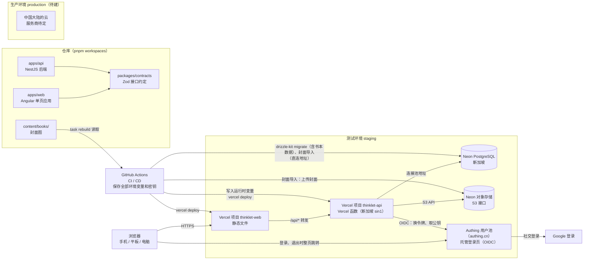

# thinklet 架构

thinklet 由一个 Angular 单页前端、一个 NestJS 后端、一个只放接口约定的共用包、一个 PostgreSQL 数据库和一个兼容 S3 的对象存储组成，家长通过第三方身份服务 Authing 登录。代码在一个 pnpm workspaces 仓库里。测试环境部署在 Vercel 和 Neon；生产环境放在中国大陆的云上，还没有建。

每个决定的理由和比较过的方案见 `.docs/decisions/`。

## 架构图



## 指标

| 指标     | 内容                                                                                                                                         |
| -------- | -------------------------------------------------------------------------------------------------------------------------------------------- |
| 规模     | 上线后第一年，同时在线不超过几百人；注册家长在几千人以内。一台小服务器加一个数据库就够                                                       |
| 可用性   | 99.5%，一个月累计停机不超过约 3.6 小时；发布生产环境时允许停几分钟                                                                           |
| 一致性   | 写入后立刻可见：家长分派的书本、孩子提交的答案，刷新后马上能看到。用一个关系型数据库和事务来保证                                             |
| 成本     | 测试环境和生产环境加起来每月不超过 200 元人民币。测试环境用免费套餐，每月 0 元                                                               |
| 维护能力 | 一个人配合 AI 代理开发和运维：组件尽量少，运维尽量自动化，优先用托管服务                                                                     |
| 安全     | 全站 HTTPS；密码加盐散列保存；孩子的个人信息只收集必需的部分，并加密保存；每个接口都检查家长只能访问自己的孩子；没有已知的高危或严重依赖漏洞 |
| 无障碍   | WCAG 2.1 AA                                                                                                                                  |
| 兼容性   | Chrome、Edge、Safari（含 iOS）、Firefox 的近两个大版本                                                                                       |

不设性能指标和资源指标。

## 组件

| 组件                 | 种类                     | 说明                                                                                                                            |
| -------------------- | ------------------------ | ------------------------------------------------------------------------------------------------------------------------------- |
| `apps/web`           | 网页前端                 | Angular 单页应用，在浏览器里渲染，一套自适应页面同时支持触屏和键鼠                                                              |
| `apps/api`           | 后端服务                 | NestJS，提供 `/api/*` 接口，包括健康检查 `GET /api/health`：在数据库上执行 `SELECT 1`，并确认存储桶能访问，两者都正常就返回 200 |
| `packages/contracts` | 共用代码包（不单独运行） | 前后端共用的接口约定：Zod schema 和由它推出的类型。只放接口约定，不放业务逻辑                                                   |
| PostgreSQL           | 数据库                   | 存全部业务数据                                                                                                                  |
| 对象存储             | 对象存储                 | 存书本和教学里的图片、音频等文件，代码只走 S3 接口                                                                              |
| Authing              | 第三方身份服务           | 家长的注册、密码登录、找回密码和社交登录，用它的托管登录页；本站只通过 OIDC 标准协议接入。家长的密码由 Authing 保存，本站不经手 |

题型怎么教、孩子怎么参与，等具体题型的 issue 在 design 步骤里再定，架构不为题型预先设计。

## 技术选择和决策点

| 方面                     | 选择                                                                                                                                                                                                                                                                                                                                                                                                                                                                                                                                                                                                         |
| ------------------------ | ------------------------------------------------------------------------------------------------------------------------------------------------------------------------------------------------------------------------------------------------------------------------------------------------------------------------------------------------------------------------------------------------------------------------------------------------------------------------------------------------------------------------------------------------------------------------------------------------------------ |
| 前端框架                 | Angular（TypeScript），独立组件加 signals，单页应用                                                                                                                                                                                                                                                                                                                                                                                                                                                                                                                                                          |
| 前端界面                 | Angular CDK 加 Tailwind CSS，界面自己设计                                                                                                                                                                                                                                                                                                                                                                                                                                                                                                                                                                    |
| 后端语言和运行时         | TypeScript，Node.js 26.13.1（最新 LTS），版本写死在 `.node-version` 和各 `package.json` 的 `engines` 里                                                                                                                                                                                                                                                                                                                                                                                                                                                                                                      |
| 后端框架                 | NestJS，底层用 Express                                                                                                                                                                                                                                                                                                                                                                                                                                                                                                                                                                                       |
| 接口约定                 | `packages/contracts` 里的 Zod schema；后端用它校验请求，前端用它推出类型。前端的 CSP 没有 `'unsafe-eval'`，而 Zod 4 建 schema 时会试探 `new Function`，CSP 会把它报成违规，所以 `packages/contracts` 用一个模块调用 `z.config({ jitless: true })`，两个应用都在任何 schema 之前导入它                                                                                                                                                                                                                                                                                                                        |
| 数据访问                 | Drizzle ORM 加 node-postgres 驱动                                                                                                                                                                                                                                                                                                                                                                                                                                                                                                                                                                            |
| 配置                     | `@nestjs/config` 加 Zod 校验：启动时校验全部环境变量，缺了或格式不对就拒绝启动，并说明是哪个                                                                                                                                                                                                                                                                                                                                                                                                                                                                                                                 |
| 日志                     | pino（nestjs-pino）输出一行一条的 JSON 日志，自动带请求编号，按遮挡列表遮掉密码和孩子的个人信息                                                                                                                                                                                                                                                                                                                                                                                                                                                                                                              |
| 安全响应头               | 不用库，自己写。前端的响应头写成一份清单，生成的 `vercel.json`、本机端到端测试的服务器和 `ng serve` 都用这一份；后端由一个全局中间件给每个响应加上自己的一份。CSP 的脚本只允许本站文件，不含 `'unsafe-eval'`，样式允许内联（Angular 运行时会插入 `<style>`）。各响应头的值见 `.docs/design/interfaces.md`                                                                                                                                                                                                                                                                                                    |
| 家长登录                 | Authing 的托管登录页，OIDC 授权码加 PKCE，流程在后端跑，用 openid-client。只走标准协议：Authing 的地址都从 issuer 的发现文档里读，换别的身份服务只改配置。跳到 Authing 和从 Authing 跳回来都是整页跳转，不用表单提交，因为前端 CSP 的 `form-action 'self'` 会挡住提交后跳到别的域名                                                                                                                                                                                                                                                                                                                          |
| 登录状态                 | 服务器无状态，不存会话。家长从 Authing 登录回来、孩子在本站登录后，后端都用同一把 ES256 私钥签发 JWT（jose），放在 HttpOnly、Secure、SameSite=Lax 的 cookie 里，家长和孩子各用一个 cookie。JWT 里只有一个编号和身份种类（家长 `parent` 或孩子 `child`），带密钥编号 `kid`，可以换密钥。同一个浏览器里家长和孩子可以同时登录，各退各的。Authing 返回的 ID 令牌另放在一个属性相同的 HttpOnly cookie 里，只在家长退出时用；请求只靠本站的 JWT 认证。登录过程中的 state、nonce 和 PKCE 也放在一个用同一把私钥签名、几分钟就过期的 cookie 里                                                                      |
| 孩子登录                 | 孩子的账号和密码由本站管理，不经过 Authing。孩子用三种方式登录：家庭码、账号和密码；家长给的一次性扫码登录链接；在记住了他的设备上点头像。密码用 Node 自带的 argon2id（`node:crypto`）加盐散列保存，散列字符串里带着参数，以后可以调高。家长的接口只认家长 cookie 里种类是 `parent` 的 JWT，孩子的接口只认孩子 cookie 里种类是 `child` 的 JWT；孩子的每个请求都查一次这个孩子还在不在，删掉孩子后下一个请求就进不来。暂不限制试密码的次数                                                                                                                                                                    |
| 扫码登录链接和记住的设备 | 两者都是后端生成的 32 字节随机令牌，数据库只存它的 SHA-256，带过期时间和用掉的时间。链接的令牌放在地址里，日志里遮掉；记住设备的令牌放在一个长期有效的 HttpOnly cookie 里，点头像时后端核对数据库。撤销设备、删除孩子就是删掉对应的行                                                                                                                                                                                                                                                                                                                                                                        |
| 孩子个人信息加密         | 孩子的昵称、账号和记住的设备名称，在后端用 Node 自带的 AES-256-GCM 按字段加密后再存，数据库和备份里只有密文；密文带密钥编号，以后能换密钥。账号另存一个 HMAC-SHA256 算出的查找值，用来在家庭内查重和登录时查找。加密和查找用的两把子密钥都由密钥 `CHILD_DATA_KEY` 用 HKDF 推出                                                                                                                                                                                                                                                                                                                               |
| 防跨站请求伪造           | cookie 用 SameSite=Lax；后端再用一个全局中间件检查每个非 GET、HEAD、OPTIONS 请求的 `Origin` 头，不是本站地址（`APP_ORIGIN`）或者没有就拒绝                                                                                                                                                                                                                                                                                                                                                                                                                                                                   |
| 退出登录                 | 家长退出：清掉 JWT cookie 和 ID 令牌 cookie，再整页跳到 Authing 发现文档里的退出地址（`end_session_endpoint`），带上 ID 令牌作为 `id_token_hint`，同时退出 Authing，退完回到本站的产品主页。孩子退出只清孩子的 JWT cookie，记住设备的 cookie 留着                                                                                                                                                                                                                                                                                                                                                            |
| 家庭和权限               | 家长和家庭是多对多的成员关系，每个家庭恰好一位管理员。一个家庭里的接口都在 `/api/families/{familyId}/...` 下，每个请求都查这位家长是不是这个家庭的成员，要管理员的再查角色。JWT 里不放家庭和角色，被移出家庭或交出管理员后马上生效。孩子属于一个家庭，家长管孩子的接口也在 `/api/families/{familyId}/...` 下，用同样的成员检查                                                                                                                                                                                                                                                                               |
| 数据库                   | PostgreSQL；开发和测试用的版本与 Neon 项目的主版本一致                                                                                                                                                                                                                                                                                                                                                                                                                                                                                                                                                       |
| 对象存储                 | S3 接口（`@aws-sdk/client-s3`）；测试环境用 Neon 对象存储，生产环境换成国内云的对象存储时只改配置                                                                                                                                                                                                                                                                                                                                                                                                                                                                                                            |
| 书本数据                 | 年级、学科和书本都存在 PostgreSQL 的表里，数据库是唯一的来源。书本表每本书一行：编号（小写字母、数字和连字符，也是它在仓库里的封面文件夹名）、书名、简介、年级、学科、状态（`active` 或 `inactive`，`inactive` 是下架）、替代的书（可空）。加书、改书、下架、删书和改年级、学科，都写成 `apps/api/drizzle/` 里一个新的 SQL 迁移脚本，走 PR，由 `drizzle-kit migrate` 在每个环境执行。有家庭获取过的书，数据库的外键不让删，删它的脚本执行失败。现在有一个脚本建好这几张表，写入 13 个年级、各学科和 30 本示例书；建生产环境的 issue 再写一个脚本删掉示例书                                                   |
| 封面导入                 | 封面图放在仓库里：`content/books/<书本编号>/cover.webp` 或 `cover.png`。后端里的一个命令，入口 `apps/api/src/rebuild.ts`，任务命令是 `rebuild`：用 NestJS 的应用上下文只启动数据库、对象存储和 `book` 模块的封面导入 service，只读这几项配置。它按书本表里的每本书找封面，按文件头检查是 WebP 或 PNG、不超过 300 KB、宽高比 3:4；有书没有封面或封面不合规格，就什么都不改，并说明是哪本书哪里不对。校验通过后把封面传到对象存储，内容没变的不重传，再把每张封面的 SHA-256 写进书本表。可以重复运行，结果一样。只处理书本表里有的书：仓库里有文件夹、表里没有的书，以及对象存储里已经删掉的书的封面，都不处理 |
| 封面图                   | 对象存储里和仓库一样按书本分文件夹，封面存成 `books/<书本编号>/cover.webp`（或 `.png`），换封面就覆盖。浏览器经过后端的接口取封面，要家长或孩子登录；后端从对象存储读出原样返回，前端 CSP 的 `img-src 'self'` 不用改。取封面的地址带上书本表里的封面散列：图片换了，地址跟着变；响应只让浏览器自己长期缓存，没换的图不再重取                                                                                                                                                                                                                                                                                 |
| 分批加载                 | 列表接口用游标分批：每批按固定的顺序取，响应带一个游标，也就是这批最后一项的排序位置，编码成一个不透明的字符串；下一批从它之后取，没有更多时不带游标。加载中途加了新书，也不会重复或漏掉                                                                                                                                                                                                                                                                                                                                                                                                                     |
| 包管理                   | pnpm workspaces；前端用 Angular CLI 构建，后端用 Nest CLI 构建                                                                                                                                                                                                                                                                                                                                                                                                                                                                                                                                               |
| 任务入口                 | Task（`Taskfile.yml`）。它作为仓库根目录的开发依赖由 pnpm 安装，开发机上只要先装好 Node.js、pnpm 和 Docker                                                                                                                                                                                                                                                                                                                                                                                                                                                                                                   |
| 云                       | 测试环境用 Vercel（Hobby 套餐）、Neon（免费套餐）和 Authing 中国版 authing.cn（免费用户池）；生产环境用中国大陆的云，服务商待定                                                                                                                                                                                                                                                                                                                                                                                                                                                                              |

## 各组件的库

版本只写在各 `package.json` 和 `pnpm-lock.yaml` 里。生成器自带的依赖不列出。

### apps/web

由 Angular CLI（`ng new`）生成。

| 库                    | 用途                                                                           | 许可证 |
| --------------------- | ------------------------------------------------------------------------------ | ------ |
| `@angular/cdk`        | 无样式的组件基础：焦点管理、键盘操作、弹层，符合无障碍要求                     | MIT    |
| `tailwindcss`         | 样式                                                                           | MIT    |
| `qrcode`              | 生成二维码的点阵，由组件画成页面里的 SVG（邀请家长的二维码和孩子的登录二维码） | MIT    |
| `@thinklet/contracts` | 接口约定（本仓库的包）                                                         | 本项目 |

### apps/api

由 Nest CLI（`nest new`）生成。

| 库                                 | 用途                                | 许可证     |
| ---------------------------------- | ----------------------------------- | ---------- |
| `@nestjs/config`                   | 读取环境变量                        | MIT        |
| `zod`                              | 校验配置和请求                      | MIT        |
| `drizzle-orm`                      | 数据访问                            | Apache-2.0 |
| `pg`                               | PostgreSQL 驱动                     | MIT        |
| `@aws-sdk/client-s3`               | 对象存储的 S3 客户端                | Apache-2.0 |
| `nestjs-pino`、`pino`、`pino-http` | JSON 日志                           | MIT        |
| `openid-client`                    | OIDC 客户端：跳转登录、换令牌、退出 | MIT        |
| `jose`                             | 签发和校验登录状态的 JWT            | MIT        |
| `cookie-parser`                    | 读请求里的 cookie                   | MIT        |
| `@thinklet/contracts`              | 接口约定（本仓库的包）              | 本项目     |

### packages/contracts

| 库    | 用途                   | 许可证 |
| ----- | ---------------------- | ------ |
| `zod` | 定义数据格式并推出类型 | MIT    |

### 仓库根目录的开发工具

| 工具                                                          | 用途                                                     | 许可证       |
| ------------------------------------------------------------- | -------------------------------------------------------- | ------------ |
| `typescript`                                                  | 类型检查                                                 | Apache-2.0   |
| `@go-task/cli`                                                | 任务入口 Task                                            | MIT          |
| `lefthook`                                                    | git hooks                                                | MIT          |
| `prettier`、`prettier-plugin-tailwindcss`                     | 格式化，给 Tailwind 的 class 排序                        | MIT          |
| `eslint`、`typescript-eslint`、`angular-eslint`               | 代码规范检查                                             | MIT          |
| `dependency-cruiser`                                          | 架构规则                                                 | MIT          |
| `jscpd`                                                       | 重复代码                                                 | MIT          |
| `@commitlint/cli`、`@commitlint/config-conventional`          | 提交信息格式                                             | MIT          |
| `markdownlint-cli2`                                           | Markdown 规则                                            | MIT          |
| `license-checker-rseidelsohn`                                 | 依赖的许可证                                             | BSD-3-Clause |
| `squawk-cli`                                                  | PostgreSQL 迁移脚本的安全检查                            | Apache-2.0   |
| `drizzle-kit`                                                 | 生成和执行数据库迁移                                     | Apache-2.0   |
| `jose`                                                        | `tools/bin/jwt-key.ts` 用它生成本机开发用的 JWT 签名密钥 | MIT          |
| `vitest`、`@vitest/browser-playwright`、`@vitest/coverage-v8` | 单元测试、组件测试、集成测试、覆盖率                     | MIT          |
| `@testing-library/angular`                                    | 组件测试里像用户一样操作页面                             | MIT          |
| `msw`                                                         | 组件测试里替换后端接口                                   | MIT          |
| `axe-core`、`@axe-core/playwright`                            | 无障碍检查                                               | MPL-2.0      |
| `@playwright/test`                                            | 端到端测试和冒烟测试                                     | Apache-2.0   |
| `testcontainers`、`@testcontainers/postgresql`                | 测试里临时起 PostgreSQL、SeaweedFS 和模拟的 OIDC 服务器  | MIT          |
| `supertest`                                                   | 集成测试里从 HTTP 入口调用后端                           | MIT          |

不通过 npm 安装的工具：gitleaks（MIT）、actionlint（MIT）、zizmor（MIT）、OSV-Scanner（Apache-2.0）、CodeQL（GitHub 提供）、ZAP（Apache-2.0）。容器镜像：`postgres`（PostgreSQL License）、`chrislusf/seaweedfs`（Apache-2.0）、`ghcr.io/navikt/mock-oauth2-server`（MIT）、Playwright 官方镜像（Apache-2.0）。

组件测试用的镜像由仓库里的 `apps/web/component-tests.Dockerfile` 在 Playwright 官方镜像上构建，装了开源的 Noto Sans CJK 字体（Debian 软件包 `fonts-noto-cjk`，SIL Open Font License 1.1），让截图里的中文有粗体字重。字体只在测试截图时用，不进产品。Dockerfile 里的基础镜像按标签和摘要固定版本，标签里的 Playwright 版本和 `playwright`、`@playwright/test` 两个包的版本一致。

`vercel` 和 `neonctl` 命令行不写进依赖清单，按固定版本临时运行（见决策 0017）：CD 用 `npm install --global vercel@<版本>` 安装，版本是部署工作流里的 `VERCEL_CLI_VERSION`，由 Renovate 更新；本机用 `npx vercel@<同一版本>` 和 `npx neonctl@<版本>`。

## 代码结构

```text
apps/
  web/                 Angular 前端
    src/app/
      core/            全局的东西：接口请求、拦截器、布局
      features/<业务>/  各业务的页面，按路由懒加载
      shared/ui/       只管显示、不调接口的通用组件
  api/                 NestJS 后端
    src/
      modules/<业务>/   每个业务一个 NestJS 模块
        *.controller.ts  收发和校验请求
        *.service.ts     业务规则
        *.repository.ts  用 Drizzle 读写数据库
      infrastructure/  数据库、对象存储、配置、日志、安全响应头、加密和密码散列的接入
      rebuild.ts       封面导入的命令入口
    drizzle/           迁移脚本，包括书本数据
packages/
  contracts/           Zod schema 和类型
content/books/         书本的封面图，每本书一个文件夹
tools/                 仓库自己的检查脚本（步骤检查、PR 标题检查、风险分级）
```

后端的业务模块：

| 模块     | 管什么                                                                                                   |
| -------- | -------------------------------------------------------------------------------------------------------- |
| `auth`   | 家长跳到 Authing 登录、接收回调、家长退出，签发和校验家长和孩子的 JWT，以及接口都用的登录检查            |
| `family` | 家长账号、同意记录、家庭、家庭码、时区、家长成员、加入申请，以及家庭内接口都用的成员和管理员检查         |
| `child`  | 孩子账号、孩子的密码、扫码登录链接、记住的设备、孩子登录和退出，以及孩子接口都用的「是不是这个孩子」检查 |
| `book`   | 年级、学科和书本目录，封面导入和取封面，家庭获取的书、分派给孩子的书，以及孩子看到的自己的书             |

规则，由 dependency-cruiser 检查：

- 后端只能从上往下调用：controller → service → repository。
- 后端模块之间只能调用对方导出的 service，不能碰对方的 repository。
- 后端各层都可以用 `infrastructure`，`infrastructure` 不引用 `modules`。
- 前端的 `features` 之间不互相引用；`shared` 不引用 `features`；`core` 不引用 `features`。
- `apps/web` 不引用 `apps/api`，反过来也一样；两边都只能通过 `packages/contracts` 共用代码。
- `packages/contracts` 不引用任何应用。
- 不允许循环依赖。

命名：文件名用小写加连字符；前端按 Angular 官方风格指南；后端按 NestJS 的约定（`<名称>.controller.ts`、`<名称>.service.ts`、`<名称>.repository.ts`、`<名称>.module.ts`）。

每一层的测试：

| 层                                 | 测试                                |
| ---------------------------------- | ----------------------------------- |
| 后端 service、`packages/contracts` | 单元测试                            |
| 后端 repository 和 controller      | 集成测试，连临时起的真实 PostgreSQL |
| 前端组件和页面                     | 组件测试                            |
| 用户能完整走一遍的流程             | 端到端测试                          |

## Deployment targets

| 名称       | 部署在哪里                                                                                     | 地址                                                                           | 用到的资源                                                                                                                                                                                                                                                                                                                                                                                                                                 |
| ---------- | ---------------------------------------------------------------------------------------------- | ------------------------------------------------------------------------------ | ------------------------------------------------------------------------------------------------------------------------------------------------------------------------------------------------------------------------------------------------------------------------------------------------------------------------------------------------------------------------------------------------------------------------------------------ |
| staging    | Vercel（前端静态文件和后端函数，函数区域 `sin1` 新加坡）和 Neon（`aws-ap-southeast-1` 新加坡） | 前端 `https://thinklet-web.vercel.app`，后端 `https://thinklet-api.vercel.app` | 新建：Vercel 项目 `thinklet-web` 和 `thinklet-api`（Hobby 套餐，每月 0 元）；Neon 项目 `thinklet-staging`，含一个 PostgreSQL 数据库和一个对象存储桶（免费套餐，每月 0 元）；Authing 中国版（authing.cn）的免费用户池 `好奇星球` 和其中一个 OIDC 应用，开 Google 登录，issuer 地址 `https://thinklet-staging.authing.cn/oidc`（每月 0 元）；Google Cloud 项目 `thinklet-staging` 里的一个 OAuth 客户端，给 Authing 的 Google 登录用（免费） |
| production | 中国大陆的云，服务商待定                                                                       | 无（待建）                                                                     | 待定，由建生产环境的 issue 回到 architect 步骤来定                                                                                                                                                                                                                                                                                                                                                                                         |

部署方式：

- **staging**：合并到 `main` 后，GitHub Actions 的 CD 任务按顺序做这些事：
  1. 用 Neon 的直连地址执行 `drizzle-kit migrate`，书本数据的改动也在这一步执行。
  2. 用同一个直连地址和对象存储的凭据执行 `task rebuild`，把 `content/books/` 里的封面传到对象存储，在书本表里记下封面的散列。
  3. 把后端运行时要用的环境变量从 GitHub 覆盖写进 Vercel 项目 `thinklet-api`，再用 `vercel build` 和 `vercel deploy --prebuilt --prod` 发布它。
  4. 按 `API_ORIGIN` 生成 `thinklet-web` 的 `vercel.json`，里面是把 `/api/*` 转发到后端的规则和前端的安全响应头，再同样发布 `thinklet-web`。`vercel.json` 读不了环境变量，所以它在发布时生成，不提交到仓库。
  5. 跑全部冒烟测试。

  手动部署（`/deploy staging`）也走同一个任务。Vercel 不连接 Git 集成，PR 没有预览环境。

- **production**：还没有部署任务。建生产环境的 issue 会加上一个手动启动的部署任务，之后才能用 `/deploy production`。那时生产环境的前端也要带上同一份安全响应头。

说明：

- Vercel 项目里的 “Production” 环境就是本项目的测试环境 staging。
- 测试环境只放测试数据，不放真实用户的个人信息。
- `*.vercel.app` 在中国大陆经常打不开，要在国内访问测试环境，需要用代理。
- Vercel Hobby 套餐只能用于个人、非商业用途；项目商用前要升级到 Pro。
- Neon 免费套餐的数据库闲置 5 分钟后自动暂停，下一个请求要等不到一秒来唤醒。
- 两个 Vercel 项目的根目录分别是 `apps/web` 和 `apps/api`，并允许构建读取根目录以外的文件，这样才能用到 `packages/contracts`。
- 两个 Vercel 项目用标准保护：预览部署和各次部署自己的地址要登录 Vercel 才能打开，正式地址 `thinklet-web.vercel.app`、`thinklet-api.vercel.app` 公开访问，冒烟测试和 `/api/*` 转发才能用。
- 登录的回调地址和退出后的返回地址都在前端的地址 `https://thinklet-web.vercel.app` 下，经过 `/api/*` 转发到后端，cookie 只属于前端的域名。
- Authing 的用户池在 authing.cn 上，服务器在腾讯云北京：家长的名字、邮箱和密码存在北京；新加坡的 Vercel 函数跨境访问 Authing，登录会慢一点；Google 登录要经过 Authing 北京的服务器连 Google，能不能稳定用要在测试环境上试。
- Authing 免费用户池每月最多 10 个活跃用户，只能连一个社交账号；每天最多发 50 封邮件（注册验证、找回密码），而且账号主人完成 Authing 的实名认证或企业认证后才能发。
- 生产环境在同一个 authing.cn 上另建用户池，测试环境的家长账号不带过去。

基础设施直接用 `vercel` 和 `neonctl` 命令行创建，不用基础设施即代码工具。scaffold 步骤执行前先用 `--help` 核对参数：

```text
npx neonctl@9.7.2 projects create --name thinklet-staging --region-id aws-ap-southeast-1 --pg-version 18 --org-id <组织 id> --no-secrets
npx neonctl@9.7.2 buckets create thinklet --project-id <id> --branch <branch>
npx neonctl@9.7.2 api /projects/<id>/branches/<branch>/storage                 # 存储地址和区域，写入 GitHub 变量 S3_ENDPOINT、S3_REGION
npx neonctl@9.7.2 credentials create --project-id <id> --branch <branch> --scope storage:read --scope storage:write --output json
                                                                                 # token_id、s3_secret_access_key 直接写入 GitHub 密钥 S3_ACCESS_KEY_ID、S3_SECRET_ACCESS_KEY，不显示
npx neonctl@9.7.2 connection-string <branch> --project-id <id> --pooled         # 输出直接写入 GitHub 密钥 DATABASE_URL，不显示
npx neonctl@9.7.2 connection-string <branch> --project-id <id>                  # 输出直接写入 GitHub 密钥 MIGRATION_DATABASE_URL，不显示
npx vercel@66.5.0 project create thinklet-web
npx vercel@66.5.0 project create thinklet-api
npx vercel@66.5.0 project update thinklet-web --root-directory apps/web --framework angular --source-files-outside-root-directory --yes
npx vercel@66.5.0 project update thinklet-api --root-directory apps/api --framework nestjs --source-files-outside-root-directory --yes
npx vercel@66.5.0 api /v9/projects/<项目名> -X PATCH --input <文件>             # 文件内容 {"ssoProtection":{"deploymentType":"prod_deployment_urls_and_all_previews"}}
```

Authing 和 Google Cloud 没有可用的命令行工具，由用户在网站上建。重建时按这几步：

1. 在 Google Cloud 建项目 `thinklet-staging`。在 Google Auth Platform 里配 OAuth 同意屏幕：应用名 好奇星球，受众选 External，保持 Testing 状态，只有加进 Test users 的账号能用 Google 登录。
2. 在 Authing 控制台 `https://console.authing.cn` 建用户池 好奇星球，子域名 `thinklet-staging`。账号主人完成个人实名认证，用户池才能发注册验证和找回密码的邮件。
3. 在用户池里建一个 Regular Web APP 类型的应用，名字 好奇星球，子域名同上。登录回调地址填 `<APP_ORIGIN>/api/auth/callback`，退出回调地址填 `<APP_ORIGIN>/`。
4. 应用的 Protocol Configuration：授权模式只勾 `authorization_code`，返回类型 `code`，ID 令牌签名 `RS256`，换令牌时的客户端验证用 `client_secret_post`，关掉 User informed consent page；ID 令牌 14 天过期。Authing 没有“必须用 PKCE”的开关：请求带了 PKCE 它就校验，本站后端每次都带。
5. 应用的 Login Control：Single Page Login，只开邮箱加密码登录，关掉邮箱验证码登录。
6. 允许注册：Security → General → Registration Security 里关掉 Prohibit Sign up。
7. 注册和登录协议：Branding → Universal Login → Functional configuration 里加一条协议，文字是「我已阅读并同意《用户协议》和《隐私政策》」，注册和登录时都显示，必须勾选，语言选中文。默认语言设成简体中文，关掉语言切换，因为协议的勾选框只在中文页面上出现。
8. Google 登录：在 Google Cloud 项目里建一个 Web application 类型的 OAuth 客户端，授权回调地址填 Authing 的 Google 连接页上给出的 Google 回调地址。在 Authing 里加社交连接 Google Web，填上这个客户端，Login Mode 选 Sign in & sign up，关掉 Bind to Existing Account：开着的话，有人先用别人的邮箱注册一个没验证过的密码账号，就能截下邮箱主人的 Google 登录。再把这个连接加进应用的社交登录。
9. 应用和用户池的图标用地球标志。
10. 用户把 client secret 存成不提交的文件，代理从文件读入 GitHub 密钥 `OIDC_CLIENT_SECRET`，不显示；issuer 地址和 client id 写入 GitHub 变量。
11. 代理读 issuer 的发现文档，确认有授权、换令牌、公钥、退出（`end_session_endpoint`）和用户信息五个地址，支持 S256 的 PKCE 和 `client_secret_post`，ID 令牌能用 RS256 签名。

## 数据迁移

| 数据                                                 | 方式                                                                                                                                                                             | 工具                                                                                                                                                                         | 在哪里执行                                                                                                                                                     |
| ---------------------------------------------------- | -------------------------------------------------------------------------------------------------------------------------------------------------------------------------------- | ---------------------------------------------------------------------------------------------------------------------------------------------------------------------------- | -------------------------------------------------------------------------------------------------------------------------------------------------------------- |
| PostgreSQL 的表结构和数据，包括年级、学科和书本      | 按版本逐个迁移：脚本放在 `apps/api/drizzle/`，从数据库当前的版本按顺序往后执行。只能往前迁移，写错了就再写一个新脚本；合并过的脚本不再修改。加书、改书、下架、删书也都写成新脚本 | Drizzle Kit：改了 TypeScript 里的表定义后由它生成 SQL 脚本，脚本可以手改；只改数据的脚本手写；执行过的脚本记在表 `__drizzle_migrations` 里；执行命令是 `drizzle-kit migrate` | 测试环境：CD 发布前执行。生产环境：它的部署任务里执行，允许停机。开发机和测试数据库：创建时执行                                                                |
| 封面：对象存储里的封面图，以及书本表里记下的封面散列 | 重建：完全由仓库里的 `content/books/` 生成，由封面导入同步，可以重复运行                                                                                                         | 本项目的封面导入命令，`task rebuild`                                                                                                                                         | 测试环境：CD 在迁移之后、发布后端之前执行。生产环境：在它的部署任务里，迁移之后执行。开发机：`task dev` 在迁移之后执行。测试：集成测试和端到端测试建好库后执行 |
| 对象存储里的其他文件                                 | 现在没有                                                                                                                                                                         | 等第一个存别的文件的 issue 再定                                                                                                                                              | —                                                                                                                                                              |

先迁移，再导入封面：新加的书先要在书本表里有一行，封面导入才知道要找它的封面。迁移之后、封面导入之前，新加的书还没有封面散列，书库怎么显示见 `.docs/design/`。家长在 Authing 里的账号不随本站迁移，本站只存 Authing 给的家长标识。

## 各组件怎么运行

| 组件       | 开发机                                                                                                                                  | CI                                        |
| ---------- | --------------------------------------------------------------------------------------------------------------------------------------- | ----------------------------------------- |
| `apps/web` | 本机直接运行 `ng serve`，把 `/api` 转给本机的后端，响应带上和测试环境一样的安全响应头                                                   | GitHub 的 Linux 机器上装 Node.js 直接运行 |
| `apps/api` | 本机直接运行 `nest start --watch`，常驻的 Node.js 进程                                                                                  | 同上                                      |
| PostgreSQL | 容器（官方 `postgres` 镜像）：开发时用 Docker Compose 起；测试时用 Testcontainers 临时起，测完删除                                      | Testcontainers                            |
| 对象存储   | SeaweedFS 容器模拟 S3：开发时用 Docker Compose 起；测试时用 Testcontainers 临时起                                                       | Testcontainers                            |
| Authing    | mock-oauth2-server 容器模拟 OIDC 服务器，打开它的登录页，填什么用户都能登录：开发时用 Docker Compose 起；测试时用 Testcontainers 临时起 | Testcontainers                            |

开发机要先装 Node.js 26.13.1、pnpm 和 Docker，并启动 Docker。后端在开发机和 CI 里以常驻进程运行，在测试环境里以 Vercel 函数运行；两种方式共用同一个 NestJS 应用模块，只是入口文件不同。

## 静态检查

| 检查         | 工具                                                                                                                                                            |
| ------------ | --------------------------------------------------------------------------------------------------------------------------------------------------------------- |
| 格式         | Prettier，含 `prettier-plugin-tailwindcss`                                                                                                                      |
| 代码规范     | ESLint、typescript-eslint（结合类型信息）、angular-eslint（含模板的无障碍规则），另加复杂度和长度上限：圈复杂度、嵌套深度、函数行数、参数个数                   |
| 类型检查     | 三个包都开 TypeScript 的 strict，各自跑 `tsc --noEmit`；前端开启严格模板检查                                                                                    |
| 编译和构建   | `ng build`、`nest build`                                                                                                                                        |
| 架构规则     | dependency-cruiser，按“代码结构”一节的规则检查                                                                                                                  |
| 重复代码     | jscpd，生成的迁移脚本和测试里的固定数据不算在内                                                                                                                 |
| 代码安全扫描 | CodeQL（公开仓库免费；仓库改成私有就要付费）                                                                                                                    |
| 依赖漏洞     | OSV-Scanner，有高危或严重漏洞时失败                                                                                                                             |
| 密钥泄漏     | gitleaks，加上 GitHub 的推送保护                                                                                                                                |
| 许可证       | license-checker-rseidelsohn：只查产品运行时用到的依赖，只允许宽松的开源许可证（MIT、Apache-2.0、BSD、ISC 等），允许的列表在根目录的 `license-allowlist.json` 里 |
| 部署配置     | actionlint 和 zizmor，检查 GitHub Actions 工作流；项目自己的镜像只有组件测试用的那一个，不部署，没有对 Dockerfile 的专门检查                                    |
| 迁移脚本     | Squawk，只查新增的脚本                                                                                                                                          |
| 提交信息     | commitlint，加上项目自己的规则：提交类型要和分支类型对得上，要带 issue 编号，最后一行要有 `Step:`。PR 标题用同一套规则检查                                      |
| 步骤检查     | `tools/` 里的 Node.js 脚本，对照各步骤能改的文件，由 commit-msg 钩子和 PR 的 CI 调用                                                                            |
| 文档格式     | Prettier、markdownlint-cli2，另加一条项目规则：`.docs/` 下每个文档都以 `Last changed: #<编号> (<日期>)` 结尾                                                    |
| AI 简化      | Claude Code 的 `/simplify`                                                                                                                                      |
| AI 评审      | Claude Code 的 `/code-review`，见“评审标准和风险规则”                                                                                                           |
| AI 安全评审  | Claude Code 的 `/security-review`                                                                                                                               |

git hooks 由 lefthook 管理，配置在 `lefthook.yml`。

## 测试

### 测试对象和工具

| 测试对象   | 工具                                                                               | 说明                                                                                                                                                                                                                                                                                                                                                                                                                                                                                                                                                                                                                                                                                                                                                                                                                                                                                      |
| ---------- | ---------------------------------------------------------------------------------- | ----------------------------------------------------------------------------------------------------------------------------------------------------------------------------------------------------------------------------------------------------------------------------------------------------------------------------------------------------------------------------------------------------------------------------------------------------------------------------------------------------------------------------------------------------------------------------------------------------------------------------------------------------------------------------------------------------------------------------------------------------------------------------------------------------------------------------------------------------------------------------------------- |
| 单元       | Vitest，三个包都用；覆盖率用 V8                                                    | —                                                                                                                                                                                                                                                                                                                                                                                                                                                                                                                                                                                                                                                                                                                                                                                                                                                                                         |
| 组件       | Vitest 浏览器模式（Playwright 驱动的 Chromium）、Angular Testing Library、MSW、axe | 每个状态都跑 axe；每个状态、每种屏幕尺寸（手机、平板、电脑）各截一张图做对比                                                                                                                                                                                                                                                                                                                                                                                                                                                                                                                                                                                                                                                                                                                                                                                                              |
| 集成       | Vitest、supertest、Testcontainers（PostgreSQL、SeaweedFS 和 mock-oauth2-server）   | 数据库从空库开始，用 `drizzle-kit migrate` 建表，迁移脚本同时写入示例书；封面导入对着临时的 PostgreSQL 和 SeaweedFS，用测试自己的固定封面                                                                                                                                                                                                                                                                                                                                                                                                                                                                                                                                                                                                                                                                                                                                                 |
| 端到端     | Playwright、axe                                                                    | 测试自己起前后端和容器里的数据库、存储、mock-oauth2-server，测完删除；建库时迁移脚本写入示例书，起好环境后对 `content/books/` 执行封面导入；前端用 HTTPS（`https://localhost:<随机端口>`），证书在测试开始时自签生成，只有设了 `TEST_IGNORE_HTTPS_ERRORS=true` 的端到端测试接受它，因为 WebKit 在 http 上不回传 `Secure` cookie；家长登录走 mock-oauth2-server 的登录页，测试起的这一个换成不加载外网资源的登录页；每个页面都跑 axe                                                                                                                                                                                                                                                                                                                                                                                                                                                       |
| 冒烟       | Playwright，打了 `@smoke` 标签的端到端测试                                         | 部署后直接对测试环境的地址跑。现在有十一条：首页能正常打开，显示标题和一句话介绍，没有控制台报错和 CSP 拦截；经过前端的 `/api` 转发调用 `GET /api/health` 返回 200；首页带着前端的安全响应头；经过前端转发的 `/api/health` 带着后端的安全响应头；`GET /api/auth/login` 返回 302，跳到身份提供方的授权地址，带 PKCE（S256）、state、nonce 和 client id，测试不跟着跳过去；没登录调用 `GET /api/me` 返回 401 `unauthenticated`；`Origin` 不是本站的 `POST /api/auth/logout` 返回 403 `bad_origin`；带本站 `Origin` 的 `POST /api/auth/logout` 经过前端转发返回 200 和退出地址；孩子登录页 `/child` 能正常打开，显示「孩子登录」，没有控制台报错和 CSP 拦截；经过前端转发、不带设备凭证调用 `GET /api/child-auth/remembered` 返回 200 和空列表；没登录取一本示例书的封面（带它的散列）返回 401 `unauthenticated`，不返回图片。十一条都只读、不改数据，不登录，都打上 `@production-safe` 标签 |
| 安全       | 安全测试用例用集成测试的工具来写；另加 ZAP 基线扫描                                | ZAP 在 CI 里扫测试临时起的环境，有中危及以上的告警就失败；确实不用修的告警，在扫描的配置里逐条写明理由后忽略                                                                                                                                                                                                                                                                                                                                                                                                                                                                                                                                                                                                                                                                                                                                                                              |
| 迁移       | Vitest、Testcontainers                                                             | 每个有新迁移脚本的 issue 都要写：把临时库停在上一个版本，用原始 SQL 塞入旧格式的数据，再执行 `drizzle-kit migrate`，检查数据都在、格式正确                                                                                                                                                                                                                                                                                                                                                                                                                                                                                                                                                                                                                                                                                                                                                |
| 契约       | 不做                                                                               | 前后端在同一个仓库，由同一个 CD 任务一起发布                                                                                                                                                                                                                                                                                                                                                                                                                                                                                                                                                                                                                                                                                                                                                                                                                                              |
| 性能和负载 | 不做                                                                               | 没有性能指标；`/perf-test` 暂时没有可跑的东西                                                                                                                                                                                                                                                                                                                                                                                                                                                                                                                                                                                                                                                                                                                                                                                                                                             |

- **覆盖率**：单元测试和组件测试的语句覆盖率下限是 80%，后端、前端和共用包各自计算，生成的代码和配置文件不算；低于下限时 CI 失败。
- **截图基准图**：只在固定的 Linux 渲染环境里生成和比较：开发机和 CI 都用 `apps/web/component-tests.Dockerfile` 构建的镜像来跑组件测试和 `test-component-update`。这个镜像在 Playwright 官方镜像上装了 Noto Sans CJK 字体，中文粗体才有真的粗体字重。字体变了以后，要用 `test-component-update` 重新生成全部基准图。
- **真的 Authing 不测**：Authing 托管页上的注册、密码登录、Google 登录和找回密码，在测试环境上也不测；本站这边的每一步（跳转、回调、签发 JWT、退出）都由集成和端到端测试对着 mock-oauth2-server 覆盖。

### 指标由什么检查

| 指标或要求                   | 测试对象     | 怎么检查                                                                                                                                                                                                                                                                                                                                                                                                                                                                                                                                         |
| ---------------------------- | ------------ | ------------------------------------------------------------------------------------------------------------------------------------------------------------------------------------------------------------------------------------------------------------------------------------------------------------------------------------------------------------------------------------------------------------------------------------------------------------------------------------------------------------------------------------------------ |
| 写入后立刻可见               | 集成         | 写入后马上读，能读到新数据                                                                                                                                                                                                                                                                                                                                                                                                                                                                                                                       |
| 安全                         | 安全、端到端 | 安全测试用例：没登录不能访问；JWT 被篡改、过期或签名不对时不能访问；不是家庭成员的家长改了 URL 里的家庭编号也看不到、改不了这个家庭；不是管理员做不了管理员的操作；`Origin` 不是本站的改数据请求被拒绝；恶意输入不会被执行。孩子的 JWT 打不开家长的接口，家长的 JWT 打不开孩子的接口；家长看不到、改不了别的家庭的孩子；扫码登录链接过期或用过后不能再用；被撤销的设备、删掉的孩子不能再登录；数据库里孩子的昵称、账号和设备名称是密文。端到端测试检查首页和 `/api/health` 带着安全响应头。另有 ZAP 扫描，以及静态检查里的 CodeQL 和 OSV-Scanner |
| WCAG 2.1 AA                  | 组件、端到端 | 组件的每个状态、端到端的每个页面都跑 axe                                                                                                                                                                                                                                                                                                                                                                                                                                                                                                         |
| 主流浏览器近两个大版本       | 端到端       | PR 上只跑 Chromium；发版前在 Chromium、Firefox、WebKit 上都跑。Firefox、WebKit 和模拟手机每次只跑一条测试，免得开发机的内存和 CPU 不够                                                                                                                                                                                                                                                                                                                                                                                                           |
| 手机、平板、电脑三种屏幕     | 组件         | 每种尺寸各截一张图                                                                                                                                                                                                                                                                                                                                                                                                                                                                                                                               |
| 触屏和键鼠两种操作           | 组件、端到端 | 组件测试用键盘操作；发版前的端到端测试再加上模拟手机的触屏操作                                                                                                                                                                                                                                                                                                                                                                                                                                                                                   |
| 规模、可用性、成本、维护能力 | —            | 测试检查不了，靠架构本身保证；部署后的冒烟测试确认首页、后端、数据库和存储都能访问                                                                                                                                                                                                                                                                                                                                                                                                                                                               |

### 运行时机

| 检查或测试                                               | 提交前          | 推送前       | 开 PR 前       | PR CI          | 合并后 | 部署到测试环境后 | 发版前               |
| -------------------------------------------------------- | --------------- | ------------ | -------------- | -------------- | ------ | ---------------- | -------------------- |
| 格式、代码规范、gitleaks、actionlint 和 zizmor、文档格式 | 只查暂存的文件  |              |                | ✓              |        |                  |                      |
| 提交信息、步骤检查                                       | commit-msg 钩子 |              |                | ✓              |        |                  |                      |
| 类型检查、编译和构建                                     |                 | ✓            |                | ✓              | ✓      |                  |                      |
| 架构规则、重复代码、迁移脚本检查                         |                 |              | ✓              | ✓              |        |                  |                      |
| 代码安全扫描、依赖漏洞、许可证                           |                 |              |                | ✓              |        |                  | ✓                    |
| AI 简化、AI 评审、AI 安全评审                            |                 |              | ✓              |                |        |                  |                      |
| 单元                                                     |                 | 只跑受影响的 | ✓              | ✓              | ✓      |                  |                      |
| 组件、集成（含安全用例）                                 |                 |              | ✓              | ✓              | ✓      |                  |                      |
| 端到端                                                   |                 |              | 只跑受影响的   | ✓（Chromium）  | ✓      |                  | 三种浏览器加手机模拟 |
| 迁移                                                     |                 |              | 改了迁移脚本时 | 改了迁移脚本时 |        |                  | ✓                    |
| ZAP 基线扫描                                             |                 |              |                | ✓              |        |                  | ✓                    |
| 冒烟                                                     |                 |              |                |                |        | 全部             |                      |

PR CI 这一列里的每项都是必过检查。用路径过滤跳过的任务也报告成功：工作流总是会运行，由任务里的 `if:` 判断有没有要做的事。

### 本机运行的范围

CI 始终全部运行。本机在推送前和开 PR 前运行时，单元、组件、集成测试全部运行；端到端测试只跑经过改动页面或接口的流程，代理判断漏掉的流程要到 CI 才会发现。

GitHub 上的公开仓库在标准机器上跑 CI 不限分钟数。如果仓库以后改成私有，每月只有 2000 分钟。

## 评审标准和风险规则

### AI 评审

- 开 PR 前，代理在本机跑 `/code-review`，级别是 medium，评审发现的每个问题都要改掉，或者写明理由才能关掉。CI 里不跑 AI 评审。
- `/simplify` 和 `/security-review` 也都在开 PR 前于本机运行。
- 评审意见用中文。

### REVIEW.md 的内容

1. **分层各管各的事**：controller 只收发和校验请求，业务规则都在 service，repository 只读写数据；前端 `shared/ui` 的组件只管显示，不调接口。
2. **保护孩子的个人信息**：每个接口都检查家长只能访问自己的孩子；孩子的个人信息只收集必需的字段，并加密保存；不写进日志，要列进日志的遮挡列表；不传给第三方。
3. **接口只有一份定义**：每个请求和响应都用 `packages/contracts` 里的 Zod schema 校验，前后端都不再手写一份重复的类型。
4. **不依赖 Vercel 和 Neon 的专有接口**：只用标准的 PostgreSQL、S3 接口和环境变量；Vercel 相关的东西只放在部署配置和一个入口文件里。
5. **界面照顾孩子和无障碍**：界面文字是简体中文，语气适合孩子的年龄；可点的元素至少 44×44 像素；用触屏和只用键盘都能操作；颜色和间距只用 Tailwind 主题里定义的值。
6. **测试写在最低能测到的一层**：边界情况在单元测试里测，端到端只测主要流程和最重要的失败流程；只转发调用、没有逻辑的方法不写测试；测试之间不互相依赖。
7. **注释只说现在的代码**：注释用英文，只讲代码做什么、为什么这样设计；不写修改历史。
8. **不写死环境和个人信息**：地址、密钥、账号、地区这类信息都从配置里读。

### 风险规则

规则写在仓库根目录的 `risk-rules.yml` 里。CI 任务 `risk` 从目标分支读取这些规则，给 PR 打上 `risk:low`、`risk:medium` 或 `risk:high`：只要改到高风险路径就是高风险；改动全在低风险路径里才是低风险；其余都是中风险；发版 PR 一律是高风险。同时属于两边的，按高风险算。

高风险：

```text
.github/**
lefthook.yml
.claude/**
AGENTS.md
CLAUDE.md
REVIEW.md
risk-rules.yml
Taskfile.yml
eslint.config.*
.prettierrc*
.prettierignore
.markdownlint-cli2.*
.dependency-cruiser.*
.jscpd.json
commitlint.config.*
.gitleaks.toml
.squawk.toml
**/vitest.config.*
**/playwright.config.*
**/tsconfig*.json
license-allowlist.json
tools/**
**/__screenshots__/**
**/auth/**
apps/api/src/modules/family/**
apps/api/src/modules/child/**
apps/api/src/modules/book/**
apps/api/drizzle/**
**/*.sql
**/.env*
**/vercel.json
apps/api/src/infrastructure/**
```

低风险：

```text
.docs/**
**/*.md
**/*.txt
LICENSE
```

存家长和孩子数据的后端模块都算高风险：`auth` 由 `**/auth/**` 覆盖，`family`、`child`、`book` 单独列出。以后新加这类模块的 issue，要把它的路径加进高风险。书本数据写在迁移脚本里，所以改书本的 PR 也是高风险。

## 依赖更新

- **工具**：Renovate，用 Mend 免费托管的 GitHub App，只装到这个仓库，大约每 4 小时检查一次。
- **配置**：
  - 用 `config:best-practices`；GitHub Actions 和 Docker 镜像都按摘要固定版本。
  - 新版本发布满 3 天才开 PR。
  - Angular、NestJS 这类一起发版的包合成一个 PR。
  - 每周一早上开 PR，安全更新随时开。
  - 大版本升级要先在依赖面板里勾选才开。
  - Node.js 只升到 LTS 版本。
- **PR 标题**：产品运行时用到的（各包的 `dependencies` 和 Node.js 版本）用 `fix(deps)`；其余（`devDependencies`、GitHub Actions、开发用的镜像、pnpm）用 `chore(deps)`。
- **合并**：不自动合并，由 `/issue next` 按风险规则来合并。CI 失败的更新 PR 转成一个 `maintenance` issue。
- **Dependabot**：只开漏洞和恶意包告警，Renovate 读这些告警来开安全更新 PR；Dependabot 自己的版本更新和安全更新都关掉。

## 平台设置、App、环境变量和密钥

### GitHub 仓库

- **仓库**：GitHub 免费账号上的公开仓库 `juanchaopan/thinklet`，默认分支 `main`。
- **合并方式**：只允许 squash 合并。
- **`main` 的规则**：
  - 只能通过 PR 合并。
  - 必过检查要全部通过：步骤检查、PR 标题检查、`risk-gate`，以及 PR CI 时机的每项检查和测试。
  - 分支必须包含最新的 `main`。
  - 评论线程要全部解决。
  - 禁止强推和删除。
  - 管理员也不能绕过这些规则。
- **人的批准**：靠 `risk-gate` 和 `human-reviewed` 标签，不设“必须有几人批准”，因为 GitHub 不让 PR 作者批准自己的 PR。
  - `risk-gate` 在标签的加上和去掉时都会重新运行。
  - 新的提交推上来时，另一个任务会去掉这个标签。
  - 这几个任务按 `pull_request` 事件运行，用的是 PR 自己带的工作流文件，PR 能把它们改掉。所以 `risk-gate` 通过不是最终的保证：代理合并前，自己用目标分支的脚本和 `risk-rules.yml` 算出风险等级，中风险和高风险的 PR 还要确认 `human-reviewed` 是在最后一次提交之后加上的。
- **远程 issue 分支**：合并后永久保留；本地分支合并后删除。
- **App**：只装 Renovate（Mend）。不装 Claude App，因为 AI 评审只在本机跑；也不装 Vercel App，因为发布只走 GitHub Actions。
- **GitHub 的安全功能**：Dependabot 告警、推送保护和 CodeQL 都打开。
- **`staging` 环境**：只允许 `main` 分支上的工作流使用；手动部署只接受已经在 `main` 上的提交。

### 环境变量和密钥

测试环境用到的全部环境变量和密钥只在 GitHub 的 `staging` 环境里维护。公开仓库能按环境保存密钥，所以名称里不带环境。

| 名称                                       | 用途                                                                                                                            | 类型 | 谁用                       | 值从哪来                                                               |
| ------------------------------------------ | ------------------------------------------------------------------------------------------------------------------------------- | ---- | -------------------------- | ---------------------------------------------------------------------- |
| `VERCEL_TOKEN`                             | 用 vercel 命令行发布、写入后端的运行时变量                                                                                      | 密钥 | CD                         | 用户在 Vercel 网站上生成，存成不提交的文件，由代理从文件读入 GitHub    |
| `VERCEL_ORG_ID`                            | 指定 Vercel 账号                                                                                                                | 变量 | CD                         | 建 Vercel 项目时产生                                                   |
| `VERCEL_WEB_PROJECT_ID`                    | 指定前端的 Vercel 项目                                                                                                          | 变量 | CD                         | 建 Vercel 项目时产生                                                   |
| `VERCEL_API_PROJECT_ID`                    | 指定后端的 Vercel 项目                                                                                                          | 变量 | CD                         | 建 Vercel 项目时产生                                                   |
| `MIGRATION_DATABASE_URL`                   | 执行 `drizzle-kit migrate` 和封面导入（Neon 的直连地址）                                                                        | 密钥 | CD                         | 建 Neon 项目时产生                                                     |
| `STAGING_URL`                              | 冒烟测试访问的地址                                                                                                              | 变量 | CD                         | 建 Vercel 前端项目时产生                                               |
| `API_ORIGIN`                               | 生成前端的 `vercel.json`，把 `/api/*` 转发到这个地址                                                                            | 变量 | CD                         | 建 Vercel 后端项目时产生                                               |
| `DATABASE_URL`                             | 后端连数据库（Neon 的连接池地址）                                                                                               | 密钥 | 后端运行时                 | 建 Neon 项目时产生                                                     |
| `S3_ENDPOINT`、`S3_REGION`、`S3_BUCKET`    | 连对象存储                                                                                                                      | 变量 | 后端运行时、CD（封面导入） | 建 Neon 存储桶时产生                                                   |
| `S3_FORCE_PATH_STYLE`                      | 对象存储用路径式地址（`<endpoint>/<桶名>/<文件>`）。Neon 和 SeaweedFS 只支持路径式；只支持 `<桶名>.<endpoint>` 的云设成 `false` | 变量 | 后端运行时、CD（封面导入） | 测试环境固定为 `true`                                                  |
| `S3_ACCESS_KEY_ID`、`S3_SECRET_ACCESS_KEY` | 对象存储的访问凭据                                                                                                              | 密钥 | 后端运行时、CD（封面导入） | 建 Neon 存储桶时产生                                                   |
| `OIDC_ISSUER`                              | Authing 应用的 issuer 地址，后端从它的发现文档读出其余地址                                                                      | 变量 | 后端运行时                 | 建 Authing 应用时产生                                                  |
| `OIDC_CLIENT_ID`                           | Authing 应用的 client id                                                                                                        | 变量 | 后端运行时                 | 建 Authing 应用时产生                                                  |
| `OIDC_CLIENT_SECRET`                       | 后端换令牌时证明自己的身份                                                                                                      | 密钥 | 后端运行时                 | 用户从 Authing 控制台存成不提交的文件，由代理从文件读入 GitHub         |
| `APP_ORIGIN`                               | 本站地址，用来拼登录回调地址和退出后的返回地址，并校验请求的 `Origin`                                                           | 变量 | 后端运行时                 | 建 Vercel 前端项目时产生，测试环境是 `https://thinklet-web.vercel.app` |
| `JWT_SIGNING_KEY`                          | 签发登录状态 JWT 的 ES256 私钥（JWK 格式），公钥由它算出                                                                        | 密钥 | 后端运行时                 | 代理随机生成，直接写进 GitHub，不显示                                  |
| `CHILD_DATA_KEY`                           | 加密孩子个人信息、算账号查找值的主密钥（32 字节随机数），两把子密钥由它推出                                                     | 密钥 | 后端运行时                 | 代理随机生成，直接写进 GitHub，不显示                                  |
| `PORT`                                     | 后端以常驻进程运行时监听的端口，可选，默认 3000                                                                                 | 变量 | 开发机和常驻进程           | 只写在 `.env.example`；GitHub 和 Vercel 都不放，Vercel 函数用不到      |

- “后端运行时”那几项，后端作为 Vercel 函数运行时要从 Vercel 项目 `thinklet-api` 里读。CD 每次发布 `thinklet-api` 前，用 `vercel env add <名称> --environment production --force` 从标准输入把它们覆盖写进去，值不出现在命令行和日志里。
- Vercel 上的这一份只是副本。改值要在 GitHub 里改，再重新部署一次（`/deploy staging`）才生效；直接在 Vercel 网站上改的，下次发布会被覆盖。
- Vercel 项目 `thinklet-web` 不放环境变量。
- 由建资源产生的值，直接从命令输出写进 GitHub，从不显示在对话里。
- 换 `JWT_SIGNING_KEY` 后，用旧密钥签发的 JWT 全部失效，所有家长要重新登录。
- 不需要额外密钥的：去掉 `human-reviewed` 标签的任务用 GitHub 自带的令牌；Renovate 用 Mend 的 App；AI 评审只在本机跑。
- Google 登录的 client secret 只填在 Authing 里，本站不用。
- 测试用的外部账号：现在没有。
- `CHILD_DATA_KEY` 丢了，孩子的昵称、账号和设备名称就再也读不出来；换它要先用新密钥把全部密文重新加密一遍，旧密钥留到重新加密完。
- 冒烟测试读 `TEST_OIDC_ISSUER` 和 `TEST_OIDC_CLIENT_ID`，CD 把 `OIDC_ISSUER`、`OIDC_CLIENT_ID` 的值传进去，用来核对登录跳转的授权地址和 client id；不设时只核对跳转的格式。名字和后端用的分开，免得本机的 `.env` 决定部署的站点按什么核对。
- 开发机和测试用的值写在不提交的 `.env` 文件里，示例写在提交的 `.env.example` 里；`OIDC_*` 指向本机的 mock-oauth2-server，`JWT_SIGNING_KEY`、`CHILD_DATA_KEY` 用测试专用的密钥。

Last changed: #9 (2026-11-24)
