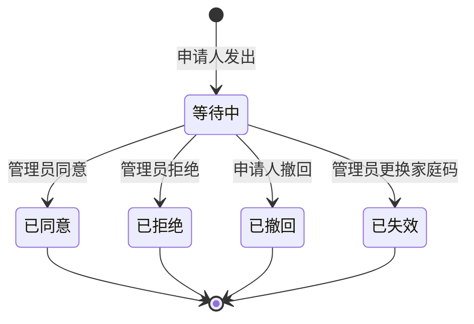

# 规则

## 登录和登录状态

- 「登录 / 注册」跳到 Authing 的托管登录页；登录成功后回到跳走前要去的页面，没有就回到 `/`。
- 没登录或登录过期时访问 `/` 以外的页面，回到产品主页；之后登录成功，回到原来要去的页面。要回去的地址只接受本站以 `/` 开头的路径，不接受 `//` 开头或别的网站的地址。
- 登录状态是后端签发的 JWT，放在 cookie 里，有效期 7 天；剩下不到 3.5 天时，下一个请求的响应换发一个新的 7 天。所以每周都用的家长不用重新登录，超过 7 天没用要重新登录。
- Authing 返回的 ID 令牌放在另一个 cookie 里，跟着登录状态一起续期，只在退出时用。
- 登录过程中的临时信息（state、nonce、PKCE）放在另一个 cookie 里，10 分钟后过期，回调用完就清掉。
- 退出登录：清掉本站的 cookie，再带着 ID 令牌跳到 Authing 的退出地址，同时退出 Authing，退完回到产品主页。
- 从 Authing 回来时出错（用户取消、state 对不上、Authing 没有回应），回到产品主页，盖一个“登录没有成功”的弹框，可以再试一次。

## 家长账号

- 家长由 Authing 的 issuer 加 `sub` 认出。第一次登录时建立家长记录。
- 名字只在建立家长记录时从 Authing 取一次：用 Authing 给的名字，没有就用邮箱 @ 前面的部分，超过 20 个字的截到 20 个字。之后只用本站存的名字，家长在个人设置页上改。
- 邮箱每次登录时从 Authing 更新；Authing 没给邮箱时为空，界面上显示“—”。
- 同一个家庭的家长互相能看到名字和邮箱；管理员在新成员页上能看到申请人的名字和邮箱。

## 协议同意

- 协议在 Authing 托管页上勾选，注册和每次登录都要勾。
- 每次登录回到本站时，记下同意的时间和协议版本，覆盖上一次的记录。协议版本写在代码里，现在是 `2026-11-21`。

## 个人设置

- 点导航上自己的名字（手机和平板上是顶栏右边的头像）进入个人设置页 `/profile`。
- 页面上有名字（铅笔图标改）、邮箱（只显示）和「退出登录」。

| 字段 | 规则                                       | 出错时的提示               |
| ---- | ------------------------------------------ | -------------------------- |
| 名字 | 必填；去掉前后空格后 1–20 个字，什么字都行 | 请填名字；名字最多 20 个字 |

## 当前家庭

- 一位家长可以属于多个家庭，没有上限；一个家庭的家长人数也没有上限。
- 登录后进入这台浏览器上次用的家庭（记在浏览器里）；没有记录或已经不是那个家庭的成员时，进入最早加入的家庭。
- 不属于任何家庭时进入开始页 `/start`。
- 在导航里切换家庭后，记下新的当前家庭。

## 家庭

| 字段     | 规则                                                                                                                                                                                          | 出错时的提示                       |
| -------- | --------------------------------------------------------------------------------------------------------------------------------------------------------------------------------------------- | ---------------------------------- |
| 家庭名称 | 必填；去掉前后空格后 1–20 个字，什么字都行。创建时预填「<家长名字>的家」，超过 20 个字时不预填                                                                                                | 请填家庭名称；家庭名称最多 20 个字 |
| 时区     | IANA 时区名。创建时默认是当前位置的时区（浏览器报告的时区），可以改。选择时区的列表包括全部时区，按当前的 UTC 偏移排序，每项显示中文城市名和偏移（如“上海（UTC+8）”），可以按城市名或偏移搜索 | 请选择时区                         |
| 家庭码   | 6 位，从 `23456789ABCDEFGHJKMNPQRSTUVWXYZ`（去掉 0、O、1、I、L）里随机取，全平台不重复；碰上重复就重新取，最多 5 次                                                                           | —                                  |

- 管理员的当前位置和家庭时区不同时，家庭管理页的时区下面显示“当前位置：<时区>（<偏移>）”和「改成这个」；两者相同时不显示。普通家长不显示。
- 更换家庭码：生成新码，旧码马上作废；用旧码发出、还在等待的申请一起变成“已失效”；旧的邀请链接和二维码也一起失效。

## 分享家庭码

家庭管理页上，家庭码旁边一行三个图标，鼠标停留时显示说明，读屏软件读出同样的说明：

| 图标   | 说明       | 点了之后                                                                                                                             |
| ------ | ---------- | ------------------------------------------------------------------------------------------------------------------------------------ |
| 复制   | 复制家庭码 | 复制家庭码，提示“已复制”                                                                                                             |
| 分享   | 分享邀请   | 打开系统的分享面板，分享邀请文字；浏览器不支持分享面板时（比如电脑上的部分浏览器、微信里打开的网页），改成复制邀请文字，提示“已复制” |
| 二维码 | 显示二维码 | 弹框：标题“扫码加入「<家庭名称>」”，中间是邀请链接的二维码，下面一行“也可以输入家庭码 <家庭码>”                                      |

- 邀请链接是 `<本站地址>/join/<家庭码>`。打开后弹出申请加入的框，家庭码已经填好。
- 邀请文字：“<家长名字>邀请你加入「<家庭名称>」，在好奇星球上输入家庭码 <家庭码>，或者打开这个链接：<邀请链接>”。

## 输入家庭码

- 6 个格子，一格一个字符；小写字母自动转成大写，允许字符以外的输入不收；粘贴时按顺序填满；输完一格跳到下一格，删除时回到上一格。
- 6 格填满就去查这个码：找到就显示家庭名称和管理员名字，让申请人确认后再发申请；没找到就提示“没有这个家庭码”。

## 加入申请

- 同一位家长对同一个家庭同时只能有一个等待中的申请；已经是成员的不能申请。
- 申请没有期限，只在同意、拒绝、撤回或更换家庭码时结束。
- 同意后申请人成为这个家庭的普通家长。
- 申请人在开始页看到自己等待中、被拒绝和已失效的申请；被拒绝和已失效的点「知道了」清掉。被同意的不列出，申请人直接有了这个家庭。
- 管理员在新成员页看到等待中的申请（申请人的名字、邮箱、时间）和处理过的申请（已同意、已拒绝、已失效，带处理的日期）；处理过的点「知道了」清掉。撤回的不列出。
- 「知道了」只清掉点的那一方看到的记录：申请人和管理员各清各的；清掉的只是不再显示。申请记录一直保存。

## 通知

- 不发邮件，也不推送。有新申请时，管理员在菜单的「新成员」上看到红点和数量。
- 数量是当前家庭等待中的申请数；页面打开、切换家庭和浏览器窗口重新回到前台时更新。

## 权限

| 操作                                   | 不是成员 | 普通家长 | 管理员                     |
| -------------------------------------- | -------- | -------- | -------------------------- |
| 看家庭的名称、时区、家庭码、成员和邮箱 | 不能     | 能       | 能                         |
| 改名称、时区                           | 不能     | 不能     | 能                         |
| 更换家庭码                             | 不能     | 不能     | 能                         |
| 看新成员页、同意或拒绝申请             | 不能     | 不能     | 能                         |
| 把别的家长设为管理员                   | 不能     | 不能     | 能                         |
| 移出别的家长                           | 不能     | 不能     | 能                         |
| 自己离开家庭                           | —        | 能       | 不能（先把管理员设给别人） |

- 每位家长都能改自己的名字，谁都不能改别人的名字。
- 每个家庭恰好一位管理员。创建家庭的人是管理员；管理员把管理员设给另一位家长后，自己变成普通家长。
- 界面上不显示当前家长没有权限的按钮和图标；接口照样每次检查。
- 不是成员时，这个家庭的任何接口都当作家庭不存在。
- 被移出或离开当前家庭后，进入另一个家庭，没有就回到开始页；自己离开的提示“你已离开 <家庭名称>”。

## 日期和时间

- 今年的日期写“11月18日”，往年的写“2025年11月18日”；带时间时加 24 小时制的时间，如“11月18日 09:12”。
- 时间按家庭时区显示：家庭里的页面用这个家庭的时区；开始页上申请人的申请，用申请的那个家庭的时区。

## 同时操作

| 情况                                                     | 结果                                                       |
| -------------------------------------------------------- | ---------------------------------------------------------- |
| 管理员在两处同时改名称或时区                             | 后保存的覆盖先保存的                                       |
| 处理一个已经被撤回、处理过或作废的申请                   | 拒绝，提示“这个申请已经失效了”，刷新列表                   |
| 已经不是管理员时做管理员的操作（比如另一个标签页刚交出） | 拒绝，提示“你已不是管理员”，刷新页面，修改的图标和按钮消失 |
| 移出一位已经不在家庭里的家长                             | 拒绝，提示“这位家长已经不在家庭里了”，刷新成员列表         |
| 已经被移出时打开这个家庭的页面或做操作                   | 显示“找不到这个家庭”                                       |
| 撤回一个刚被处理过的申请                                 | 拒绝，提示“这个申请已经处理过了”，刷新列表                 |

## 出错时的显示

| 情况                       | 显示                                                                                                                               | 数据                 |
| -------------------------- | ---------------------------------------------------------------------------------------------------------------------------------- | -------------------- |
| 输入不对                   | 输入框下面红字说明，输入框抖一下；提交前就检查                                                                                     | 不提交               |
| 业务规则不允许             | 在操作的地方或顶部提示条说明原因：没有这个家庭码；你已经是这个家庭的成员；你已经申请过了，等管理员处理；先把管理员设给别人才能离开 | 不变                 |
| 没登录或登录过期           | 回到产品主页，重新登录后回到原来的页面                                                                                             | 不变                 |
| 不是管理员                 | 界面上不显示这些按钮；直接调接口被拒绝                                                                                             | 不变                 |
| 不是成员或家庭不存在       | 内容区显示“找不到这个家庭”，可以回到自己的家庭                                                                                     | 不变                 |
| 从 Authing 回来时出错      | 产品主页上盖“登录没有成功”的弹框                                                                                                   | 不变                 |
| 操作时服务器出错或没有回应 | 顶部提示条“出了点问题，请稍后再试”                                                                                                 | 不变，已填的内容不丢 |
| 整页打开时服务器出错       | 内容区显示“页面没能打开”，带错误编号和「重试」                                                                                     | 不变                 |
| 断网                       | 顶部提示条“网络断开了，请稍后再试”                                                                                                 | 不变，已填的内容不丢 |
| 重复提交                   | 按钮点下后到结果回来前不能再点，显示正在处理                                                                                       | 只提交一次           |
| 程序自己的错               | 同“整页打开时服务器出错”；错误编号就是日志里这次请求的编号                                                                         | 不变                 |

- 提示条从顶部滑下，成功的停 3 秒、出错的停 5 秒后自己消失，也可以点 × 提前关掉。

Last changed: #7 (2026-11-21)
