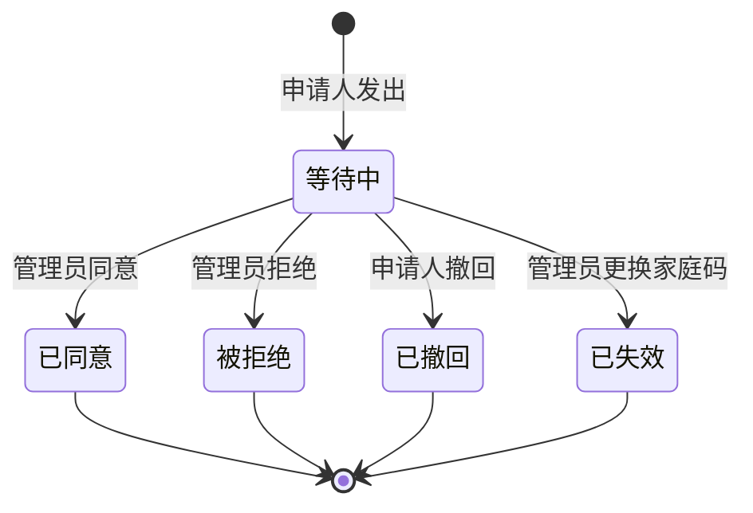

# 规则

## 登录和登录状态

- 「家长登录 / 注册」跳到 Authing 的托管登录页；登录成功后回到跳走前要去的页面，没有就回到 `/`。
- `/` 按这台浏览器上登录着的人显示：家长登录着时是当前家庭的书库（没有家庭时进入开始页），只有孩子登录着时是孩子首页，都没登录时是产品主页。
- 产品主页 `/`、孩子登录页 `/child` 和扫码登录页 `/child/qr/<令牌>` 不用家长登录；孩子的账号由本站自己管理（见“孩子登录”），已经登录的家长打开孩子登录页也照常显示。
- 家长没登录或登录过期时访问家长的页面，回到 `/`；之后登录成功，回到原来要去的页面。要回去的地址只接受本站以 `/` 开头的路径，不接受 `//` 开头或别的网站的地址。
- 家长的登录状态是后端签发的 JWT，身份种类是 `parent`，放在 cookie 里，有效期 7 天；剩下不到 3.5 天时，下一个请求的响应换发一个新的 7 天。所以每周都用的家长不用重新登录，超过 7 天没用要重新登录。
- Authing 返回的 ID 令牌放在另一个 cookie 里，跟着登录状态一起续期，只在退出时用。
- 登录过程中的临时信息（state、nonce、PKCE）放在另一个 cookie 里，10 分钟后过期，回调用完就清掉。
- 退出登录：清掉家长的 cookie，再带着 ID 令牌跳到 Authing 的退出地址，同时退出 Authing，退完回到产品主页。这台浏览器上登录着的孩子不受影响。
- 从 Authing 回来时出错（用户取消、state 对不上、Authing 没有回应），回到 `/?login=failed`：没登录时是产品主页，已经登录着的家长是书库，上面都盖一个“登录没有成功”的弹框，可以再试一次；关掉弹框后地址变回 `/`。

## 家长账号

- 家长由 Authing 的 issuer 加 `sub` 认出。第一次登录时建立家长记录。
- 名字只在建立家长记录时从 Authing 取一次：用 Authing 给的名字，没有就用邮箱 @ 前面的部分，两样都没有（或者只有空格）时用“家长”；超过 20 个字的截到 20 个字。之后只用本站存的名字，家长在个人设置页上改。
- 邮箱每次登录时从 Authing 更新；Authing 没给邮箱时为空，界面上显示“—”。
- 同一个家庭的家长互相能看到名字和邮箱；管理员在家庭管理页上能看到申请人的名字和邮箱。
- “字”按看到的一个字符算：一个汉字、一个字母、一个 emoji 都算一个字。名字、家庭名称、孩子的昵称、密码和书名的长度都这样数，前端和后端一致。
- 名字、家庭名称和孩子的昵称另有字节上限：UTF-8 的字节数不超过字数上限的 16 倍（名字和家庭名称 320 字节，昵称 160 字节）；孩子的密码不超过 128 字节。超过时的提示和字数超过时一样，正常输入碰不到。

## 删除账号

- 家长在个人设置页的底部删除自己的账号。
- 还是任何家庭的管理员时不能删：「删除账号」变淡、点不了，前面一行灰字“你还是「<家庭>」「<家庭>」的管理员，先把管理员设给别人或者删除家庭，才能删除账号”。
- 不是管理员时，「删除账号」是 `rose-ink` 的文字按钮，点了先确认：标题“删除你的账号？”，说明“你会离开「<家庭>」。你在好奇星球和 Authing 上的账号都会删掉，不能恢复。”（没有家庭时没有第一句），「取消」「删除账号」（红色）。
- 确认后，本站先请 Authing 删除这个账号；Authing 删成功了，马上删掉本站的家长记录、他在各个家庭的成员关系和他发的加入申请，清掉他的登录，回到产品主页，盖一个“你的账号已删除”的弹框（半开的木门、“你在好奇星球上的账号和数据都已删掉。”、「关闭」）。Authing 没删成时什么都不删，顶部提示条“出了点问题，请稍后再试”。
- 这位家长在别的浏览器里还登录着时，那里的下一个请求回到产品主页。
- 平台团队在 Authing 控制台里直接删掉的家长，由 Authing 通知本站同样删掉；他是管理员、家里还有别的家长的家庭，管理员交给其余家长里最早加入的一位，只剩他一位家长的家庭整个删掉（同“删除家庭”）。
- 家长写进审计记录的只有编号，删掉后留下的记录对不上任何人，见 `data.md`。

## 协议同意

- 协议在 Authing 托管页上勾选，注册和每次登录都要勾。
- 每次登录回到本站时，记下同意的时间和协议版本，覆盖上一次的记录。协议版本写在代码里，现在是 `2026-11-21`。

## 导航

- 导航分两部分：
  - **当前家庭**：家庭切换按钮下面的书库、孩子、家庭管理。选了哪个家庭，这三项就是那个家庭的。三项每位家长都看得到。
  - **家长自己**：以家长的名字为标题的一组，里面是加入家庭、个人设置，和哪个家庭都无关。
- 家庭切换菜单：自己的全部家庭（按加入顺序，当前家庭打勾），下面是「创建家庭」。
- 从地址打开一个家庭的页面（比如 `/families/<编号>`），这个家庭就成为当前家庭。
- 切换家庭后：在书库，显示新家庭的书库；在书本页，留在这一页，换成新家庭的获取和分派；在孩子页，进入新家庭的孩子页；在家庭管理页，进入新家庭的家庭管理页；在加入家庭页和个人设置页，留在原页。
- 旧的新成员页地址 `/families/<编号>/new-members` 进入这个家庭的家庭管理页，不提示。
- 已经有家庭的家长打开开始页 `/start`，进入书库。

## 书库

- 书库是当前家庭的书库，地址 `/`。顶上是小兔老师的欢迎横幅（“欢迎回来，<名字>”“挑几本书，分派给孩子吧。”），比孩子首页的横幅矮；下面是三个筛选，再下面是书。
- 书在平台的书本表里，由平台团队用迁移脚本添加和修改，家长不能改书。每本书有书名、简介、封面、一个年级和一个学科，状态是上架或下架；下架的书可以有一本替代的书。
- 年级和学科都在表里。每个年级有一个级别数字：学前是 0，一年级是 1，依次到高三是 12；以后不同年级的孩子由不同的老师、用不同的教法来教时按它来分。年级和学科都按表里定的顺序显示。现在的年级是学前、一年级到六年级、初一到初三、高一到高三，共 13 级；学科是语文、数学、英语、科学、编程。

### 筛选

| 筛选 | 选项                                                         | 规则                                                                                                      |
| ---- | ------------------------------------------------------------ | --------------------------------------------------------------------------------------------------------- |
| 年级 | 全部年级，可以多选                                           | 什么都不选就是全部。按钮上写“年级：全部”“年级：一年级”“年级：一年级、二年级”，选了 3 个以上写“年级：3 个” |
| 学科 | 在另外两个筛选下有书的学科，可以多选                         | 什么都不选就是全部；按钮的写法同年级                                                                      |
| 范围 | 书库（默认）、我家的书、家里的每个孩子（写孩子的名字和头像） | 书库：全部上架的书；我家的书：这个家庭获取的书，包括已下架的；孩子：分派给这个孩子的书，包括已下架的      |

- 年级和学科的菜单里每一项是一个能点的格子，选中的格子里有对勾；底下是「清除」「完成」。点一个格子马上筛选，按钮上的字马上变；「完成」只是关上菜单。
- 范围的菜单是单选，选中的一项打勾。
- 筛选记在地址里，刷新、从书本页返回后还在。地址里的值不对时（比如已经删除的孩子），那一项当作全部或书库。
- 已下架的书只在「我家的书」和孩子的范围里出现，书库里没有。

### 书的卡片

- 手机每行 2 本，平板 3 本，电脑 4 本，新上架的在前。
- 卡片：封面（3:4）；书名，最多两行；“一年级 · 数学”；简介，最多两行，多的省略；底部一行。
  - 家里没获取：「获取」。点了获取，变成已获取，不弹提示。
  - 家里获取了：“✓ 已获取”，右边是在读的孩子的小头像，最多 3 个，多的写“+2”；没有孩子在读时是一个虚线圆圈里的「+」。点头像或「+」打开「谁能读」。
  - 已下架的书封面左上角写“已下架”，没有「获取」。
- 家里获取了、没有孩子在读的书，封面右上角有「…」（读屏名称“更多操作”），菜单里是「从我家的书里移除」。有孩子在读的书没有「…」。
- 点卡片的其他地方进入这本书的书本页。
- 还没有封面的书用默认封面：`tint` 底色，中间一个线条书本图标。封面图读不出来时也显示它。

### 加载更多

- 一批 12 本。鼠标版在书下面有「加载更多」；手指版滑到底自动加载下一批。
- 没有更多的书时，不再加载，书下面写“全部的书都在这里了”。
- 筛选后没有书时，显示小盆栽、“没有符合条件的书”和「清除筛选」，「清除筛选」把三个筛选都恢复成默认。

## 书本页

- 地址 `/books/<书本编号>`，从书库的卡片进入，左上角「返回」回到书库，筛选不变。书本页显示的是当前家庭的获取和分派。
- 页面顶上是一条铺满宽度的色带，颜色来自这本书的封面：封面图放大、模糊、调淡后垫在后面，往下淡进页面底色；没有封面的书用 `tint`。色带里：
  - 左边是像一本书一样的大封面（有书脊和阴影），手机上封面居中；
  - 封面旁边是年级和学科两个小标签、大号书名，下面一行操作：
    - 家里没获取：「获取」；
    - 家里获取了：“✓ 已获取”和一个按钮，按钮上是在读的孩子的头像和“小米、豆豆可以读”，没有孩子在读时是虚线「+」和“选择谁能读”，点了打开「谁能读」；
    - 家里获取了但还没有孩子：“还没有孩子”和「去添加孩子」，进入孩子页。
- 色带下面是“这本书讲什么”和完整的简介。
- 家里获取了、没有孩子在读时，简介下面有「从我家的书里移除」。有孩子在读时不显示。
- 已下架的书，色带里在标签上面有一条提示“这本书已下架。可以换成《<替代的书名>》”，点书名进入替代的书的书本页。没有替代的书，或者替代的书也已下架时，只写“这本书已下架。”
- 书本编号不存在，或者是家里没获取的已下架的书：显示放大镜、“找不到这本书”和「回到书库」。

## 谁能读

- 书库卡片上的头像或「+」，和书本页上的同一个按钮，都打开同一个弹框“谁能读《<书名>》”。
- 弹框里是家里的每个孩子，按添加的时间排：头像、昵称；在读的孩子这一行是浅紫底，行尾有对勾。点整行就选上或取消。
- 刚打开时只有「取消」；选的和原来不一样了才出现「确定」。点「确定」后，新选的孩子分派到这本书，取消的孩子撤回这本书，不弹提示，卡片和书本页上的头像马上变。
- 已下架的书：没在读的孩子这一行变淡，点不了；在读的孩子可以取消；列表下面写“下架的书不能再分派”。
- 撤回后，孩子首页上不再有这本书。撤回后再分派，算作一本新分派的书。

## 移除

- 「从我家的书里移除」只在家里获取了、没有孩子在读时出现（书库卡片的「…」菜单和书本页上）。
- 先确认：标题“从我家的书里移除《<书名>》？”，说明“这本书还在书库里时，可以再获取。”，「取消」「移除」（红色）。
- 移除后提示“已移除《<书名>》”。在书库里，这张卡片变回没获取的样子；已下架的书从「我家的书」和孩子的范围里消失。在书本页上，留在这一页，按钮变回「获取」；已下架的书显示“找不到这本书”。

## 个人设置

- 进入个人设置页 `/profile`：电脑上点侧边栏的「个人设置」；手机和平板上点顶栏右边的头像，在弹出的菜单里选「个人设置」。
- 页面上有名字（铅笔图标改）、邮箱（只显示）和「退出登录」；最下面一条细线，下面靠右是「删除账号」，见“删除账号”。
- 没有家庭时，页面上没有菜单，顶部和开始页一样，左上角有「返回」，回到开始页。

| 字段 | 规则                                       | 出错时的提示               |
| ---- | ------------------------------------------ | -------------------------- |
| 名字 | 必填；去掉前后空格后 1–20 个字，什么字都行 | 请填名字；名字最多 20 个字 |

## 当前家庭

- 一位家长可以属于多个家庭，没有上限；一个家庭的家长人数也没有上限。
- 登录后进入这台浏览器上次用的家庭（记在浏览器里）；没有记录或已经不是那个家庭的成员时，进入最早加入的家庭。
- 不属于任何家庭时进入开始页 `/start`。
- 在导航里切换家庭后，记下新的当前家庭。
- 自己离开或删除当前家庭后，进入家庭列表里下一个家庭的书库（离开的是最后一个，就进入第一个），提示“你已离开 <家庭名称>”或“已删除「<家庭名称>」”；一个家庭都没有了，进入开始页。
- 被移出当前家庭，或者当前家庭被管理员删除时：正在看这个家庭的页面（书本页、孩子、家庭管理），显示“找不到这个家庭”；在书库，或者切换家庭时，进入另一个家庭，没有就进入开始页。

## 家庭

| 字段     | 规则                                                                                                                                                                                                                                   | 出错时的提示                       |
| -------- | -------------------------------------------------------------------------------------------------------------------------------------------------------------------------------------------------------------------------------------- | ---------------------------------- |
| 家庭名称 | 必填；去掉前后空格后 1–20 个字，什么字都行。创建时预填「<家长名字>的家」，超过 20 个字时不预填                                                                                                                                         | 请填家庭名称；家庭名称最多 20 个字 |
| 时区     | IANA 时区名，显示成“Asia/Shanghai（UTC+08:00）”。创建时默认是当前位置的时区（浏览器报告的时区），可以改。选择时区的列表用浏览器自带的全部时区，按当前的 UTC 偏移排序，偏移相同的按名字排；可以按名字（不分大小写，包含即可）或偏移搜索 | 请选择时区                         |
| 家庭码   | 6 位，从 `23456789ABCDEFGHJKMNPQRSTUVWXYZ`（去掉 0、O、1、I、L）里随机取，全平台不重复；碰上重复就重新取，最多 5 次                                                                                                                    | —                                  |

- 时区的别名（比如 `Asia/Calcutta`）先换成标准名再显示、保存和比较。浏览器报告不出时区时，时区框空着，保存时提示“请选择时区”。
- 管理员的当前位置和家庭时区不同（按标准名比较）时，家庭管理页的时区下面显示“当前位置：<时区>（<偏移>）”和「改成这个」；两者相同时不显示。普通家长不显示。
- 更换家庭码：生成新码，旧码马上作废；用旧码发出、还在等待的申请一起变成“已失效”；旧的邀请链接和二维码也一起失效。孩子手动登录要用新码；孩子记住的设备和登录二维码不受影响。
- 创建家庭后，新家庭成为当前家庭，进入它的书库，提示“已创建「<家庭名称>」”。

## 删除家庭

- 只有管理员能删除家庭，家里还有别的家长时也能删。家庭管理页最下面，「离开家庭」那一行的最后是 `rose-ink` 的文字按钮「删除家庭」；普通家长的家庭管理页上没有它。
- 先确认：标题“删除「<家庭名称>」？”，说明“<孩子数> 个孩子和他们的书、学习记录都会删掉，另外 <家长数> 位家长会离开这个家庭。不能恢复。”（没有孩子或没有别的家长时，去掉对应的半句），「取消」「删除家庭」（红色）。
- 删除后，这个家庭、它的孩子（连同记住的设备、登录二维码、分派的书和以后的学习记录）、获取的书、加入申请和所有家长在这个家庭的成员关系都删掉；家长的账号留着，他们别的家庭不受影响。
- 管理员进入下一个家庭的书库，提示“已删除「<家庭名称>」”，见“当前家庭”。别的家长和被移出时一样；这个家庭的孩子登录着时，下一个请求回到孩子登录页，记住的头像消失。

## 分享家庭码

家庭管理页上，家庭码旁边一行三个图标；鼠标版在鼠标停留或键盘聚焦时显示说明，读屏软件在两版里都读出同样的说明：

| 图标   | 说明       | 点了之后                                                                                                                             |
| ------ | ---------- | ------------------------------------------------------------------------------------------------------------------------------------ |
| 复制   | 复制家庭码 | 复制家庭码，提示“已复制”                                                                                                             |
| 分享   | 分享邀请   | 打开系统的分享面板，分享邀请文字；浏览器不支持分享面板时（比如电脑上的部分浏览器、微信里打开的网页），改成复制邀请文字，提示“已复制” |
| 二维码 | 显示二维码 | 弹框：标题“扫码加入「<家庭名称>」”，中间是邀请链接的二维码，下面一行“也可以输入家庭码 <家庭码>”                                      |

- 邀请链接是 `<本站地址>/join/<家庭码>`。打开后，没有家庭的家长看到开始页、有家庭的家长看到加入家庭页，上面盖着申请加入的框，家庭码已经填好；没登录的先登录，登录后回到这个链接。关掉申请框后，地址变回 `/start` 或 `/join`。
- 邀请文字：“<家长名字>邀请你加入「<家庭名称>」，在好奇星球上输入家庭码 <家庭码>，或者打开这个链接：<邀请链接>”。

## 输入家庭码

- 6 个格子，一格一个字符；小写字母自动转成大写，允许字符以外的输入不收；粘贴时按顺序填满；输完一格跳到下一格，删除时回到上一格。邀请链接里的家庭码也按这个规则填进格子。
- 6 格填满就去查这个码：找到就显示家庭名称和管理员名字，让申请人确认后再发申请；没找到就在格子下面提示“没有这个家庭码”。已经是成员、已经申请过的提示也显示在格子下面。
- 发出申请后，申请框关上，提示“申请已发出”，申请列表里多出这一条。

## 加入申请

- 同一位家长对同一个家庭同时只能有一个等待中的申请；已经是成员的不能申请。
- 申请没有期限，只在同意、拒绝、撤回或更换家庭码时结束。
- 同意后申请人成为这个家庭的普通家长。

### 我的申请（申请人）

- 加入家庭页 `/join`（有家庭的家长）和开始页（没有家庭的家长）列出“我的申请”：等待中、已同意、被拒绝、已失效、还没点「知道了」的，按发出时间从新到旧。撤回的不列出。

| 状态   | 标签和颜色            | 说明                         | 操作       |
| ------ | --------------------- | ---------------------------- | ---------- |
| 等待中 | 等待中（`sun`，沙漏） | 管理员 <名字> · <日期>申请   | 「撤回」   |
| 已同意 | 已同意（`mint`）      | 同上                         | 「知道了」 |
| 被拒绝 | 被拒绝（`rose`）      | 同上                         | 「知道了」 |
| 已失效 | 已失效（中性色）      | 同上，下面一行“家庭码已更换” | 「知道了」 |

- 加入家庭页顶上有「申请加入家庭」按钮，打开申请加入的框；没有申请时显示“还没有发出过申请”。
- 有已同意、被拒绝、已失效且还没点「知道了」的申请时，导航上的「加入家庭」和手机、平板顶栏的头像带一个红点。
- 「知道了」只是不再显示这一条，申请记录一直保存。
- 没有家庭的家长停在开始页时，发现自己的申请被同意了，就进入那个家庭的书库，提示“你已加入「<家庭名称>」”。

### 等你处理（管理员）

- 管理员的家庭管理页上，有等待中的申请时，在家庭信息卡片下面、成员列表上面有一张“等你处理”卡片：每条申请一行，申请人的头像、名字、邮箱和申请的日期，「拒绝」「同意」，按发出时间从新到旧。没有等待中的申请时没有这张卡片。
- 同意或拒绝后，这一行滑出并收起，不另外提示；同意的家长马上出现在成员列表里。处理过的申请不再显示。
- 普通家长的家庭管理页上没有这张卡片。

## 孩子

- 孩子属于一个家庭，由这个家庭的家长添加。每个孩子有昵称和账号：昵称是显示的名字，账号是孩子登录时输入的。昵称家长能改，孩子也能在自己的个人设置里改。密码由孩子第一次登录时自己设，家长不设，见“孩子的密码”。
- 孩子的头像是昵称的第一个字，底色和家长的头像用同样的五种颜色，按孩子编号算出一种（见 `look.md`）。
- 家长离开或被移出家庭，不影响这个家庭的孩子。

| 字段             | 规则                                                                                                                                                                                                                                      | 出错时的提示                                                                                                  |
| ---------------- | ----------------------------------------------------------------------------------------------------------------------------------------------------------------------------------------------------------------------------------------- | ------------------------------------------------------------------------------------------------------------- |
| 昵称             | 必填；去掉前后空格后 1–10 个字，不超过 160 字节，什么字都行；同一个家庭里可以重名                                                                                                                                                         | 请填昵称；昵称最多 10 个字                                                                                    |
| 账号             | 必填；去掉前后空格后 1–20 个字符，只能是小写字母 a–z 和数字 0–9；家庭内唯一。输入时大写字母自动转成小写，别的字符不收，和家庭码的格子一样。输入框下面的说明：“孩子登录时输入，只能用小写字母和数字”。孩子登录表单的账号框也按这个规则输入 | 请填账号；家里已经有孩子用这个账号了                                                                          |
| 密码             | 6–32 个字符（按看到的字符数），不超过 128 字节，什么字符都行，包括空格；设密码时输两遍。扫码登录页的输入密码必填；孩子登录表单上可以空着，只有还没设密码的孩子能空着登录（见“孩子的密码”）。密码框带眼睛按钮「显示密码」                  | 设密码时：请设密码；密码至少 6 个字符；密码最多 32 个字符；两次输的密码不一样。扫码登录页输入密码时：请填密码 |
| 孩子登录的家庭码 | 孩子登录表单上必填，6 个格子都要填满；输入规则同“输入家庭码”                                                                                                                                                                              | 请填家庭码                                                                                                    |
| 监护人同意       | 添加孩子时勾选「我是这个孩子的监护人，同意好奇星球处理孩子的昵称、账号和登录记录」，默认不勾                                                                                                                                              | 请先同意                                                                                                      |

- 这些检查和其他输入一样，在提交前做，提示显示在输入框下面。
- 出错的密码框清空，别的框留着已经输入的内容：扫码登录页密码不对时清空密码框；两次输的密码不一样时清空第二个框；“家庭码、账号或密码不对”时清空密码框。
- 添加孩子时在审计记录里记下勾选同意的家长、时间和同意文字的版本；版本写在代码里，写法和家长的协议版本一样，是 `2026-11-22`。审计记录只有编号，删除孩子时不删。

### 孩子的密码

- 家长不给孩子设密码。孩子第一次登录时自己设：扫码登录时随时能设；用家庭码和账号登录时，只在家长添加这个孩子或重设密码后的 48 小时内能设，过了期限只能扫码设，或者请家长重设密码。
- 家长「重设密码」是清掉密码，之后和刚添加的孩子一样。
- 设好密码后，扫码登录和用账号登录都要输入它。

### 孩子页

- 地址 `/families/<家庭编号>/children`，标题“孩子”，标题下面是「添加孩子」按钮。
- 每个孩子一行，按添加的时间排：头像、昵称、“账号 <账号>”；行尾是二维码图标按钮（读屏名称“显示登录二维码”）和「…」菜单（读屏名称“更多操作”）。
- 还没设密码的孩子，账号后面一个 `sun` 底的小标签「还没设密码」（手机上折到下一行），下面一行小字：还在 48 小时内时“<日期 时间> 前可以用账号登录设密码”（按家庭时区），过了期限时“请让孩子扫登录二维码设密码，或者重设密码”。
- 没有孩子时显示“还没有孩子”“添加孩子后，孩子就能用自己的账号登录。”和「添加孩子」，配小盆栽。
- 没有孩子的详情页，对孩子的操作都在这一页上。
- 「…」菜单：改昵称和账号、记住的设备、重设密码、删除（红字）。手指版是浮动面板，顶上显示孩子的头像和昵称，和成员的操作面板一样。

### 添加和修改孩子

- 「添加孩子」弹框：昵称、账号、同意的勾选框，「取消」「添加」。添加后弹框关上，列表里多出这个孩子，提示“已添加「<昵称>」”；不自动打开登录二维码。
- 「改昵称和账号」打开弹框“修改<昵称>”：昵称和账号，「取消」「保存」；保存后提示“已保存”。

### 登录二维码

- 点一行的二维码图标，打开弹框“让<昵称>扫码登录”：中间是登录链接的二维码，下面“10 分钟内有效，还剩 9:41”（倒计时）和“用手机或平板的相机扫一扫”。
- 登录链接是 `<本站地址>/child/qr/<令牌>`，10 分钟内有效，只能用一次；令牌是 32 字节随机数，写成 base64url。
- 每次打开弹框都生成一个新链接，这个孩子之前还没用过的链接一起作废。
- 弹框开着、页面在前台时，每 3 秒查一次链接的状态，最多查 10 分钟：
  - 用掉了：二维码换成一个大对勾和“<昵称>已登录”，下面是「完成」。
  - 过期、作废（比如另一位家长生成了新的）或孩子被删除：二维码变淡，显示“已失效”和「重新生成」。「重新生成」生成一个新链接。

### 记住的设备

- 「记住的设备」打开弹框“<昵称>记住的设备”：每台设备一行，按最近登录从新到旧，显示设备名称，第二行“记住于 11月18日 · 最近登录 11月22日 09:12”，行尾是「撤销」；下面是「全部撤销」。
- 设备名称在记住时从浏览器得出，比如“iPad · Safari”“Android 手机 · Chrome”“Windows 电脑 · Edge”；认不出时是“未知设备”。
- 「撤销」不用确认：这一行滑出并收起，不弹提示。「全部撤销」先确认。
- 没有设备时显示“还没有记住的设备”“孩子登录时勾选「在这台设备上记住我」，这台设备就会出现在这里。”

### 确认框

| 操作     | 标题                         | 说明                                                                                                                                 | 按钮                     |
| -------- | ---------------------------- | ------------------------------------------------------------------------------------------------------------------------------------ | ------------------------ |
| 重设密码 | 重设<昵称>的密码？           | 旧密码马上不能用，已经登录的设备会退出，记住的设备也会一起撤销。之后 48 小时内，<昵称>用账号登录就能设新密码；也可以扫登录二维码设。 | 「取消」「重设」         |
| 删除     | 删除<昵称>？                 | <昵称>的账号、记住的设备和分派给他的书都会删掉，不能恢复。                                                                           | 「取消」「删除」（红色） |
| 全部撤销 | 撤销<昵称>的全部设备？       | 这些设备上点头像不能再直接登录，要重新输入密码。                                                                                     | 「取消」「全部撤销」     |
| 移除书   | 从我家的书里移除《<书名>》？ | 这本书还在书库里时，可以再获取。                                                                                                     | 「取消」「移除」（红色） |

- 全部撤销的确认框叠在记住的设备弹框上面。
- 重设密码：清掉密码，从这时起 48 小时内能用账号登录设新密码，撤销这个孩子全部记住的设备，重设之前签发的孩子登录全部作废；还没用掉的登录二维码照常有效。分派给他的书不变。
- 删除孩子：连同记住的设备、登录二维码和分派给他的书一起删掉；孩子已经登录着的设备，下一个请求就进不来。

## 孩子登录

孩子的页面不用家长登录，也没有家长的菜单。

| 地址               | 页面                                                                                 |
| ------------------ | ------------------------------------------------------------------------------------ |
| `/child`           | 孩子登录页；孩子已经登录着时进入 `/child/home`                                       |
| `/child/qr/<令牌>` | 扫码登录页；孩子已经登录着时也照常显示，登录另一个孩子就换掉这台浏览器上登录着的孩子 |
| `/child/home`      | 孩子首页；只有孩子登录着时，`/` 也显示它                                             |
| `/child/profile`   | 孩子的个人设置                                                                       |

- 没有孩子登录时打开孩子首页，进入 `/child`。
- 只有孩子登录着的浏览器打开家长的页面，进入 `/`，也就是孩子首页。
- 同一个浏览器里家长和孩子可以同时登录，各退各的。
- 孩子的登录状态和家长的一样：有效期 7 天，剩下不到 3.5 天时，下一个请求的响应换发一个新的 7 天。
- 孩子的每个请求都查这个孩子还在不在、这次登录是不是在最后一次重设密码之后签发的；不是就回到 `/child`。

### 孩子登录页

- 小兔老师（半身挥手）在卡片上面；卡片下面是“还没有账号？请家长在「孩子」里添加。”和「回到首页」。
- 这台设备上没有记住的孩子时，卡片“孩子登录”：家庭码（6 个格子，输入规则同“输入家庭码”，但填满后不去查）、账号、密码（带「显示密码」）、勾选框「在这台设备上记住我」（默认不勾）、「登录」。
- 密码框右下方是文字按钮「忘记密码」，点了打开说明框：胡萝卜钥匙、“忘记密码了？”、“请家长在「孩子」里点「重设密码」。之后 48 小时内用账号登录，或者扫家长给的二维码，就能设一个新密码。”、「知道了」。不改任何数据。
- 家庭码和账号对上了一个还没设密码、还在 48 小时期限内的孩子时，不管密码框里填了什么，卡片换成设密码：左上角「返回」（回到表单）、大头像、“你好，<昵称>！”、“先设一个密码，以后登录要用。”、密码和再输一遍（都带「显示密码」）、说明“6–32 个字符”、「在这台设备上记住我」（沿用表单上的勾选）、「设好了，进入」。设好后登录，进入孩子首页。
- 家庭码、账号、密码有一项不对，有密码的孩子密码框空着，或者还没设密码的孩子已经过了 48 小时，都在「登录」按钮上面显示“家庭码、账号或密码不对”，不说是哪一项，密码框清空。
- 这台设备上有记住的孩子时，卡片上是“点你的头像登录”和这些孩子的大头像，每个头像下面是昵称；再下面是「用账号登录」，点了换成上面的表单，卡片左上角多一个「返回」，回到头像。
- 点头像直接登录，不用密码。
- 打开登录页时，已经被撤销、过期，或者密码被重设过的设备记录已经不在了，这个孩子的头像不显示；一个头像都不剩时就是普通的表单。
- 头像显示着、点的那一刻才发现失效时：这个头像消失，打开表单，家庭码和账号已经填好，光标在密码框，表单上面一条带这个孩子头像的说明“这台设备需要重新输入密码”。

### 在这台设备上记住我

- 登录时勾上，这台浏览器就留着这个孩子的头像，点头像不用密码就能登录。
- 从记住或最后一次点头像登录算起 30 天内有效，每次点头像登录都重新算 30 天。
- 不勾选登录，就去掉这台浏览器上这个孩子的记录。
- 孩子退出后头像留着。家长撤销设备、重设密码、删除孩子后马上失效。
- 一台浏览器可以记住几个孩子；每个浏览器算一台设备。
- 孩子每次登录时，删掉这个孩子已经过期的设备记录。

### 扫码登录页

- 打开链接不会用掉它，登录成功才用掉。登录成功后进入孩子首页。
- 孩子还没有密码（新添加的，或者密码被重设过）：大头像、“你好，<昵称>！”、“先设一个密码，以后登录要用。”、密码和再输一遍（都带「显示密码」）、说明“6–32 个字符”、「在这台设备上记住我」（默认勾上）、「设好了，进入」。
- 孩子已经有密码：头像、“你好，<昵称>！”、“输入你的密码。”、密码、「在这台设备上记住我」（默认勾上）、「登录」。密码不对时显示“密码不对”，链接还能用。
- 链接过期、用过、作废，或者孩子被删除：小兔老师、“这个二维码已经失效了”“请家长重新给你一个二维码。”和「去登录页」。

### 孩子首页

- 顶栏左边是完整 logo，右边是孩子的头像（电脑上是头像和昵称），点了进入孩子的个人设置，读屏名称“个人设置”。
- 欢迎横幅和家长的书库一样的样式：“你好，<昵称>！”“我是小兔老师，今天也一起学习吧！”，配挥手的小兔老师。
- 横幅下面是“我的书”：分派给这个孩子的书，按分派的时间从新到旧，一次全部显示，不分批。卡片和书库的一样，只是没有底部一行；已下架的书封面左上角写“已下架”。卡片现在点不开。
- 孩子还没打开过的新分派的书，封面右上角有“新”，“我的书”旁边的红底数字是这些书的本数。孩子打开这本书后，“新”和数字里的这一本才消失；现在书还点不开，所以它们一直显示，等以后能打开书的 issue 来清。
- 没有书时显示“还没有书”“家长给你分派书以后，会出现在这里。”，配小盆栽。

### 孩子的个人设置

- 地址 `/child/profile`，顶栏和孩子首页一样，头像标成当前页；左上角「返回」回到孩子首页。标题“个人设置”。
- 一张卡片：昵称（铅笔图标改，读屏名称“改昵称”）、账号（只显示）、家庭（家庭名称，只显示）；下面是「退出登录」。
- 改昵称和家长改名字一样：手指版是浮动面板「改昵称」，鼠标版原地改；规则和家长添加孩子时的昵称一样，保存后提示“已保存”。
- 孩子不能改账号和密码。
- 「退出登录」只清掉孩子的登录，进入 `/child`；记住的头像留着。

## 限流

按来源（IP）只计失败的次数，成功的不算；计数放在 Redis，见 `data.md`。

| 接口                                               | 怎么计                                                                                                                                   | 上限                              |
| -------------------------------------------------- | ---------------------------------------------------------------------------------------------------------------------------------------- | --------------------------------- |
| 孩子用家庭码和账号登录、设密码，扫码登录页输入密码 | 两层：同一个来源对同一个孩子（家庭码和账号对不上任何孩子时，按输入的家庭码和账号算一个）；同一个来源对所有孩子合计。哪一层到了上限都拒绝 | 15 分钟里 10 次；15 分钟里 200 次 |
| 家长查家庭码                                       | 同一个来源查不到（没有这个家庭码）的次数                                                                                                 | 1 小时里 30 次                    |

- 窗口从这个来源第一次失败算起，到时清零。
- 到了上限时不做检查，直接显示“试得太多了，请 <分钟数> 分钟后再试”，分钟数是窗口剩下的时间，向上取整。
- 超长的密码（超过 32 个字符或 128 字节）不做散列，当作密码不对，也算一次失败。

## 通知

- 不发邮件，也不推送。
- 等待中的申请（只算自己是管理员的家庭）：家庭切换按钮上的红底数字是全部这些家庭的总数；家庭切换菜单里每个家庭后面是它自己的数；导航的「家庭管理」上是当前家庭的数。超过 99 显示“99+”，没有时不显示。
- 申请人：「加入家庭」和头像上的红点，见“我的申请”。
- 孩子：“我的书”旁边的数字，见“孩子首页”。
- 数量和红点在页面打开、切换家庭和浏览器窗口重新回到前台时更新。开始页、加入家庭页、家庭管理页（包括打开着的二维码框）、孩子页、书库和书本页在同样的时候重新读一次数据。

## 成功的提示

| 操作                                                     | 提示                   |
| -------------------------------------------------------- | ---------------------- |
| 保存家庭名称、时区，保存自己的名字，保存孩子的昵称和账号 | 已保存                 |
| 复制家庭码或邀请文字                                     | 已复制                 |
| 更换家庭码                                               | 已更换家庭码           |
| 把别的家长设为管理员                                     | 「<名字>」现在是管理员 |
| 移出别的家长                                             | 已移出「<名字>」       |
| 自己离开家庭                                             | 你已离开 <家庭名称>    |
| 创建家庭                                                 | 已创建「<家庭名称>」   |
| 发出申请                                                 | 申请已发出             |
| 申请被同意后进入家庭（见“我的申请”）                     | 你已加入「<家庭名称>」 |
| 添加孩子                                                 | 已添加「<昵称>」       |
| 孩子改自己的昵称                                         | 已保存                 |
| 删除家庭                                                 | 已删除「<家庭名称>」   |
| 删除孩子                                                 | 已删除「<昵称>」       |
| 重设孩子的密码                                           | 已重设「<昵称>」的密码 |
| 撤销孩子的全部设备                                       | 已全部撤销             |
| 从我家的书里移除                                         | 已移除《<书名>》       |

同意、拒绝申请，点「知道了」，撤销一台设备，获取书，在「谁能读」里确定都不弹提示，按钮、头像或那一行的变化就是结果。

## 权限

| 操作                                                     | 不是成员 | 普通家长 | 管理员                     |
| -------------------------------------------------------- | -------- | -------- | -------------------------- |
| 看家庭的名称、时区、家庭码、成员和邮箱                   | 不能     | 能       | 能                         |
| 改名称、时区                                             | 不能     | 不能     | 能                         |
| 更换家庭码                                               | 不能     | 不能     | 能                         |
| 看等待中的申请、同意或拒绝申请                           | 不能     | 不能     | 能                         |
| 把别的家长设为管理员                                     | 不能     | 不能     | 能                         |
| 移出别的家长                                             | 不能     | 不能     | 能                         |
| 自己离开家庭                                             | —        | 能       | 不能（先把管理员设给别人） |
| 删除家庭                                                 | 不能     | 不能     | 能                         |
| 看孩子，添加、修改、删除孩子                             | 不能     | 能       | 能                         |
| 显示孩子的登录二维码，看和撤销记住的设备，重设孩子的密码 | 不能     | 能       | 能                         |
| 看书库和书本页，获取、分派、撤回、移除书                 | 不能     | 能       | 能                         |

- 每位家长都能改自己的名字，谁都不能改别人的名字。
- 每位家长都能删除自己的账号，前提是不是任何家庭的管理员。
- 孩子只能改自己的昵称。
- 每个家庭恰好一位管理员。创建家庭的人是管理员；管理员把管理员设给另一位家长后，自己变成普通家长。
- 界面上不显示当前家长没有权限的按钮和图标；接口照样每次检查。
- 不是成员时，这个家庭的任何接口都当作家庭不存在。
- 只能把书分派给本家庭的孩子，只能分派家里获取了的、上架的书。
- 孩子登录后只能用孩子的页面和接口，打不开家长的；孩子只看得到分派给自己的书。
- 取封面图要家长或孩子登录。

## 日期和时间

- 日期的写法是固定的：今年的写“11月18日”，往年的写“2025年11月18日”；带时间时加 24 小时制的时间，如“11月18日 09:12”。不用“今天”“昨天”。
- 时间按家庭时区显示：家庭里的页面用这个家庭的时区；我的申请用申请的那个家庭的时区。

## 同时操作

| 情况                                                     | 结果                                                                                       |
| -------------------------------------------------------- | ------------------------------------------------------------------------------------------ |
| 管理员在两处同时改名称或时区                             | 后保存的覆盖先保存的                                                                       |
| 处理一个已经被撤回、处理过或作废的申请                   | 拒绝，提示“这个申请已经失效了”，刷新列表                                                   |
| 已经不是管理员时做管理员的操作（比如另一个标签页刚交出） | 拒绝，提示“你已不是管理员”，刷新页面，修改的图标和按钮消失                                 |
| 移出一位已经不在家庭里的家长                             | 拒绝，提示“这位家长已经不在家庭里了”，刷新成员列表                                         |
| 已经被移出时打开这个家庭的页面或做操作                   | 显示“找不到这个家庭”                                                                       |
| 撤回一个刚被处理过的申请                                 | 拒绝，提示“这个申请已经处理过了”，刷新列表                                                 |
| 两位家长同时改同一个孩子                                 | 后保存的覆盖先保存的；账号已经被别的孩子用了时，账号框下面提示“家里已经有孩子用这个账号了” |
| 对一个刚被删除的孩子做操作                               | 拒绝，提示“这个孩子已经被删除了”，刷新列表                                                 |
| 另一位家长给同一个孩子生成了新的登录二维码               | 旧的作废；开着的二维码弹框下一次查状态时显示“已失效”                                       |
| 撤销一台已经被撤销的设备                                 | 这一行照样消失，不报错                                                                     |
| 孩子登录着时被删除或被重设密码                           | 孩子的下一个请求回到 `/child`                                                              |
| 获取一本另一位家长刚获取的书                             | 照样显示已获取，不报错                                                                     |
| 两位家长同时改同一本书的「谁能读」                       | 后确定的覆盖先确定的；已经是想要的结果的孩子不报错                                         |
| 「谁能读」里选了一个刚被删除的孩子                       | 拒绝，提示“这个孩子已经被删除了”，刷新这本书                                               |
| 分派或撤回一本刚被另一位家长移除的书                     | 拒绝，提示“这本书已经不在我家的书里了”，刷新                                               |
| 移除一本刚被另一位家长分派给孩子的书                     | 拒绝，提示“还有孩子在读这本书，先在「谁能读」里取消”，刷新                                 |
| 移除一本刚被另一位家长移除的书                           | 照样显示移除成功                                                                           |
| 获取或分派一本刚下架的书                                 | 拒绝，提示“这本书已下架”，刷新                                                             |
| 家庭刚被管理员删除时，别的家长打开这个家庭的页面或做操作 | 和被移出一样，显示“找不到这个家庭”                                                         |
| 家庭或孩子刚被删除时，孩子登录着                         | 孩子的下一个请求回到 `/child`，记住的头像消失                                              |
| 删除账号时刚被别人设为管理员（比如另一个标签页）         | 拒绝，顶部提示“你还是家庭的管理员，先把管理员设给别人”，刷新页面                           |
| 删除了账号，别的标签页或浏览器还开着                     | 那里的下一个请求回到产品主页                                                               |
| 家长和孩子同时改孩子的昵称                               | 后保存的覆盖先保存的                                                                       |

## 出错时的显示

| 情况                       | 显示                                                                                                                                                                                                                                 | 数据                 |
| -------------------------- | ------------------------------------------------------------------------------------------------------------------------------------------------------------------------------------------------------------------------------------ | -------------------- |
| 输入不对                   | 输入框下面红字说明，输入框抖一下；提交前就检查                                                                                                                                                                                       | 不提交               |
| 业务规则不允许             | 在操作的地方说明原因：申请框里显示在格子下面（没有这个家庭码；你已经是这个家庭的成员；你已经申请过了，等管理员处理），添加和修改孩子时显示在账号框下面（家里已经有孩子用这个账号了），其余用顶部提示条（先把管理员设给别人才能离开） | 不变                 |
| 家长没登录或登录过期       | 回到 `/`，重新登录后回到原来的页面                                                                                                                                                                                                   | 不变                 |
| 孩子没登录或登录已经结束   | 孩子的页面回到 `/child`                                                                                                                                                                                                              | 不变                 |
| 孩子登录不成功             | 「登录」按钮上面显示“家庭码、账号或密码不对”，不说是哪一项                                                                                                                                                                           | 不变                 |
| 试得太多了                 | 在原来显示错误的地方（「登录」按钮上面、扫码登录页的密码框下面、家庭码格子下面）显示“试得太多了，请 <分钟数> 分钟后再试”，分钟数向上取整；按钮照常能点，见“限流”                                                                     | 不变                 |
| 记住的设备已经失效         | 这个头像消失，打开填好家庭码和账号的表单，显示“这台设备需要重新输入密码”                                                                                                                                                             | 不变                 |
| 扫码登录的链接已经失效     | 整页显示“这个二维码已经失效了”                                                                                                                                                                                                       | 不变                 |
| 不是管理员                 | 界面上不显示这些按钮；直接调接口被拒绝                                                                                                                                                                                               | 不变                 |
| 不是成员或家庭不存在       | 内容区显示“找不到这个家庭”，可以回到自己的家庭                                                                                                                                                                                       | 不变                 |
| 书本不存在或看不到         | 书本页显示“找不到这本书”和「回到书库」                                                                                                                                                                                               | 不变                 |
| 筛选后没有书               | 显示“没有符合条件的书”和「清除筛选」                                                                                                                                                                                                 | 不变                 |
| 加载更多失败               | 已经显示的书留着，顶部提示条“出了点问题，请稍后再试”；「加载更多」还在，手指版滑到底再试一次                                                                                                                                         | 不变                 |
| 从 Authing 回来时出错      | 产品主页或书库上盖“登录没有成功”的弹框                                                                                                                                                                                               | 不变                 |
| 删除账号时 Authing 出错    | 顶部提示条“出了点问题，请稍后再试”                                                                                                                                                                                                   | 不变，什么都不删     |
| Redis 连不上               | 限流不计数，照常放行；扫码登录页显示“页面没能打开”和「重试」；生成登录二维码时顶部提示条“出了点问题，请稍后再试”                                                                                                                     | 不变                 |
| 操作时服务器出错或没有回应 | 顶部提示条“出了点问题，请稍后再试”；操作没有做成，页面保持原样（比如没同意成功的申请还在列表里）                                                                                                                                     | 不变，已填的内容不丢 |
| 整页打开时服务器出错       | 内容区显示“页面没能打开”，带错误编号和「重试」；服务器没有回应时没有错误编号这一行                                                                                                                                                   | 不变                 |
| 断网                       | 顶部提示条“网络断开了，请稍后再试”                                                                                                                                                                                                   | 不变，已填的内容不丢 |
| 重复提交                   | 按钮点下后到结果回来前不能再点，显示正在处理                                                                                                                                                                                         | 只提交一次           |
| 程序自己的错               | 同“整页打开时服务器出错”                                                                                                                                                                                                             | 不变                 |

- 显示的方式按这几条分，同类的情况用同一种：
  - 输入不对、表单被拒绝：红字显示在出错的输入框下面或者按钮上面。
  - 在当前页面上刚做的操作没做成，或者业务规则不允许：顶部提示条。
  - 现在做不了、要先做别的事（管理员离开家庭、管理员删除账号）：按钮变淡点不了，前面一行灰字说明原因。
  - 整页跳转回来以后才知道的结果（从 Authing 回来时登录没有成功、账号已删除）：盖在页面上的弹框，带要做的按钮。
  - 孩子或家长自己要看的说明（忘记密码）：弹框。
- 错误编号是这次请求编号的前 8 位，写成“a1f3-92c0”的样子；日志里按这 8 位能找到这次请求。
- 提示条从顶部滑下，成功的停 3 秒、出错的停 5 秒后自己消失，也可以点 × 提前关掉。

Last changed: #14 (2026-11-24)
