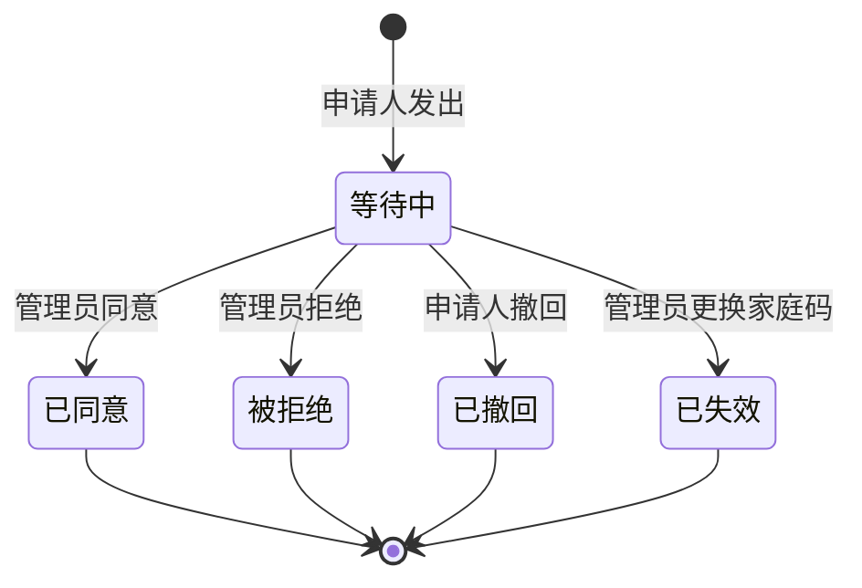

# 规则

## 登录和登录状态

- 「家长登录 / 注册」跳到 Authing 的托管登录页；登录成功后回到跳走前要去的页面，没有就回到 `/`。
- 产品主页 `/` 和孩子登录页 `/child` 不用登录；孩子登录页由本站自己管理孩子的账号（#8 做），已经登录的家长打开它也照常显示。
- 没登录或登录过期时访问其他页面，回到产品主页；之后登录成功，回到原来要去的页面。要回去的地址只接受本站以 `/` 开头的路径，不接受 `//` 开头或别的网站的地址。
- 登录状态是后端签发的 JWT，放在 cookie 里，有效期 7 天；剩下不到 3.5 天时，下一个请求的响应换发一个新的 7 天。所以每周都用的家长不用重新登录，超过 7 天没用要重新登录。
- Authing 返回的 ID 令牌放在另一个 cookie 里，跟着登录状态一起续期，只在退出时用。
- 登录过程中的临时信息（state、nonce、PKCE）放在另一个 cookie 里，10 分钟后过期，回调用完就清掉。
- 退出登录：清掉本站的 cookie，再带着 ID 令牌跳到 Authing 的退出地址，同时退出 Authing，退完回到产品主页。
- 从 Authing 回来时出错（用户取消、state 对不上、Authing 没有回应），回到产品主页，盖一个“登录没有成功”的弹框，可以再试一次。

## 家长账号

- 家长由 Authing 的 issuer 加 `sub` 认出。第一次登录时建立家长记录。
- 名字只在建立家长记录时从 Authing 取一次：用 Authing 给的名字，没有就用邮箱 @ 前面的部分，两样都没有（或者只有空格）时用“家长”；超过 20 个字的截到 20 个字。之后只用本站存的名字，家长在个人设置页上改。
- 邮箱每次登录时从 Authing 更新；Authing 没给邮箱时为空，界面上显示“—”。
- 同一个家庭的家长互相能看到名字和邮箱；管理员在新成员页上能看到申请人的名字和邮箱。
- “字”按看到的一个字符算：一个汉字、一个字母、一个 emoji 都算一个字。名字、家庭名称的长度都这样数，前端和后端一致。

## 协议同意

- 协议在 Authing 托管页上勾选，注册和每次登录都要勾。
- 每次登录回到本站时，记下同意的时间和协议版本，覆盖上一次的记录。协议版本写在代码里，现在是 `2026-11-21`。

## 导航

- 导航分两部分：
  - **当前家庭**：家庭切换按钮下面的首页、家庭管理、新成员。选了哪个家庭，这三项就是那个家庭的。新成员只有这个家庭的管理员看得到。
  - **家长自己**：以家长的名字为标题的一组，里面是加入家庭、个人设置，和哪个家庭都无关。
- 家庭切换菜单：自己的全部家庭（按加入顺序，当前家庭打勾），下面是「创建家庭」。
- 从地址打开一个家庭的页面（比如 `/families/<编号>`），这个家庭就成为当前家庭。
- 切换家庭后：在家庭管理页，进入新家庭的家庭管理页；在新成员页，新家庭里自己是管理员就进入它的新成员页，不是就进入它的家庭管理页；在首页，显示新家庭的首页；在加入家庭页和个人设置页，留在原页。
- 普通家长从地址打开新成员页，直接进入这个家庭的家庭管理页，不提示。
- 已经有家庭的家长打开开始页 `/start`，进入首页。

## 首页

- 当前家庭的首页：小兔老师的欢迎横幅（“欢迎回来，<名字>”），下面一张空状态卡片：“孩子和书库很快就来”“以后在这里看到这个家庭的孩子和书。”孩子和书库由 #8、#9 加进来。

## 个人设置

- 进入个人设置页 `/profile`：电脑上点侧边栏的「个人设置」；手机和平板上点顶栏右边的头像，在弹出的菜单里选「个人设置」。
- 页面上有名字（铅笔图标改）、邮箱（只显示）和「退出登录」。
- 没有家庭时，页面上没有菜单，顶部和开始页一样，左上角有「返回」，回到开始页。

| 字段 | 规则                                       | 出错时的提示               |
| ---- | ------------------------------------------ | -------------------------- |
| 名字 | 必填；去掉前后空格后 1–20 个字，什么字都行 | 请填名字；名字最多 20 个字 |

## 当前家庭

- 一位家长可以属于多个家庭，没有上限；一个家庭的家长人数也没有上限。
- 登录后进入这台浏览器上次用的家庭（记在浏览器里）；没有记录或已经不是那个家庭的成员时，进入最早加入的家庭。
- 不属于任何家庭时进入开始页 `/start`。
- 在导航里切换家庭后，记下新的当前家庭。
- 自己离开当前家庭后，进入家庭列表里的下一个家庭（离开的是最后一个，就进入第一个），提示“你已离开 <家庭名称>”；一个家庭都没有了，进入开始页。
- 被移出当前家庭时：正在看这个家庭的页面（家庭管理、新成员），显示“找不到这个家庭”；在首页，或者切换家庭时，进入另一个家庭，没有就进入开始页。

## 家庭

| 字段     | 规则                                                                                                                                                                                                                                   | 出错时的提示                       |
| -------- | -------------------------------------------------------------------------------------------------------------------------------------------------------------------------------------------------------------------------------------- | ---------------------------------- |
| 家庭名称 | 必填；去掉前后空格后 1–20 个字，什么字都行。创建时预填「<家长名字>的家」，超过 20 个字时不预填                                                                                                                                         | 请填家庭名称；家庭名称最多 20 个字 |
| 时区     | IANA 时区名，显示成“Asia/Shanghai（UTC+08:00）”。创建时默认是当前位置的时区（浏览器报告的时区），可以改。选择时区的列表用浏览器自带的全部时区，按当前的 UTC 偏移排序，偏移相同的按名字排；可以按名字（不分大小写，包含即可）或偏移搜索 | 请选择时区                         |
| 家庭码   | 6 位，从 `23456789ABCDEFGHJKMNPQRSTUVWXYZ`（去掉 0、O、1、I、L）里随机取，全平台不重复；碰上重复就重新取，最多 5 次                                                                                                                    | —                                  |

- 时区的别名（比如 `Asia/Calcutta`）先换成标准名再显示、保存和比较。浏览器报告不出时区时，时区框空着，保存时提示“请选择时区”。
- 管理员的当前位置和家庭时区不同（按标准名比较）时，家庭管理页的时区下面显示“当前位置：<时区>（<偏移>）”和「改成这个」；两者相同时不显示。普通家长不显示。
- 更换家庭码：生成新码，旧码马上作废；用旧码发出、还在等待的申请一起变成“已失效”；旧的邀请链接和二维码也一起失效。
- 创建家庭后，新家庭成为当前家庭，进入它的首页，提示“已创建「<家庭名称>」”。

## 分享家庭码

家庭管理页上，家庭码旁边一行三个图标；鼠标版在鼠标停留或键盘聚焦时显示说明，读屏软件在两版里都读出同样的说明：

| 图标   | 说明       | 点了之后                                                                                                                             |
| ------ | ---------- | ------------------------------------------------------------------------------------------------------------------------------------ |
| 复制   | 复制家庭码 | 复制家庭码，提示“已复制”                                                                                                             |
| 分享   | 分享邀请   | 打开系统的分享面板，分享邀请文字；浏览器不支持分享面板时（比如电脑上的部分浏览器、微信里打开的网页），改成复制邀请文字，提示“已复制” |
| 二维码 | 显示二维码 | 弹框：标题“扫码加入「<家庭名称>」”，中间是邀请链接的二维码，下面一行“也可以输入家庭码 <家庭码>”                                      |

- 邀请链接是 `<本站地址>/join/<家庭码>`。打开后，没有家庭的家长看到开始页、有家庭的家长看到加入家庭页，上面盖着申请加入的框，家庭码已经填好；没登录的先登录，登录后回到这个链接。关掉申请框后，地址变回 `/start` 或 `/join`。
- 邀请文字：“<家长名字>邀请你加入「<家庭名称>」，在好奇星球上输入家庭码 <家庭码>，或者打开这个链接：<邀请链接>”。

## 输入家庭码

- 6 个格子，一格一个字符；小写字母自动转成大写，允许字符以外的输入不收；粘贴时按顺序填满；输完一格跳到下一格，删除时回到上一格。邀请链接里的家庭码也按这个规则填进格子。
- 6 格填满就去查这个码：找到就显示家庭名称和管理员名字，让申请人确认后再发申请；没找到就在格子下面提示“没有这个家庭码”。已经是成员、已经申请过的提示也显示在格子下面。
- 发出申请后，申请框关上，提示“申请已发出”，申请列表里多出这一条。

## 加入申请

- 同一位家长对同一个家庭同时只能有一个等待中的申请；已经是成员的不能申请。
- 申请没有期限，只在同意、拒绝、撤回或更换家庭码时结束。
- 同意后申请人成为这个家庭的普通家长。

### 我的申请（申请人）

- 加入家庭页 `/join`（有家庭的家长）和开始页（没有家庭的家长）列出“我的申请”：等待中、已同意、被拒绝、已失效、还没点「知道了」的，按发出时间从新到旧。撤回的不列出。

| 状态   | 标签和颜色            | 说明                         | 操作       |
| ------ | --------------------- | ---------------------------- | ---------- |
| 等待中 | 等待中（`sun`，沙漏） | 管理员 <名字> · <日期>申请   | 「撤回」   |
| 已同意 | 已同意（`mint`）      | 同上                         | 「知道了」 |
| 被拒绝 | 被拒绝（`rose`）      | 同上                         | 「知道了」 |
| 已失效 | 已失效（中性色）      | 同上，下面一行“家庭码已更换” | 「知道了」 |

- 加入家庭页顶上有「申请加入家庭」按钮，打开申请加入的框；没有申请时显示“还没有发出过申请”。
- 有已同意、被拒绝、已失效且还没点「知道了」的申请时，导航上的「加入家庭」和手机、平板顶栏的头像带一个红点。
- 没有家庭的家长停在开始页时，发现自己的申请被同意了，就进入那个家庭的首页，提示“你已加入「<家庭名称>」”。

### 新成员（管理员）

- 管理员在新成员页看到等待中的申请（申请人的名字、邮箱、时间）和处理过的申请（已同意、已拒绝、已失效，带处理的日期）；处理过的点「知道了」清掉。撤回的不列出。
- 同意或拒绝后，这一行滑出“等你处理”，马上出现在“处理过的”最上面；不再另外提示。

- 「知道了」只清掉点的那一方看到的记录：申请人和管理员各清各的；清掉的只是不再显示。申请记录一直保存。

## 通知

- 不发邮件，也不推送。
- 管理员：菜单的「新成员」上显示当前家庭等待中的申请数，超过 99 显示“99+”。
- 申请人：「加入家庭」和头像上的红点，见“我的申请”。
- 数量和红点在页面打开、切换家庭和浏览器窗口重新回到前台时更新。开始页、加入家庭页、家庭管理页（包括打开着的二维码框）在同样的时候重新读一次数据。

## 成功的提示

| 操作                                 | 提示                   |
| ------------------------------------ | ---------------------- |
| 保存家庭名称、时区，保存自己的名字   | 已保存                 |
| 复制家庭码或邀请文字                 | 已复制                 |
| 更换家庭码                           | 已更换家庭码           |
| 把别的家长设为管理员                 | 「<名字>」现在是管理员 |
| 移出别的家长                         | 已移出「<名字>」       |
| 自己离开家庭                         | 你已离开 <家庭名称>    |
| 创建家庭                             | 已创建「<家庭名称>」   |
| 发出申请                             | 申请已发出             |
| 申请被同意后进入家庭（见“我的申请”） | 你已加入「<家庭名称>」 |

同意、拒绝申请和点「知道了」不弹提示，那一行的动画就是结果。

## 权限

| 操作                                   | 不是成员 | 普通家长 | 管理员                     |
| -------------------------------------- | -------- | -------- | -------------------------- |
| 看家庭的名称、时区、家庭码、成员和邮箱 | 不能     | 能       | 能                         |
| 改名称、时区                           | 不能     | 不能     | 能                         |
| 更换家庭码                             | 不能     | 不能     | 能                         |
| 看新成员页、同意或拒绝申请             | 不能     | 不能     | 能                         |
| 把别的家长设为管理员                   | 不能     | 不能     | 能                         |
| 移出别的家长                           | 不能     | 不能     | 能                         |
| 自己离开家庭                           | —        | 能       | 不能（先把管理员设给别人） |

- 每位家长都能改自己的名字，谁都不能改别人的名字。
- 每个家庭恰好一位管理员。创建家庭的人是管理员；管理员把管理员设给另一位家长后，自己变成普通家长。
- 界面上不显示当前家长没有权限的按钮和图标；接口照样每次检查。
- 不是成员时，这个家庭的任何接口都当作家庭不存在。

## 日期和时间

- 日期的写法是固定的：今年的写“11月18日”，往年的写“2025年11月18日”；带时间时加 24 小时制的时间，如“11月18日 09:12”。不用“今天”“昨天”。
- 时间按家庭时区显示：家庭里的页面用这个家庭的时区；我的申请用申请的那个家庭的时区。

## 同时操作

| 情况                                                     | 结果                                                       |
| -------------------------------------------------------- | ---------------------------------------------------------- |
| 管理员在两处同时改名称或时区                             | 后保存的覆盖先保存的                                       |
| 处理一个已经被撤回、处理过或作废的申请                   | 拒绝，提示“这个申请已经失效了”，刷新列表                   |
| 已经不是管理员时做管理员的操作（比如另一个标签页刚交出） | 拒绝，提示“你已不是管理员”，刷新页面，修改的图标和按钮消失 |
| 移出一位已经不在家庭里的家长                             | 拒绝，提示“这位家长已经不在家庭里了”，刷新成员列表         |
| 已经被移出时打开这个家庭的页面或做操作                   | 显示“找不到这个家庭”                                       |
| 撤回一个刚被处理过的申请                                 | 拒绝，提示“这个申请已经处理过了”，刷新列表                 |

## 出错时的显示

| 情况                       | 显示                                                                                                                                                                 | 数据                 |
| -------------------------- | -------------------------------------------------------------------------------------------------------------------------------------------------------------------- | -------------------- |
| 输入不对                   | 输入框下面红字说明，输入框抖一下；提交前就检查                                                                                                                       | 不提交               |
| 业务规则不允许             | 在操作的地方说明原因：申请框里显示在格子下面（没有这个家庭码；你已经是这个家庭的成员；你已经申请过了，等管理员处理），其余用顶部提示条（先把管理员设给别人才能离开） | 不变                 |
| 没登录或登录过期           | 回到产品主页，重新登录后回到原来的页面                                                                                                                               | 不变                 |
| 不是管理员                 | 界面上不显示这些按钮；直接调接口被拒绝                                                                                                                               | 不变                 |
| 不是成员或家庭不存在       | 内容区显示“找不到这个家庭”，可以回到自己的家庭                                                                                                                       | 不变                 |
| 从 Authing 回来时出错      | 产品主页上盖“登录没有成功”的弹框                                                                                                                                     | 不变                 |
| 操作时服务器出错或没有回应 | 顶部提示条“出了点问题，请稍后再试”；操作没有做成，页面保持原样（比如没同意成功的申请还在列表里）                                                                     | 不变，已填的内容不丢 |
| 整页打开时服务器出错       | 内容区显示“页面没能打开”，带错误编号和「重试」；服务器没有回应时没有错误编号这一行                                                                                   | 不变                 |
| 断网                       | 顶部提示条“网络断开了，请稍后再试”                                                                                                                                   | 不变，已填的内容不丢 |
| 重复提交                   | 按钮点下后到结果回来前不能再点，显示正在处理                                                                                                                         | 只提交一次           |
| 程序自己的错               | 同“整页打开时服务器出错”                                                                                                                                             | 不变                 |

- 错误编号是这次请求编号的前 8 位，写成“a1f3-92c0”的样子；日志里按这 8 位能找到这次请求。
- 提示条从顶部滑下，成功的停 3 秒、出错的停 5 秒后自己消失，也可以点 × 提前关掉。

Last changed: #7 (2026-11-21)
